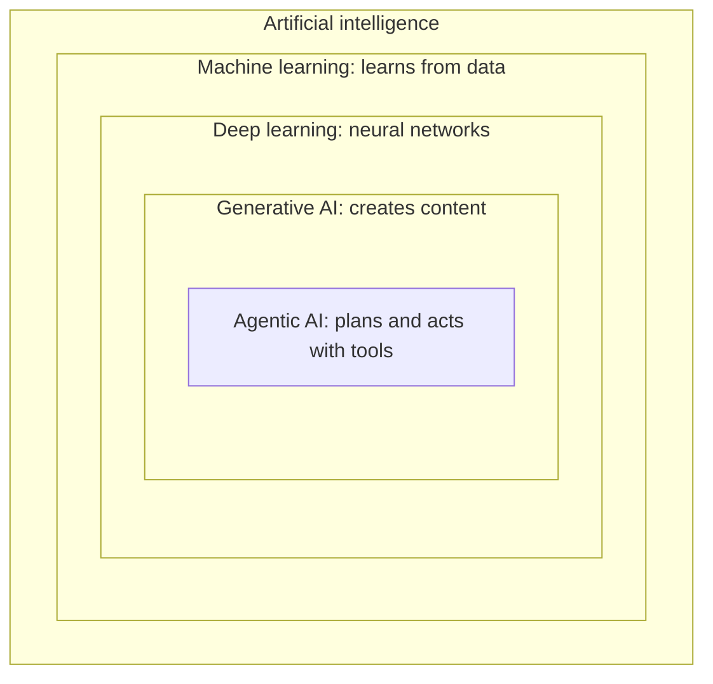
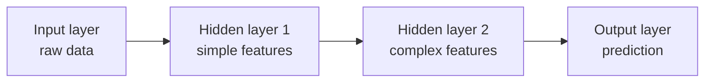
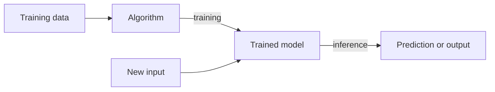
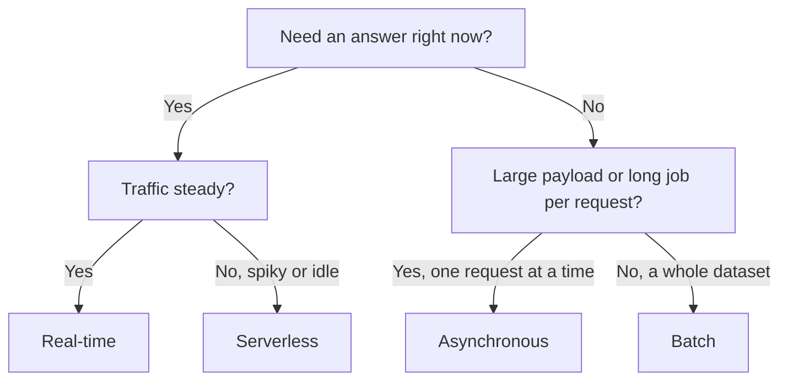
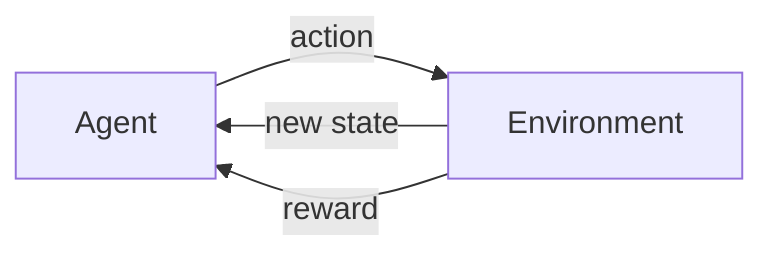

## 1.1.1 AI, ML, deep learning, GenAI and agentic AI as nested layers

Think of these terms as circles inside circles. Each inner layer is a more specific way of doing the outer one.

| Layer | What it means | Example |
|---|---|---|
| **Artificial intelligence (AI)** | Any technique that lets a machine do tasks that normally need human intelligence (rules, search, learning) | A chess engine, a rules-based chatbot |
| **Machine learning (ML)** | AI that **learns patterns from data** instead of being given explicit rules | Spam filter trained on past emails |
| **Deep learning (DL)** | ML that uses **multi-layer neural networks**; great with images, audio and text | Face detection in photos |
| **Generative AI (GenAI)** | Deep learning models that **create new content** (text, images, code, audio). Large language models (**LLMs**) are the text-focused kind | Drafting an email |
| **Agentic AI** | GenAI that **plans and takes actions** toward a goal: it calls tools and APIs, checks results and decides the next step, with limited human input | An assistant that books travel end to end |

Key similarity: every layer is still "AI". Key difference: how the system gets its behaviour (hand-written rules vs learned from data) and what it produces (a prediction vs new content vs completed actions).

**On the exam:** "predicts a label or number" points to traditional ML; "creates new content" points to GenAI; "autonomously completes multi-step tasks using tools" points to agentic AI.

## 1.1.2 Neural networks, computer vision and natural language processing (NLP)

A **neural network** is a model loosely inspired by the brain. It is built from layers of connected nodes (neurons):

- An **input layer** receives the data (pixels, words turned into numbers).
- One or more **hidden layers** each transform the data and pick out patterns. Early layers find simple features (edges, letters); deeper layers combine them into complex ones (faces, meaning).
- An **output layer** produces the answer (a class, a number, the next word).

During training the network adjusts the **weights** on its connections to reduce its errors. "Deep" learning simply means many hidden layers.

Two big application areas of [deep learning](concept:1.1.1):

- **Computer vision (CV)**: understanding images and video. Tasks include image classification, object detection, face analysis and reading text in images.
- **Natural language processing (NLP)**: understanding and producing human language. Tasks include sentiment analysis, entity extraction, translation, summarization and question answering. LLMs are the modern, generative form of NLP.

**On the exam:** "images or video" means computer vision; "text, documents, language" means NLP. Speech sits next to NLP: speech is first converted to text, then NLP works on it.

## 1.1.3 Model vs algorithm, and training vs inference

These two pairs are easy to mix up.

- An **algorithm** is the *method*: the recipe for learning from data (for example linear regression, decision trees, k-means, a neural network architecture).
- A **model** is the *result*: what you get after running the algorithm on your data. It holds the learned parameters and is the thing you deploy to make predictions.

A simple way to remember it: **algorithm + data = model**.

- **Training** is the learning phase. The algorithm sees many examples, measures its errors and adjusts the model's parameters. It is compute-heavy, done occasionally, and usually needs large datasets.
- **Inference** is the using phase. The trained model receives new, unseen input and returns a prediction or generated output. It happens every time a user or application calls the model, so speed and cost per request matter.

**On the exam:** "the model is learning or being built" is training; "the model is answering a request in production" is inference. Most ongoing cost for a popular application comes from inference.

## 1.1.4 Inference types: batch, real-time, asynchronous, serverless

How you run [inference](concept:1.1.3) depends on latency needs, payload size and traffic pattern. Amazon SageMaker AI offers all four options.

| Type | How it works | Best for |
|---|---|---|
| **Real-time** | Always-on endpoint returns a response in milliseconds | Interactive apps with steady traffic, such as fraud checks at checkout |
| **Serverless** | Endpoint scales automatically, including down to zero; you pay only when used. May have a **cold start** delay | Intermittent or unpredictable traffic where a short delay is fine |
| **Asynchronous** | Requests are queued; results are written to Amazon S3 and you are notified when done. Handles large payloads and long processing (up to about an hour) | Big inputs or slow models where the caller does not need to wait |
| **Batch** (batch transform) | Processes a whole dataset offline, with no persistent endpoint | Scoring millions of records overnight, no need for instant answers |

**On the exam:** "lowest latency" → real-time; "intermittent traffic, minimize cost, tolerate cold starts" → serverless; "large payloads, near real-time, queue" → asynchronous; "entire dataset, no endpoint needed" → batch.

## 1.1.5 Types of data: labeled/unlabeled, structured/unstructured, tabular, time-series, image, text

Data is described along two independent axes.

**Labeled vs unlabeled**
- **Labeled** data includes the correct answer (the **label** or target) for each example, such as an email marked "spam". Labeling usually costs human effort.
- **Unlabeled** data is just raw inputs with no answers. It is plentiful and cheap.

**Structured vs unstructured**
- **Structured** data fits a fixed schema of rows and columns.
- **Unstructured** data has no predefined schema: free text, images, audio, video. Most of the world's data is unstructured.

Common data formats:

| Format | Structure | Example |
|---|---|---|
| **Tabular** | Structured | Customer table: age, plan, monthly spend |
| **Time-series** | Structured, ordered by time | Hourly sales, sensor readings, stock prices |
| **Text** | Unstructured | Reviews, support tickets, contracts |
| **Image** | Unstructured | Product photos, X-rays, scanned forms |

Why it matters: the data type steers the choice of technique. Tabular data often suits classic ML algorithms; images, audio and text usually call for [deep learning](concept:1.1.1). Whether you have labels decides between supervised and unsupervised learning.

**On the exam:** "historical data with known outcomes" means labeled; "values recorded at regular time intervals" means time-series; "PDFs, emails, photos" means unstructured.

## 1.1.6 Supervised learning (classification and regression)

**Supervised learning** trains a model on [labeled data](concept:1.1.5): each example has inputs (features) and the known correct answer. The model learns the mapping from inputs to answer, then predicts answers for new inputs.

There are two kinds of supervised task, decided by the type of answer:

- **Classification** predicts a **category** (a discrete class).
  - Binary: fraud or not fraud, spam or not spam, will churn or will not churn.
  - Multi-class: which product category, which species of plant.
- **Regression** predicts a **continuous number**.
  - House price, delivery time in minutes, next month's revenue, temperature.

Common examples you might see: image classification, sentiment classification, loan default prediction, demand and sales forecasting (a regression problem on [time-series data](concept:1.1.5)).

The main cost of supervised learning is getting enough good labels. Labeling is often done by people, which is slow and expensive.

**On the exam:** look at the *output*. A yes/no or a named category is classification. A quantity, amount or price is regression. Both need labeled historical data.

## 1.1.7 Unsupervised learning (clustering, dimensionality reduction, anomaly detection)

**Unsupervised learning** works on [unlabeled data](concept:1.1.5). There is no correct answer to learn from; the algorithm discovers structure on its own.

- **Clustering** groups similar items together. Example: customer segmentation, grouping customers by buying behaviour so marketing can target each segment. A classic algorithm is **k-means**.
- **Dimensionality reduction** compresses many features into fewer while keeping most of the information. It simplifies data, speeds up training and helps visualization. A classic technique is principal component analysis (**PCA**).
- **Anomaly detection** learns what "normal" looks like and flags data points that differ. Examples: unusual network traffic, a strange credit card transaction, a failing machine sensor.
- **Association** finds items that occur together ("customers who buy X also buy Y"), used in market basket analysis.

Compared with [supervised learning](concept:1.1.6), you do not need labels, so it is cheaper to start, but the output (for example, the clusters) needs a human to interpret what each group means.

There is also a middle ground: **semi-supervised learning** uses a small labeled set plus a large unlabeled set, and **self-supervised learning** creates its own labels from raw data, which is how [LLMs](concept:1.1.1) are pre-trained.

**On the exam:** "group", "segment", "no labels" means clustering; "detect unusual behaviour without labeled fraud examples" means anomaly detection.

## 1.1.8 Reinforcement learning (agent, environment, reward)

**Reinforcement learning (RL)** learns by trial and error. There is no labeled dataset; instead the system learns from the consequences of its own actions.

Key terms:

- **Agent**: the learner and decision-maker.
- **Environment**: the world the agent acts in (a game, a simulated warehouse, a race track).
- **State**: the current situation the agent observes.
- **Action**: what the agent chooses to do.
- **Reward**: a score from the environment saying how good the action was (positive or negative).
- **Policy**: the strategy the agent learns, mapping states to the best actions.

The goal is to **maximize total reward over time**, not just the next reward.

Typical uses: game playing, robotics, autonomous driving (AWS DeepRacer was a well-known RL learning tool), resource and traffic optimization, and trading strategies. A related method, **reinforcement learning from human feedback (RLHF)**, uses human ratings as the reward signal to align [LLM](concept:1.1.1) answers with human preferences.

**On the exam:** "learns by trial and error", "reward", "penalty", "maximize cumulative reward" all point to reinforcement learning, not supervised learning.

## 1.1.9 Model fit: overfitting, underfitting, bias and variance

**Fit** describes how well a model has learned the real pattern in the data.

- **Overfitting**: the model memorizes the training data, including its noise. It scores very well on training data but **poorly on new data**. Causes: model too complex, too little or non-diverse data, training too long.
- **Underfitting**: the model is too simple to capture the pattern. It performs **poorly on both** training and new data. Causes: model too simple, too few useful features, too little training.
- **Good fit**: performs well on training data and generalizes well to new data.

These map to two kinds of error:

| | Low variance | High variance |
|---|---|---|
| **Low bias** | Good fit (goal) | **Overfitting** |
| **High bias** | **Underfitting** | Poor everywhere |

- **Bias** (statistical): error from overly simple assumptions; the model is consistently off target.
- **Variance**: error from being too sensitive to the training data; predictions change a lot with small data changes.

Reducing one tends to increase the other, which is the **bias-variance tradeoff**.

Common fixes, at a concept level: for overfitting, use more and more diverse data, simplify the model, stop training earlier or apply regularization. For underfitting, use a more capable model, add better features or train longer.

**On the exam:** "high training accuracy, low test accuracy" is overfitting (high variance). "Low accuracy on both" is underfitting (high bias).

## 1.1.10 Bias and fairness in AI

The word "bias" has a second meaning in AI. Beyond the statistical bias in [model fit](concept:1.1.9), **bias** also means a model that produces **systematically unfair outcomes for certain groups** of people, for example by gender, age or ethnicity.

**Fairness** is the goal of making a model's outcomes equitable across groups, so that no group is unjustly favoured or harmed.

Where unfair bias comes from:

- **Training data**: under-representation of some groups, or historical decisions that were already biased (a hiring model trained on past hires that favoured one group).
- **Labels**: human labelers bring their own assumptions.
- **Features**: a harmless-looking feature (such as postal code) can act as a proxy for a protected attribute.
- **Feedback loops**: biased predictions shape future data, making the bias worse.

How to reduce it: collect diverse and representative data, check model results per group, and keep a human in the loop for high-impact decisions. **Amazon SageMaker Clarify** can detect bias in data before training and in model predictions after training. Responsible AI is covered in depth in Domain 4.

**On the exam:** "the model performs worse for one demographic group" is a bias and fairness problem, and the first fix is usually **more representative training data**.

## Exam traps

- **Model vs algorithm**: the algorithm is the learning method; the model is the trained artifact you deploy.
- **Classification vs regression**: decide by the output. A category is classification, a number is regression. "Will the customer churn?" is classification even though it sounds like a forecast.
- **Supervised vs unsupervised**: "labeled historical outcomes" → supervised; "find hidden groups, no labels" → unsupervised (clustering). "Reward" or "trial and error" → reinforcement learning.
- **Two meanings of bias**: statistical bias (underfitting) vs unfair bias against groups (fairness). Read the context.
- **Inference deciding phrases**: "lowest latency" → real-time; "intermittent traffic, pay only when used" → serverless; "large payload, queue" → asynchronous; "whole dataset offline" → batch.
- **Overfitting vs underfitting**: good on training but bad on new data is overfitting; bad on both is underfitting.

## Further reading

- [What is artificial intelligence? (AWS)](https://aws.amazon.com/what-is/artificial-intelligence/)
- [What is machine learning? (AWS)](https://aws.amazon.com/what-is/machine-learning/)
- [What is deep learning? (AWS)](https://aws.amazon.com/what-is/deep-learning/)
- [What is a neural network? (AWS)](https://aws.amazon.com/what-is/neural-network/)
- [What is reinforcement learning? (AWS)](https://aws.amazon.com/what-is/reinforcement-learning/)
- [What is overfitting? (AWS)](https://aws.amazon.com/what-is/overfitting/)
- [Deploy models for inference (Amazon SageMaker AI docs)](https://docs.aws.amazon.com/sagemaker/latest/dg/deploy-model.html)
- [CloudCityPress: Explain basic AI concepts and terminologies](https://github.com/CloudCityPress/aws-aif-c01/blob/main/english/10_10_Explain_basic_AI_concepts_and_terminologies.md)
