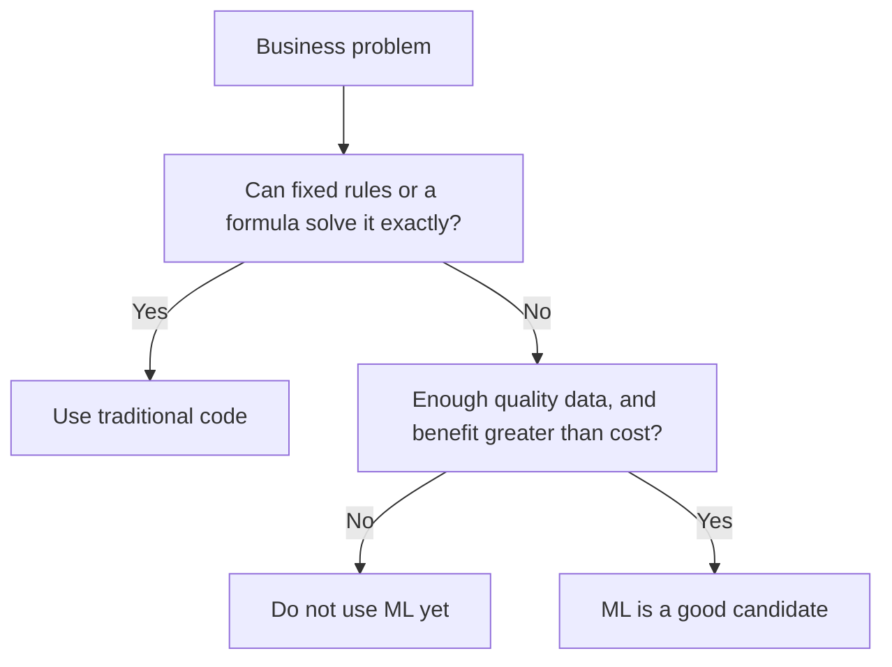
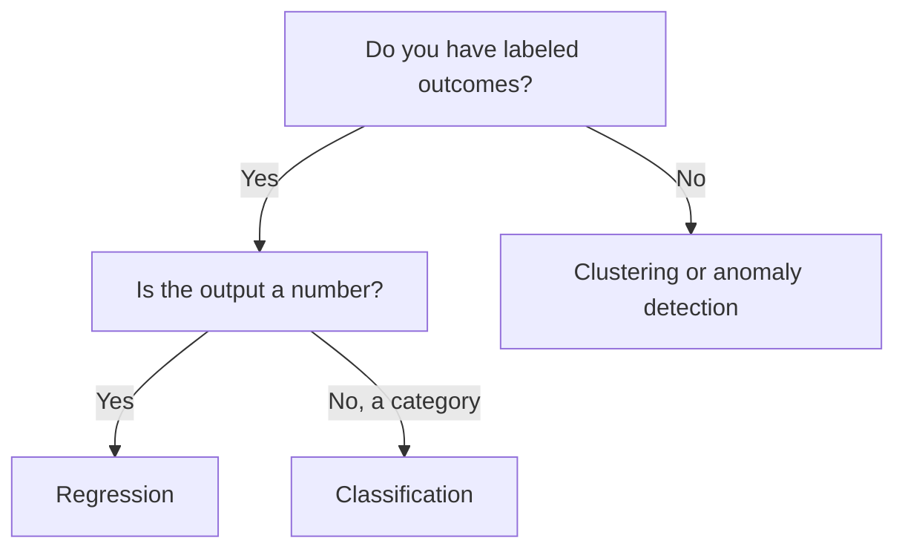
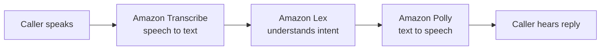

## 1.2.1 Where AI/ML adds value: decision support, scalability, automation

AI/ML is worth using when a problem has **patterns hidden in lots of data** that are too complex or too large for people or hand-written rules to handle.

Three kinds of value show up again and again:

- **Assisting human decisions**: the model gives a prediction or score and a person makes the final call. Examples: a risk score for a loan officer, a suggested diagnosis for a radiologist to review, demand forecasts for a buyer.
- **Scalability**: a model can handle volumes no team could. It can screen millions of transactions, moderate every uploaded image, or answer customer questions around the clock, in many languages, at a steady cost per request.
- **Automation**: the model takes over repetitive, well-defined tasks end to end, such as extracting fields from invoices, routing support tickets or transcribing calls. This frees people for higher-value work.

Other signals that ML fits well:

- The rules are too complex to write down (recognizing a face, understanding tone of voice).
- The patterns **change over time** and the system must adapt (fraud tactics, shopping trends).
- You have, or can collect, enough **relevant historical data**.
- Some error is acceptable, because the output is a probability, not a guarantee.

**On the exam:** phrases like "process millions of", "24/7", "reduce manual effort" and "help analysts decide" all describe where AI adds value.

## 1.2.2 When AI/ML is not appropriate: cost-benefit, need for a specific outcome

ML always outputs a **prediction with some uncertainty**. That makes it the wrong tool in several situations:

- **A specific, exact outcome is required.** If the answer must be deterministic and always correct, use traditional code. Calculating tax owed, applying a fixed discount rule or totalling an invoice should be a formula, not a model.
- **Simple rules already work.** If a few if/then rules solve the problem reliably, ML adds cost and complexity for no gain.
- **The cost outweighs the benefit.** A **cost-benefit analysis** weighs the cost of data collection, labeling, training, hosting, monitoring and skilled staff against the expected business value. A small benefit rarely justifies a large ML project.
- **There is not enough good data**, or the data cannot legally be used.
- **Full explainability is mandatory** and the model would be a black box (common in regulated decisions).
- **Errors are unacceptable** and there is no human review step.

**On the exam:** "requires an exact, deterministic result" or "the cost of the ML solution exceeds the benefit" means AI/ML is **not** the right choice.

## 1.2.3 Picking a technique: regression vs classification vs clustering

Pick the technique by asking two questions: **do I have labels**, and **what kind of output do I need?**

| You need to... | Technique | Learning type | Example |
|---|---|---|---|
| Predict a number | **Regression** | [Supervised](concept:1.1.6) | Forecast next week's sales, estimate a house price |
| Predict a category | **Classification** | [Supervised](concept:1.1.6) | Fraud or not, spam or not, which product category |
| Find natural groups without labels | **Clustering** | [Unsupervised](concept:1.1.7) | Segment customers by behaviour |
| Flag rare, unusual items | **Anomaly detection** | Usually [unsupervised](concept:1.1.7) | Unusual logins, faulty sensors |
| Learn a sequence of decisions from rewards | **Reinforcement learning** | [RL](concept:1.1.8) | Robot navigation, game strategy |

Watch the wording. "Predict whether a customer will cancel" is **classification** (yes or no). "Predict how much a customer will spend" is **regression**. "Group customers with similar habits" is **clustering**.

**On the exam:** questions often describe a business goal in plain words. Translate the goal into its output type first, then pick the technique.

## 1.2.4 Real-world AI applications: vision, NLP, speech, recommendations, fraud, forecasting, knowledge bases, agents

| Application | What it does | Typical examples |
|---|---|---|
| **Computer vision** | Understands images and video ([CV](concept:1.1.2)) | Defect detection on a production line, face verification, content moderation |
| **NLP** | Understands text ([NLP](concept:1.1.2)) | Sentiment of reviews, extracting entities from contracts, translation |
| **Speech recognition** | Converts speech to text, and text to speech | Call-centre transcripts, captions, voice assistants |
| **Recommendation systems** | Suggests items based on behaviour | "Customers also bought", personalized playlists |
| **Fraud detection** | Flags suspicious transactions ([classification](concept:1.1.6) or [anomaly detection](concept:1.1.7)) | Card payments, fake account sign-ups |
| **Forecasting** | Predicts future values from [time-series data](concept:1.1.5) | Demand planning, energy load, staffing |
| **Knowledge bases** | Answer questions from a company's own documents | Employee help desk, policy search |
| **Agentic AI** | [Agents](concept:1.1.1) plan and complete multi-step tasks using tools | Process a refund end to end, triage IT tickets |

Many real solutions combine several of these. A customer-service flow might transcribe a call (speech), detect sentiment (NLP), look up an answer in a knowledge base, then let an agent take the follow-up action.

**On the exam:** map the verb in the scenario to the application. "Recognize objects" is vision, "understand sentiment" is NLP, "suggest products" is recommendations, "predict future demand" is forecasting.

## 1.2.5 Amazon SageMaker AI: build, train and deploy your own models

**Amazon SageMaker AI** is AWS's fully managed service for the whole ML lifecycle when you want **your own custom model** rather than a ready-made AI service. It removes the work of setting up and managing servers for each step.

What it covers:

- **Prepare data**: explore, clean and label data (for example SageMaker Data Wrangler and SageMaker Ground Truth).
- **Build**: notebooks and the SageMaker Studio IDE; built-in algorithms and popular frameworks.
- **Train and tune**: managed training jobs on the compute you choose, plus automatic hyperparameter tuning.
- **Deploy**: all four [inference types](concept:1.1.4): real-time, serverless, asynchronous and batch.
- **Monitor and govern**: watch models in production and detect [bias](concept:1.1.10).

Two options lower the skill barrier:

- **SageMaker Canvas**: a **no-code**, point-and-click interface for business analysts to build ML models and get predictions.
- **SageMaker JumpStart**: a hub of **pre-trained models** and solution templates you can deploy or fine-tune in a few clicks.

You will meet the individual SageMaker AI features again in step 1.3.

**On the exam:** choose SageMaker AI when the scenario needs a **custom model trained on your own data** with full control. Choose an AI service (the next sections) when a **pre-trained, API-based** capability already does the job with the **least operational overhead**.

## 1.2.6 Text services: Amazon Comprehend and Amazon Translate

Both are fully managed, pre-trained [NLP](concept:1.1.2) services you call through an API. No ML expertise needed.

**Amazon Comprehend** extracts insights from text:

- **Sentiment** (positive, negative, neutral, mixed)
- **Entities** (people, places, organizations, dates) and **key phrases**
- **Language detection**
- **PII detection** and redaction (names, addresses, card numbers)
- **Topic modeling** to group a collection of documents by theme
- **Custom classification** and **custom entity recognition**, trained on your own labeled examples

Amazon Comprehend Medical is a variant that extracts medical information such as conditions and medications from clinical text.

**Amazon Translate** performs **neural machine translation** between many languages, in real time or in batch. It supports **custom terminology** so brand names and technical terms are translated consistently.

| Need | Service |
|---|---|
| "What is this text about / how does the customer feel?" | Comprehend |
| "Turn this text into another language" | Translate |

**On the exam:** "analyze customer reviews for sentiment" or "find PII in documents" → **Comprehend**. "Localize content into other languages" → **Translate**. Neither one converts speech; that is the next section.

## 1.2.7 Speech and conversation: Amazon Transcribe, Amazon Polly, Amazon Lex

**Amazon Transcribe** converts **speech to text** (automatic speech recognition). Notable features: **speaker diarization** (who spoke when), **custom vocabulary** for domain terms, automatic language identification, **PII redaction** in transcripts and toxicity detection. Variants include Transcribe Call Analytics for contact centres and Transcribe Medical.

**Amazon Polly** converts **text to speech** with lifelike voices in many languages. **SSML** tags control pronunciation, pauses and emphasis, and **lexicons** define how specific words are spoken.

**Amazon Lex** builds **conversational interfaces** (chatbots and voice bots) using the same technology as Alexa. You define **intents** (what the user wants), **utterances** (example phrases) and **slots** (details to collect, such as a date). Lex can call AWS Lambda to fulfil the request, and it now adds generative AI features for more natural conversations.

**On the exam:** speech → text is **Transcribe**; text → speech is **Polly**; a bot that understands intents and holds a conversation is **Lex**. Lex handles voice and text itself, so it is the answer for "build a chatbot".

## 1.2.8 Vision, documents and personalization: Rekognition, Textract, Personalize, Kendra

**Amazon Rekognition**: pre-trained [computer vision](concept:1.1.2) for images and video. It detects objects, scenes, faces and text, compares faces, flags unsafe content (**content moderation**) and checks for protective equipment. **Custom Labels** lets you train it to spot your own objects, such as your company logo or product defects.

**Amazon Textract**: extracts text **and structure** from scanned documents. It goes beyond basic OCR by understanding **forms (key-value pairs)** and **tables**, answering **queries** ("what is the invoice total?"), and has specialised APIs for invoices, receipts and identity documents.

**Amazon Personalize**: real-time **recommendations** and personalized rankings, built on the same kind of technology Amazon.com uses. You provide user, item and interaction data; it trains and hosts the recommender for you.

**Amazon Kendra**: intelligent **enterprise search** powered by ML. Users ask natural-language questions and get precise answers from documents stored across many sources, using built-in connectors. Kendra can also act as the retriever behind GenAI assistants.

| Scenario | Service |
|---|---|
| Detect objects or unsafe content in photos and video | Rekognition |
| Pull fields and tables from scanned forms | Textract |
| "Recommended for you" product lists | Personalize |
| Natural-language search over internal documents | Kendra |

**On the exam:** "text inside an image" in a photo is Rekognition, but "extract data from forms and tables in documents" is Textract.

## 1.2.9 Traditional ML vs foundation models: regulation, explainability, operational constraints

A **foundation model (FM)** is a very large model pre-trained on huge, broad datasets that can be adapted to many tasks; [LLMs](concept:1.1.1) are one kind. A **traditional ML model** is usually smaller and trained for **one narrow task**, such as a churn classifier. Neither is always better; the constraints decide.

| Constraint | Favours traditional ML | Favours an FM |
|---|---|---|
| **Regulation** | Decisions must be auditable and repeatable (credit, insurance) | Lower-risk content and assistant tasks |
| **Explainability** | Must explain which features drove each decision | A plausible answer is enough |
| **Operational** | Tight latency, low cost per prediction, small hardware or edge devices | Can accept higher latency and token costs |
| **Task type** | Structured, [tabular](concept:1.1.5) prediction with labeled data | Open-ended language, images, summarizing, conversation |
| **Data** | You have task-specific labeled data | Little labeled data, but the FM's general knowledge helps |
| **Output** | Same input should give the same output | Varied, creative output is acceptable |

Traditional models, such as decision trees or linear regression, are generally easier to explain, cheaper to run and more predictable. FMs are flexible and fast to start with (no training needed), but they are harder to explain, cost more per request and can produce confident wrong answers.

**On the exam:** "regulators require an explanation of every loan decision" → a simpler, explainable traditional model. "Summarize and answer questions over varied documents" → an FM.

## Exam traps

- **AI not appropriate**: "needs an exact, deterministic result" or "cost exceeds benefit" → use rules or traditional code, not ML.
- **Transcribe vs Polly**: Transcribe is speech **to** text; Polly is text **to** speech. Lex is the chatbot that can use both ideas.
- **Comprehend vs Translate**: Comprehend *analyzes* text (sentiment, entities, PII); Translate *converts* language.
- **Rekognition vs Textract**: Rekognition analyzes images and video; Textract extracts text, forms and tables from documents.
- **Kendra vs Comprehend**: Kendra *searches and answers* across documents; Comprehend *analyzes* the text it is given.
- **Deciding constraint**: "LEAST operational overhead" or "no ML expertise" → a pre-trained AI service; "custom model on our own data" → SageMaker AI; "business analysts, no code" → SageMaker Canvas.

## Further reading

- [What is Amazon SageMaker AI?](https://docs.aws.amazon.com/sagemaker/latest/dg/whatis.html)
- [What is Amazon Comprehend?](https://docs.aws.amazon.com/comprehend/latest/dg/what-is.html)
- [What is Amazon Translate?](https://docs.aws.amazon.com/translate/latest/dg/what-is.html)
- [What is Amazon Transcribe?](https://docs.aws.amazon.com/transcribe/latest/dg/what-is.html)
- [What is Amazon Polly?](https://docs.aws.amazon.com/polly/latest/dg/what-is.html)
- [What is Amazon Lex V2?](https://docs.aws.amazon.com/lexv2/latest/dg/what-is.html)
- [What is Amazon Rekognition?](https://docs.aws.amazon.com/rekognition/latest/dg/what-is.html)
- [What is Amazon Textract?](https://docs.aws.amazon.com/textract/latest/dg/what-is.html)
- [What is Amazon Personalize?](https://docs.aws.amazon.com/personalize/latest/dg/what-is-personalize.html)
- [What is Amazon Kendra?](https://docs.aws.amazon.com/kendra/latest/dg/what-is-kendra.html)
- [CloudCityPress: Identify practical use cases for AI](https://github.com/CloudCityPress/aws-aif-c01/blob/main/english/10_20_Identify_practical_use_cases_for_AI.md)
