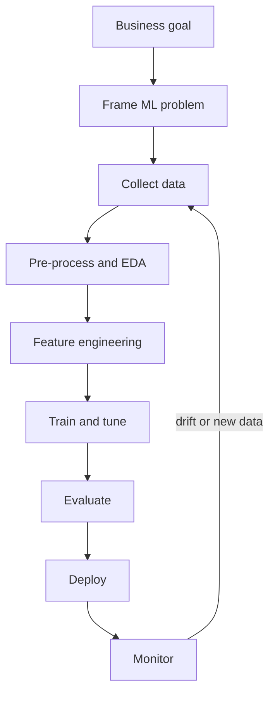
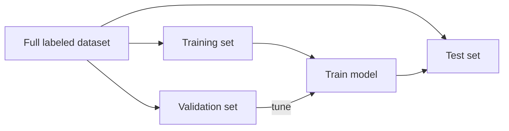
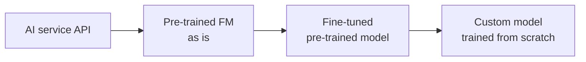
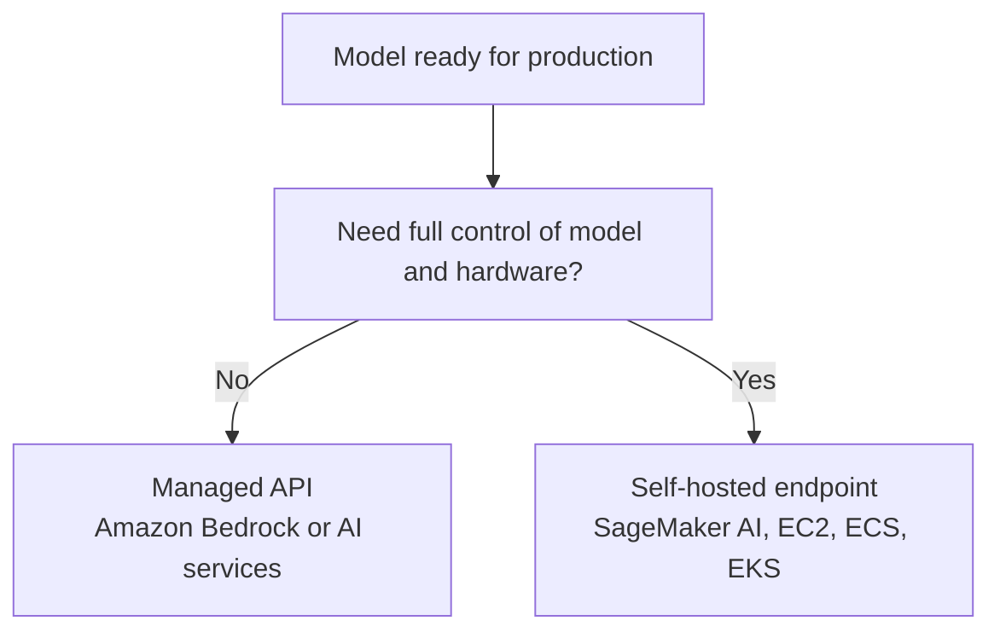
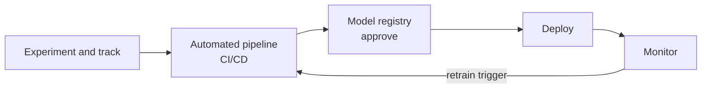
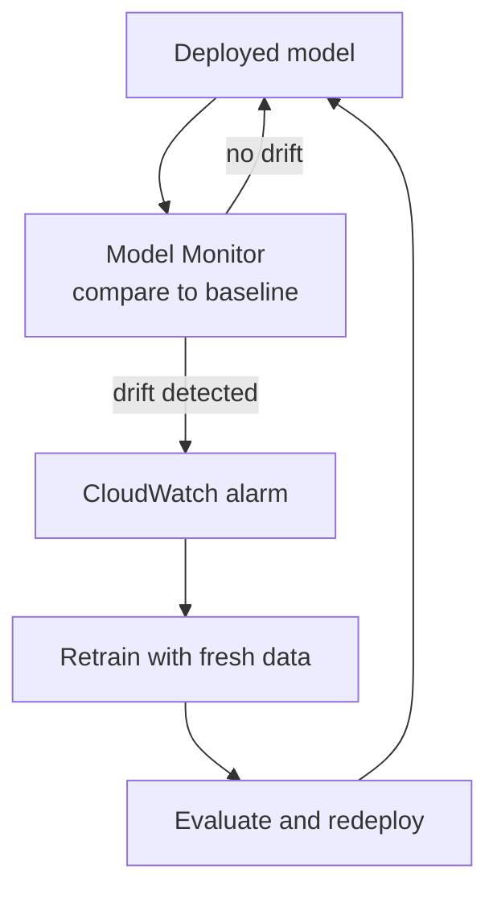

## 1.3.1 ML pipeline stages from business goal to monitoring

An **ML pipeline** (or ML lifecycle) is the ordered set of stages that turns a business problem into a model running in production. It is a **loop**, not a straight line: monitoring feeds back into earlier stages.

| Stage | Key question |
|---|---|
| **Business goal** | What problem are we solving, and how will we measure success? |
| **ML problem framing** | Is this classification, regression, clustering...? What is the target? Is ML even needed ([see 1.2.2](concept:1.2.2))? |
| **Data collection** | What data do we need, and where does it live? |
| **Pre-processing and EDA** | Is the data clean? What does **exploratory data analysis (EDA)** reveal about patterns and gaps? |
| **Feature engineering** | Which inputs help the model most? |
| **Training and tuning** | Run the [algorithm](concept:1.1.3) on the data to produce a model. |
| **Evaluation** | Does it meet the metrics on data it has not seen? |
| **Deployment** | Make the model available for [inference](concept:1.1.4). |
| **Monitoring** | Is it still accurate and healthy in production? |

**On the exam:** ordering questions often list these stages. Business goal and problem framing always come **before** data collection, and monitoring comes **after** deployment.

## 1.3.2 Data collection, labeling, pre-processing and feature engineering

Data work is usually the largest part of an ML project. Good data matters more than a clever algorithm.

- **Data collection**: gather relevant data from databases, logs, files and third parties, often into a data lake on **Amazon S3**. Check that you are allowed to use it.
- **Labeling**: add the correct answer to each example for [supervised learning](concept:1.1.6). Human labelers are common; **SageMaker Ground Truth** manages labeling jobs with human workers and can use active learning to label some data automatically.
- **Pre-processing (data preparation)**: clean the data so the model can learn from it.
  - Handle **missing values** and remove duplicates.
  - Fix outliers and errors.
  - Convert formats, for example turning categories into numbers.
  - **Scale or normalize** values so large numbers do not dominate.
  - Balance classes if one outcome is very rare.
- **Exploratory data analysis (EDA)**: summarize and visualize data to understand distributions, correlations and problems before training.
- **Feature engineering**: create, select or transform the inputs (**features**) the model learns from. Example: turning a timestamp into "day of week" and "is holiday", or combining height and weight into BMI. Good features can matter more than the choice of algorithm.

AWS tools here include **AWS Glue** and **AWS Glue DataBrew** for data preparation, **SageMaker Data Wrangler** for visual data prep, and **SageMaker Feature Store** for storing and sharing features.

**On the exam:** "garbage in, garbage out": poor data quality causes poor models. "Label images with a human workforce" → **SageMaker Ground Truth**.

## 1.3.3 Training, hyperparameters, and train/validation/test splits

During **training**, the algorithm learns the model's internal **parameters** (such as the weights in a [neural network](concept:1.1.2)) from data.

**Hyperparameters** are different: they are the settings **you choose before training** that control how learning happens. Examples: learning rate, number of epochs (passes over the data), batch size, and number of layers or trees. Finding good values is called **hyperparameter tuning**; SageMaker AI **automatic model tuning** runs many training jobs and keeps the best combination.

| | Parameters | Hyperparameters |
|---|---|---|
| Set by | The training process | You, before training |
| Example | Neural network weights | Learning rate, epochs |

To measure performance honestly, the data is split three ways:

| Split | Typical share | Purpose |
|---|---|---|
| **Training set** | about 70-80% | The model learns from it |
| **Validation set** | about 10-15% | Compare models and tune hyperparameters during development |
| **Test set** | about 10-15% | Final, unbiased check on unseen data, used once at the end |

Comparing training and validation results is how you spot [overfitting or underfitting](concept:1.1.9).

**On the exam:** "settings chosen before training, such as epochs or learning rate" are **hyperparameters**. The **test set** must stay unseen until the final evaluation.

## 1.3.4 Sources of models: open-source pre-trained vs training a custom model

You rarely have to build a model from nothing. The main sources, from least to most effort:

- **Ready-made AI services**: pre-trained models behind an API, such as [Comprehend](concept:1.2.6) or [Rekognition](concept:1.2.8). No model work at all.
- **Pre-trained foundation models (FMs)**: proprietary or open models from providers such as Amazon (Amazon Nova), Anthropic, Meta and Mistral AI, available through **Amazon Bedrock**.
- **Open-source pre-trained models**: models with public weights from hubs such as Hugging Face, or from **SageMaker JumpStart**, which you can deploy and **fine-tune** (further train on your own smaller dataset).
- **Train a custom model**: train your own model on your own data with SageMaker AI. Training a large FM **from scratch** (pre-training) is the most expensive option and needs huge datasets and compute.

Moving right adds **cost, time, data needs and required skills**, but also **control and specialization**.

| Choose... | When... |
|---|---|
| Pre-trained model | A general model already does the task well; fastest time to value |
| Fine-tune | You need domain-specific behaviour and have some labeled data |
| Custom training | Unique data or task, strict control needs, and budget to match |

**On the exam:** "fastest, lowest cost, no training data" → use a pre-trained model. "Build from scratch" is almost never the cost-effective answer unless the scenario demands full control.

## 1.3.5 Using a model in production: managed API service vs self-hosted endpoint

Once you have a model, there are two broad ways to serve [inference](concept:1.1.3) in production.

**Managed API service**: AWS hosts and scales the model; you just call an API.
- Examples: **Amazon Bedrock** for FMs, and AI services such as [Comprehend](concept:1.2.6), [Transcribe](concept:1.2.7) or [Rekognition](concept:1.2.8).
- Serverless: no instances to manage, pay per request or per token.
- Least operational overhead and fastest to start, but less control over the model and infrastructure.

**Self-hosted endpoint**: you deploy the model onto compute you choose and manage.
- Examples: a **SageMaker AI endpoint** (you pick the instance type and scaling), or your own containers on **Amazon EC2**, **Amazon ECS** or **Amazon EKS**.
- Full control over the model version, hardware, network and custom code.
- You are responsible for capacity, scaling, patching and cost while it runs, even when idle (except for serverless inference).

SageMaker AI sits in the middle: it is managed infrastructure, but you choose and operate the endpoint and its [inference type](concept:1.1.4).

**On the exam:** "LEAST operational overhead" or "no infrastructure to manage" → **managed API**. "Custom model with specific hardware or network requirements" → **self-hosted endpoint**.

## 1.3.6 AWS services for each pipeline stage (SageMaker AI features, Bedrock, Amazon Quick, Kiro)

| Pipeline stage | AWS services and features |
|---|---|
| Store and collect data | **Amazon S3**, AWS Glue |
| Prepare data, EDA | **SageMaker Data Wrangler**, AWS Glue DataBrew, **Amazon Quick** for visual exploration |
| Label data | **SageMaker Ground Truth** |
| Store and share features | **SageMaker Feature Store** |
| Detect data and model bias, explain predictions | **SageMaker Clarify** |
| Build and train | **SageMaker Studio**, training jobs, **SageMaker Canvas** (no-code), **SageMaker Autopilot** (AutoML) |
| Pre-trained models | **SageMaker JumpStart**, **Amazon Bedrock** |
| Track experiments | SageMaker AI with **managed MLflow** |
| Automate the workflow | **SageMaker Pipelines** |
| Version and approve models | **SageMaker Model Registry** |
| Deploy | SageMaker AI endpoints, **Amazon Bedrock** (managed API) |
| Monitor | **SageMaker Model Monitor**, Amazon CloudWatch |
| Document and govern | **SageMaker Model Cards**, Model Dashboard |

Assistants and tools that help people along the way:

- **Amazon Quick**: AI-powered business intelligence and agentic workspace (it absorbed Amazon QuickSight and Amazon Q Business). Dashboards and natural-language questions about data, for EDA and business metrics.
- **Amazon Q Developer**: AI coding assistant, also built into SageMaker Canvas. **Amazon Quick** (formerly Amazon Q Business) also answers employees' questions from company data.
- **Kiro**: an AI-powered IDE whose agents turn specs into code, speeding up the code around a model.

**On the exam:** match the verb to the feature: label → Ground Truth, bias → Clarify, drift → Model Monitor, no-code → Canvas, orchestrate → Pipelines.

## 1.3.7 MLOps: experimentation, repeatable processes, scalability, technical debt, production readiness

**MLOps** applies DevOps practices to machine learning. Its goal is to move models from experiment to production reliably, and keep them working.

Core concepts:

- **Experimentation**: try many datasets, features, algorithms and hyperparameters, and **track every run** (inputs, code, metrics) so results can be compared and reproduced.
- **Repeatable processes**: automate the pipeline (data prep, training, evaluation, deployment) instead of running steps by hand. **Version** data, code and models so any model can be rebuilt.
- **Scalable systems**: infrastructure that handles growing data, more models and more traffic without redesign.
- **Managing technical debt**: ML systems collect hidden debt: messy glue code, undocumented features, manual steps and dependencies on changing data. MLOps reduces it through automation, documentation and clean, modular pipelines.
- **Production readiness**: before release, a model needs testing, approval, security checks, monitoring and a rollback plan, not just good accuracy in a notebook.
- **Model monitoring and re-training**: watch the deployed model and retrain it when performance drops (next section).

On AWS: **SageMaker Pipelines** (automation), **managed MLflow** (experiment tracking), **Model Registry** (versioning and approval) and **Model Monitor** (monitoring).

**On the exam:** "reproducible", "automated", "version control for models", "CI/CD for ML" all point to **MLOps** practices.

## 1.3.8 Model monitoring, drift and re-training

A model that was accurate at launch can slowly get worse. The world changes, but the model stays fixed to the data it learned from. This is called **drift**.

- **Data drift**: the input data changes compared with the training data. Example: a new customer segment starts using the product, or a sensor is recalibrated.
- **Concept drift**: the relationship between inputs and the right answer changes. Example: fraudsters change tactics, so patterns that used to mean "safe" now mean "fraud".
- Model quality drift and **bias drift** can also appear when outcomes or group fairness shift over time.

**Model monitoring** catches this early. **Amazon SageMaker Model Monitor** compares live data and predictions against a **baseline** from training, and raises alerts through **Amazon CloudWatch** when they diverge. It can monitor data quality, model quality, bias drift and feature attribution drift (using SageMaker Clarify).

**Re-training** with recent data fixes most drift. It can run on a schedule or be triggered automatically by an alert, ideally through an automated [MLOps pipeline](concept:1.3.7).

**On the exam:** "model accuracy has degraded over time in production" → **drift**; detect it with **SageMaker Model Monitor**, fix it by **re-training** on new data.

## 1.3.9 Classification metrics: confusion matrix, accuracy, precision, recall, F1, AUC

For [classification](concept:1.1.6) models, compare predictions to the true labels in a **confusion matrix**:

| | Predicted positive | Predicted negative |
|---|---|---|
| **Actually positive** | True positive (TP) | False negative (FN), a miss |
| **Actually negative** | False positive (FP), a false alarm | True negative (TN) |

From it come the key metrics:

- **Accuracy** = correct predictions / all predictions. Misleading with **imbalanced data**: if 99% of transactions are legitimate, a model that always says "legitimate" is 99% accurate but useless.
- **Precision** = TP / (TP + FP). "Of the items I flagged, how many were right?" Prioritize it when **false positives are costly**, such as marking good email as spam.
- **Recall** (sensitivity) = TP / (TP + FN). "Of the real positives, how many did I catch?" Prioritize it when **false negatives are costly**, such as missing a cancer or a fraud case.
- **F1 score**: the harmonic mean of precision and recall. Use it to balance both, especially with imbalanced classes.
- **AUC** (area under the ROC curve): how well the model separates the classes across all decision thresholds. 1.0 is perfect; 0.5 is random guessing.

**On the exam:** "minimize missed fraud or disease" → **recall**; "minimize false alarms" → **precision**; "balance both on imbalanced data" → **F1**; "compare models across thresholds" → **AUC**.

## 1.3.10 Regression metrics: MAE, RMSE, R-squared

[Regression](concept:1.1.6) models predict numbers, so their metrics measure **how far predictions are from the actual values**.

| Metric | What it tells you | Better when |
|---|---|---|
| **MAE** (mean absolute error) | The average size of the errors, in the same units as the target ("off by $12 on average") | Lower |
| **RMSE** (root mean squared error) | Also an average error in the target's units, but squaring first means **large errors are penalized more** | Lower |
| **R-squared** (coefficient of determination) | The share of the variation in the target that the model explains, usually between 0 and 1 | Higher, closer to 1 |

How to choose:

- Use **MAE** when every error counts equally and you want an easy-to-explain number.
- Use **RMSE** when big mistakes are especially bad (for example, badly under-forecasting stock).
- Use **R-squared** to say how well the model explains the data overall, for example "the model explains 85% of the variation in house prices".

Classification metrics such as accuracy and F1 **do not apply** to regression, and these regression metrics do not apply to classification.

**On the exam:** "average prediction error in dollars" → MAE or RMSE; "penalize large errors more" → RMSE; "proportion of variance explained" → R-squared.

## 1.3.11 Business metrics: cost per user, development cost, customer feedback, ROI

A model with great [technical metrics](concept:1.3.9) can still fail if it does not deliver **business value**. Define business metrics at the very start of the [pipeline](concept:1.3.1), at the business goal stage, and track them after deployment.

| Business metric | What it measures |
|---|---|
| **Cost per user** (or per transaction) | Inference, hosting and support cost divided by users served |
| **Development cost** | Data, labeling, training compute and staff time to build the solution |
| **Customer feedback** | Satisfaction scores, ratings, complaints, adoption and usage |
| **Return on investment (ROI)** | (Benefit − cost) / cost: does the value created exceed what was spent? |

Other common examples: revenue gained, time saved per task, reduction in manual work, fewer fraud losses and conversion rate.

Technical and business metrics answer different questions:

- **Model metrics** (accuracy, F1, RMSE): *is the model good at its task?*
- **Business metrics** (ROI, cost per user): *is the solution worth it?*

Both are needed. A recommendation model with slightly lower accuracy but much lower cost per user may be the better business choice.

**On the exam:** "measure whether the AI project is financially worthwhile" → **ROI**; "user satisfaction with the chatbot" → **customer feedback**. Technical metrics alone do not show business value.

## Exam traps

- **Precision vs recall**: costly false alarms → precision; costly misses → recall. Accuracy is a trap on imbalanced data.
- **Classification vs regression metrics**: F1, AUC and accuracy are for categories; MAE, RMSE and R-squared are for numbers.
- **Parameters vs hyperparameters**: parameters are learned in training; hyperparameters are set before training.
- **Validation vs test set**: validation is used during tuning; the test set is the final, untouched check.
- **SageMaker feature matching**: Ground Truth labels data, Clarify detects bias, Model Monitor detects drift, Pipelines automates, Model Registry versions, Feature Store stores features.
- **Deciding constraints**: "LEAST operational overhead" → managed API (Amazon Bedrock or an AI service); "full control of the model and hardware" → self-hosted endpoint; "accuracy degraded over time" → drift, so monitor and retrain.

## Further reading

- [Machine Learning Lens: AWS Well-Architected Framework](https://docs.aws.amazon.com/wellarchitected/latest/machine-learning-lens/machine-learning-lens.html)
- [What is MLOps? (AWS)](https://aws.amazon.com/what-is/mlops/)
- [Amazon SageMaker Ground Truth](https://docs.aws.amazon.com/sagemaker/latest/dg/sms.html)
- [Amazon SageMaker Pipelines](https://docs.aws.amazon.com/sagemaker/latest/dg/pipelines.html)
- [Amazon SageMaker Model Monitor](https://docs.aws.amazon.com/sagemaker/latest/dg/model-monitor.html)
- [Amazon SageMaker JumpStart](https://docs.aws.amazon.com/sagemaker/latest/dg/studio-jumpstart.html)
- [What is Amazon Bedrock?](https://docs.aws.amazon.com/bedrock/latest/userguide/what-is-bedrock.html)
- [CloudCityPress: Describe the AI/ML development lifecycle](https://github.com/CloudCityPress/aws-aif-c01/blob/main/english/10_30_Describe_the_AI_ML_development_lifecycle.md)
