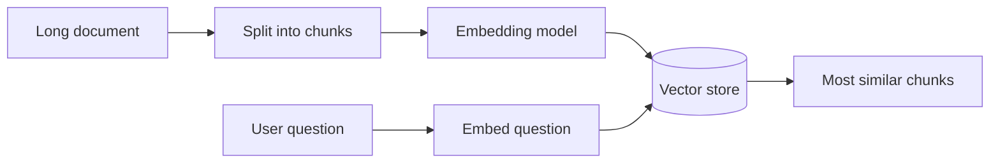
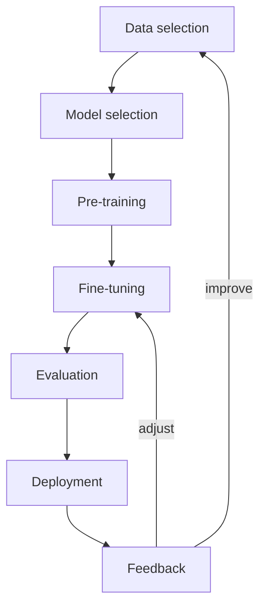
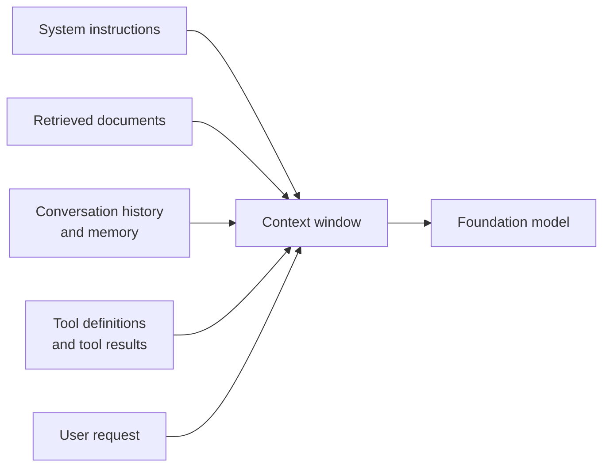
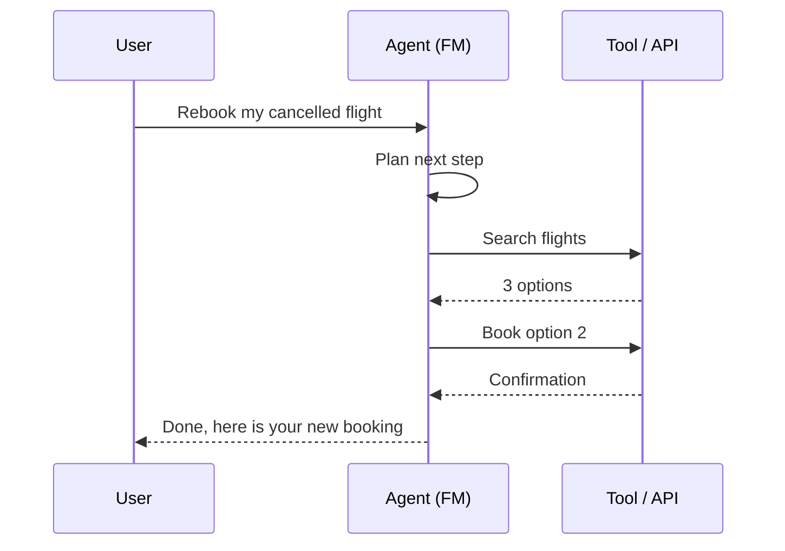
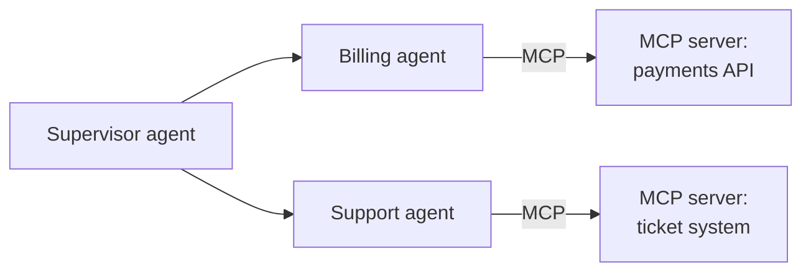

## 2.1.1 Foundation models and large language models (LLMs)

A **foundation model (FM)** is a very large [deep learning model](concept:1.1.2) pre-trained on a huge, broad dataset (web text, code, images and more), mostly [unlabeled data](concept:1.1.5). Because it learned general patterns rather than one narrow task, a single FM can be adapted to many jobs: answering questions, summarizing, writing code, classifying, extracting data.

A **large language model (LLM)** is a foundation model that works with text (and often code). Every LLM is an FM, but not every FM is an LLM: some FMs generate images, produce embeddings or handle several modalities.

| | Traditional ML model | Foundation model |
|---|---|---|
| Training data | Labeled, task-specific | Massive, mostly unlabeled |
| Tasks | One (e.g. churn prediction) | Many, steered by prompts |
| Who trains it | You | A model provider (you reuse it) |

Examples you will meet on AWS: **Amazon Nova**, Anthropic **Claude**, Meta **Llama**, **Mistral**, Cohere and Stability AI models.

FMs sit inside the GenAI layer of the [AI → ML → DL → GenAI nesting](concept:1.1.1). The big shift is that you usually **reuse** a pre-trained model instead of [training your own](concept:1.3.4), which is why [traditional ML vs FMs](concept:1.2.9) is a recurring exam decision.

**On the exam:** "general-purpose, adaptable to many tasks, pre-trained on broad data" = foundation model.

## 2.1.2 Transformers and attention: how LLMs generate text

Modern LLMs are built on the **transformer** architecture (introduced in 2017). Its key idea is **self-attention**: for every word in the input, the model weighs how relevant every other word is. In "The bank raised interest rates", attention links "bank" to "interest rates", so the model reads it as a financial bank, not a river bank. Transformers process all input positions in parallel, which made training on enormous datasets practical (older RNNs read one word at a time).

LLMs generate text **one token at a time**. At each step the model predicts a probability for every possible next token, picks one, appends it to the text, and repeats. This is called **autoregressive** generation.

Two consequences matter for the exam:
- The model predicts **plausible** text, not verified facts, which is the root of hallucinations.
- Because a token is *sampled* from probabilities, the same prompt can give different answers.

GPT ("generative pre-trained transformer") is literally named after this design. BERT is an encoder-only transformer used for understanding tasks rather than free-form generation.

**On the exam:** "architecture behind LLMs" or "captures relationships between words in a sequence" = transformer / self-attention.

## 2.1.3 Tokens and the context window

A **token** is the unit of text a model reads and writes: a whole word, part of a word, a punctuation mark or a space. A rough rule for English is **1 token ≈ 4 characters ≈ 0.75 words**, so 1,000 words is about 1,300 tokens. Other languages and code often need more tokens for the same content. **Tokenization** is the step that splits text into tokens and maps each one to a numeric ID.

The **context window** is the maximum number of tokens a model can consider at once. It covers **everything**: system instructions, conversation history, retrieved documents, tool results, the user's question **and** the generated answer. Windows range from a few thousand tokens to over a million, depending on the model.

What happens when you run out of room:
- Older conversation turns or documents must be dropped, trimmed or summarized.
- The answer may be cut short when it hits the output limit.

Bigger is not automatically better: a larger window lets you include long documents, but every extra token costs money and adds latency, and models can overlook details buried in the middle of a very long context.

**On the exam:** "model can't process the whole 300-page contract" or "forgets earlier parts of the conversation" points to the **context window** limit. Fixes include chunking, retrieval and summarization.

## 2.1.4 Embeddings and vectors: meaning as numbers

An **embedding** is a list of numbers (a **vector**) that represents the *meaning* of a piece of content: a word, sentence, document, image or audio clip. An **embedding model** produces these vectors, often with hundreds or thousands of dimensions.

The key property: **similar meanings end up close together** in vector space. "Car" and "automobile" get nearby vectors even though they share no letters. "How do I reset my password?" lands close to "I forgot my login credentials."

Closeness is measured with a similarity score such as **cosine similarity** or distance. This enables:
- **Semantic search**: find documents by meaning, not exact keywords.
- **Recommendations**: suggest items whose vectors sit near what a user liked.
- **Clustering and anomaly detection**: group similar items or spot outliers (compare [unsupervised learning](concept:1.1.7)).
- **Retrieval for GenAI**: fetch relevant passages to give an FM.

Vectors are stored and searched in a **vector database** (a vector store). On AWS, Amazon Titan Text Embeddings, Amazon Nova Multimodal Embeddings and Cohere Embed are embedding models available in Amazon Bedrock.

**On the exam:** "numerical representation of meaning" or "find semantically similar content" = embeddings / vectors.

## 2.1.5 Chunking long documents

**Chunking** splits long documents into smaller pieces (**chunks**) before turning them into [embeddings](concept:2.1.4). You need it because:
- Embedding models and FMs have [token limits](concept:2.1.3), so a 200-page manual cannot be embedded or sent as one piece.
- Smaller chunks give **more precise retrieval**: a search returns the paragraph that answers the question, not an entire handbook.
- Sending only the relevant chunks to the model saves tokens, cost and latency.

Common strategies:

| Strategy | How it splits |
|---|---|
| **Fixed-size** | Every N tokens, usually with some **overlap** so a sentence is not cut in half without context |
| **Semantic** | At natural meaning boundaries |
| **Hierarchical** | Small child chunks for precise search, linked to larger parent chunks for context |
| **No chunking** | Each file is one chunk (for documents that are already short) |

The tradeoff: chunks that are **too small** lose context; chunks that are **too large** dilute relevance and waste tokens. Amazon Bedrock Knowledge Bases lets you choose among these strategies.

**On the exam:** "improve retrieval relevance from long documents" or "documents exceed token limits" = chunking.

## 2.1.6 Multi-modal models and diffusion models

A **modality** is a type of data: text, image, audio, video. A **multi-modal model** can take in and/or produce more than one modality. Examples: describing a photo in text, answering questions about a chart or a scanned invoice, generating an image from a text prompt, or turning speech into a spoken reply. Multi-modal **embedding** models put text and images in the same [vector space](concept:2.1.4), so a text query like "red running shoes" can find matching product photos.

A **diffusion model** generates images (and video or audio) by learning to **remove noise**:
1. **Forward process (training):** gradually add random noise to real images until only noise remains.
2. **Reverse process (generation):** start from pure noise and remove it step by step, guided by the text prompt, until a clear image appears.

Stable Diffusion (Stability AI) is the best-known example. Amazon Nova Canvas (images) and Amazon Nova Reel (video) are Amazon's own generation models in Bedrock. Older generative designs you may see as distractors include **GANs** (generator vs discriminator) and **VAEs** (variational autoencoders).

**On the exam:** "generate images from text by iteratively removing noise" = diffusion. "One model that handles text and images" = multi-modal.

## 2.1.7 GenAI use cases: generation, summarization, assistants, translation, code, search, recommendations

GenAI creates **new content**, so its use cases differ from classic [prediction tasks](concept:1.2.4):

| Use case | Example |
|---|---|
| **Text generation** | Marketing copy, product descriptions, emails |
| **Image, video, audio generation** | Ad creatives, storyboards, synthetic voices |
| **Summarization** | Condense call transcripts, reports, legal documents |
| **AI assistants / chatbots** | Employee helpdesk, customer service agents that resolve tickets |
| **Translation** | Context-aware translation that keeps tone and style |
| **Code generation** | Write, explain, test and refactor code |
| **Search** | Semantic search and natural-language Q&A over company documents |
| **Recommendations** | Personalized suggestions with generated explanations |
| **Data extraction** | Pull fields from unstructured documents into structured output |

Pick GenAI when the output is **open-ended language or media**, or when one model must handle many varied tasks. Prefer a purpose-built service or traditional ML when you need a single well-defined prediction, strict determinism, or the lowest cost per request. For example, plain sentiment detection fits [Amazon Comprehend](concept:1.2.6), and a fixed-schema fraud score fits a classic classifier ([choosing a technique](concept:1.2.3)).

**On the exam:** match the verb. "Create, draft, summarize, rewrite, converse" → GenAI. "Predict a number, assign a fixed label" → often traditional ML.

## 2.1.8 The FM lifecycle: data selection to feedback

The **FM lifecycle** mirrors the [ML pipeline](concept:1.3.1) but is shaped by the scale of foundation models:

1. **Data selection**: gather huge, diverse, high-quality datasets; filter toxic, duplicated or copyrighted content.
2. **Model selection**: choose architecture and size, or (much more common) choose an existing FM that fits your task, cost and latency needs.
3. **Pre-training**: train on massive unlabeled data so the model learns language and world patterns. Extremely expensive (thousands of accelerators for weeks), so most companies **skip it** and use a provider's model.
4. **Fine-tuning**: further train on smaller, task- or domain-specific data to specialize the model.
5. **Evaluation**: test quality, accuracy, safety and bias with benchmarks, metrics and human review.
6. **Deployment**: serve the model for [inference](concept:1.1.3) through a [managed API or endpoint](concept:1.3.5).
7. **Feedback**: [monitor](concept:1.3.8) real usage, collect user ratings and errors, and feed them back into improvements.

**On the exam:** ordering questions are likely. Remember the sequence **select data → select model → pre-train → fine-tune → evaluate → deploy → feedback**, and that most businesses start at *model selection* with an existing FM.

## 2.1.9 Token-based pricing: input vs output tokens, cost and latency

Managed FM APIs such as Amazon Bedrock on-demand charge **per token**, priced per thousand or million tokens:
- **Input tokens**: everything you send (instructions, history, retrieved documents, the question).
- **Output tokens**: everything the model generates. Output tokens usually cost **several times more** than input tokens.

Prices differ by model: larger, more capable models cost more per token than small, fast ones. Image and video models are often priced per image or per second instead.

**Cost** = (input tokens × input price) + (output tokens × output price), multiplied by request volume.

**Latency** also tracks tokens. Long prompts take longer to process, and every output token is generated one after another ([autoregressive](concept:2.1.2)), so long answers are slow.

Ways to reduce both:
- Use a **smaller model** when it is good enough.
- Keep prompts **concise**; send only relevant chunks, not whole documents.
- **Limit output length** ("answer in 3 bullets", a maximum token setting).
- Trim or summarize long conversation history.
- Use [batch inference](concept:1.1.4) for non-urgent bulk jobs (cheaper per token on Bedrock).

**On the exam:** "reduce cost of a chatbot" → shorter prompts/outputs, smaller model, fewer tokens. "Pay only for what you use, no infrastructure" = on-demand token pricing.

## 2.1.10 Prompt engineering and context engineering

**Prompt engineering** is crafting the input text to get better output from an FM *without changing the model*: clear instructions, a role ("You are a support agent"), examples, constraints and a required output format. It is the fastest, cheapest way to improve results.

**Context engineering** is the broader discipline of deciding **everything the model sees** in its [context window](concept:2.1.3) for each call, not just the wording of one prompt. In real applications, and especially agents, the context is assembled from many sources:

Core context-engineering techniques:
- **Select**: include only relevant information (retrieve the top chunks, pick the right tools).
- **Compress**: summarize long histories or tool outputs.
- **Order and structure**: put key instructions and facts where the model will use them.
- **Persist**: store facts in memory outside the window and bring them back when needed.
- **Isolate**: give sub-tasks to separate agents so each has a small, focused context.

Why it matters: the window is limited, every token costs money, and irrelevant or stale content lowers accuracy and raises hallucination risk. Good context engineering grounds the model in the right facts at the right time.

**On the exam:** "wording of the instruction" = prompt engineering. "Managing what information, memory, retrieved data and tool output goes into the model's context" = context engineering.

## 2.1.11 AI agents: tool use, memory and workflow orchestration

An **AI agent** uses an FM as its "brain" to pursue a **goal** by planning steps, taking actions and checking results, rather than just answering one prompt. It is the "agentic AI" layer from [the nested layers](concept:1.1.1).

Three building blocks:
- **Tool use**: the agent can call external functions such as APIs, databases, search, code execution or a calendar. The model decides *which* tool to call with *which* inputs; the application runs it and returns the result into the [context](concept:2.1.10).
- **Memory**: **short-term memory** holds the current session (recent turns, intermediate results). **Long-term memory** persists facts and preferences across sessions, such as "this customer prefers email".
- **Workflow orchestration**: breaking a goal into steps, running them in order or in parallel, handling errors and retries, and deciding when the task is done. Common patterns are **ReAct** (reason → act → observe, repeat) and plan-then-execute.

Agents can act on real systems, so they need guardrails, least-privilege permissions and sometimes **human-in-the-loop** approval for risky steps.

**On the exam:** "complete multi-step tasks autonomously by calling APIs" = agent. "Remember user preferences across sessions" = long-term memory.

## 2.1.12 Multi-agent patterns and the Model Context Protocol (MCP)

A **multi-agent system** splits complex work across several specialized [agents](concept:2.1.11), each with its own instructions, tools and focused [context](concept:2.1.10). Common patterns:

| Pattern | How agents coordinate |
|---|---|
| **Supervisor / orchestrator-worker** | A supervisor plans, delegates sub-tasks to specialist agents, and merges results |
| **Sequential (pipeline)** | Each agent's output feeds the next (research → draft → review) |
| **Parallel** | Agents work at the same time; results are aggregated |
| **Hierarchical** | Supervisors of supervisors for large problems |
| **Swarm / peer-to-peer** | Agents hand off to each other directly with shared context |

Agents communicate by passing messages, through shared state or memory, or through a standard such as the **Agent2Agent (A2A)** protocol.

The **Model Context Protocol (MCP)** is an open standard (introduced by Anthropic in 2024 and now widely adopted, including across AWS) for connecting agents to **external tools and data**. An **MCP server** wraps a system (a database, ticketing tool or file store) and exposes its **tools**, **resources** and **prompts** in a standard format. Any **MCP client** inside an agent or AI app can discover and use them. Build one integration and every MCP-compatible agent can use it, instead of a custom connector per agent per system.

**On the exam:** MCP = **agent-to-tool/data** standard. A2A = **agent-to-agent** communication. "Specialists coordinated by one agent" = supervisor pattern.

## Exam traps

- **FM vs LLM**: every LLM is an FM, but image, embedding and multi-modal models are FMs that are not LLMs.
- **Embeddings vs tokens**: tokens are pieces of text the model reads; embeddings are vectors that capture meaning for similarity search.
- **Prompt engineering vs context engineering**: wording one prompt vs curating everything in the context window (retrieved data, memory, tool results, history).
- **MCP vs A2A**: MCP connects an agent to tools and data; A2A connects agents to each other. "Standard way to connect agents to external systems without custom integrations" → MCP.
- **Output tokens cost more than input tokens**: "reduce cost" answers usually shorten output, trim context or pick a smaller model.
- **Diffusion vs transformer**: "denoising" or "image generation from noise" → diffusion; "attention over a text sequence" → transformer.

## Further reading

- [What is generative AI? (AWS)](https://aws.amazon.com/what-is/generative-ai/)
- [What are foundation models? (AWS)](https://aws.amazon.com/what-is/foundation-models/)
- [What is a large language model? (AWS)](https://aws.amazon.com/what-is/large-language-model/)
- [What are embeddings? (AWS)](https://aws.amazon.com/what-is/embeddings-in-machine-learning/)
- [What are AI agents? (AWS)](https://aws.amazon.com/what-is/ai-agents/)
- [Amazon Bedrock pricing](https://aws.amazon.com/bedrock/pricing/)
- [Model Context Protocol](https://modelcontextprotocol.io/)
- [CloudCityPress: Explain basic concepts of GenAI](https://github.com/CloudCityPress/aws-aif-c01/blob/main/english/20_10_Explain_basic_concepts_of_GenAI.md)
