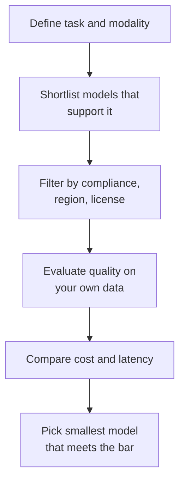

## 2.2.1 Advantages: adaptability, responsiveness, conversation, content generation

GenAI is attractive to businesses because one [foundation model](concept:2.1.1) can cover work that once needed many separate systems.

| Advantage | What it means | Example |
|---|---|---|
| **Adaptability** | One model handles many tasks and domains, steered by [prompts](concept:2.1.10) instead of retraining | The same FM drafts emails, summarizes reports and classifies tickets |
| **Responsiveness** | Answers in seconds, at any hour, at large scale | 24/7 support that absorbs traffic spikes |
| **Conversational capability** | Understands natural language, follows multi-turn dialogue, keeps context | Customers describe problems in their own words |
| **Content generation** | Produces new text, images, audio, video and code | Personalized product descriptions for 10,000 SKUs |

Other benefits that show up in scenarios:
- **Simplicity and speed**: no need to collect labeled data or train a model before getting value, unlike [traditional ML](concept:1.2.9).
- **Personalization at scale**: tailor content to each user cheaply.
- **Productivity**: automate drafting, summarizing and research so people focus on judgment.
- **Unstructured data**: works directly on emails, documents and transcripts ([use cases](concept:2.1.7)).

These line up with the general [value of AI](concept:1.2.1): decision support, scalability and automation.

**On the exam:** "handle many different tasks without building separate models" = adaptability. "Natural, multi-turn interaction" = conversational capability.

## 2.2.2 Hallucinations

A **hallucination** is output that sounds confident and fluent but is **false, made up or unsupported** by the input. Examples: inventing a legal case, citing a non-existent research paper, quoting a wrong product price, or stating a policy the company never had.

Why it happens: an LLM [predicts the next likely token](concept:2.1.2). It optimizes for *plausible* text, not *verified* truth, and has no built-in fact checker. It is more likely when:
- The question is outside or after the model's training data (knowledge cutoff).
- The prompt lacks the facts needed, so the model fills gaps.
- The question is ambiguous or pushes for an answer the model does not have.

Ways to reduce (not eliminate) hallucinations:
- **Ground** the model in trusted data: add relevant documents to its [context](concept:2.1.10), the idea behind retrieval augmented generation (RAG).
- Instruct it to answer **only from provided context** and to say "I don't know" otherwise.
- Ask for **citations** to sources.
- Use **contextual grounding checks** (a Bedrock Guardrails feature) to block ungrounded answers.
- Lower randomness for factual tasks.
- Keep a **human in the loop** for high-stakes outputs.

Hallucinations are a business and legal risk: wrong advice to customers, reputational damage and liability.

**On the exam:** "confident but factually incorrect / fabricated" = hallucination. The usual fix is grounding with company data (RAG), not retraining.

## 2.2.3 Nondeterminism, interpretability and inaccuracy

Three more limitations to recognize:

**Nondeterminism**: the same prompt can produce **different outputs** on different runs, because the next token is *sampled* from probabilities ([how LLMs generate](concept:2.1.2)). That is good for creativity but a problem for testing, auditing, and processes that need repeatable answers. Lowering the randomness setting (temperature) makes output more consistent, but not perfectly guaranteed.

**Interpretability**: FMs have billions of parameters, so it is very hard to explain **why** a model produced a specific answer. They are effectively **black boxes**. This is a problem in regulated areas (lending, hiring, healthcare) where decisions must be explained. A [simpler traditional model](concept:1.2.9) may be the right choice when explainability is mandatory.

**Inaccuracy**: beyond outright hallucination, outputs can be outdated (knowledge cutoff), subtly wrong in maths or logic, incomplete, or **biased** because of skewed training data ([bias and fairness](concept:1.1.10)).

Other practical limits:
- **Context window limits** on how much can be processed at once ([tokens and context](concept:2.1.3)).
- **Cost and latency** at scale ([token pricing](concept:2.1.9)).
- **Security risks** such as prompt injection and data leakage.

Remember [when AI is not appropriate](concept:1.2.2): if the business needs an exact, auditable, identical result every time (for example, calculating tax owed), use deterministic rules instead of GenAI.

**On the exam:** "same input gives different answers" = nondeterminism. "Cannot explain how the model reached its output" = interpretability (black box).

## 2.2.4 Factors for selecting a GenAI model

There is no single best model. Choose the one that meets requirements at the lowest cost and risk.

| Factor | Questions to ask |
|---|---|
| **Model type / modality** | Text, image, embeddings, multi-modal ([modalities](concept:2.1.6))? |
| **Capabilities** | Reasoning, coding, languages supported, tool use, long [context window](concept:2.1.3)? |
| **Performance requirements** | Accuracy needed? Measured on your own data and tasks? |
| **Latency** | Real-time chat (fast, small model) or overnight batch? |
| **Cost** | Price per [input/output token](concept:2.1.9) times expected volume |
| **Model size / complexity** | Larger models are more capable but slower and pricier. Smaller ones are cheaper and faster for simple tasks |
| **Customization** | Can it be fine-tuned, or is prompting enough? |
| **Constraints** | Input/output length, regional availability, throughput limits |
| **Compliance** | Data residency, licensing, industry rules, explainability needs |

A good habit is to **start with the smallest model that passes your quality bar**, then move up only if needed.

**On the exam:** the deciding phrase picks the factor. "Lowest latency" → smaller model. "Must keep data in the EU" → compliance and region. "Most cost-effective for simple classification" → smaller, cheaper model, not the largest.

## 2.2.5 Business value metrics: ROI, efficiency, conversion rate, ARPU, CLV, accuracy

Technical quality is not enough; a GenAI project must show **business value**. This extends the [business metrics](concept:1.3.11) from the ML lifecycle.

| Metric | What it measures | GenAI example |
|---|---|---|
| **ROI** (return on investment) | Benefit gained vs total cost (tokens, build, maintenance) | Support automation saves more than it costs |
| **Efficiency** | Time or effort saved, throughput | Average handle time down; documents processed per hour up |
| **Conversion rate** | % of users who take a desired action | More visitors buy after AI-generated product pages |
| **ARPU** (average revenue per user) | Revenue divided by users | Personalized upsell suggestions raise spend per user |
| **CLV** (customer lifetime value) | Total revenue a customer brings over the relationship | Better service keeps customers longer |
| **Accuracy** | How often outputs are correct | % of answers matching ground truth or approved by reviewers |
| **Cross-domain performance** | How well one model performs across different tasks or business areas | One assistant serving HR, IT and finance questions well |

Also common: customer satisfaction (CSAT), task completion rate, deflection rate (issues solved without a human) and cost per interaction.

Model-level metrics such as [accuracy](concept:1.3.9) need to be linked to these outcomes. A model can be very accurate yet deliver little ROI if nobody uses it.

**On the exam:** match the goal to the metric. "Revenue per customer" = ARPU. "Long-term customer value" = CLV. "Did users buy?" = conversion rate. "Was the investment worth it?" = ROI.

## Exam traps

- **Hallucination vs nondeterminism**: wrong or fabricated content vs different answers for the same input. Grounding fixes the first; lowering randomness reduces the second.
- **Interpretability vs inaccuracy**: "cannot explain why" is interpretability, even when the answer is correct.
- **"Reduce hallucinations with company data"** → ground the model in trusted documents (RAG), not retrain from scratch.
- **Biggest model ≠ best answer**: "cost-effective" or "lowest latency" usually points to a smaller model that meets requirements.
- **ARPU vs CLV**: revenue per user in a period vs total value over the whole customer relationship.
- **Strict, auditable, identical results required** → GenAI may not be appropriate; use deterministic rules or traditional ML.

## Further reading

- [What is generative AI? Benefits and limitations (AWS)](https://aws.amazon.com/what-is/generative-ai/)
- [Choosing a generative AI model (AWS decision guide)](https://docs.aws.amazon.com/decision-guides/latest/generative-ai-on-aws-how-to-choose/guide.html)
- [Amazon Bedrock Guardrails: contextual grounding check](https://docs.aws.amazon.com/bedrock/latest/userguide/guardrails-contextual-grounding-check.html)
- [AWS Cloud Adoption Framework for AI, ML and Generative AI](https://docs.aws.amazon.com/whitepapers/latest/aws-caf-for-ai/aws-caf-for-ai.html)
- [CloudCityPress: Capabilities and limitations of GenAI](https://github.com/CloudCityPress/aws-aif-c01/blob/main/english/20_20_Capabilities_and_limitations_of_GenAI.md)
