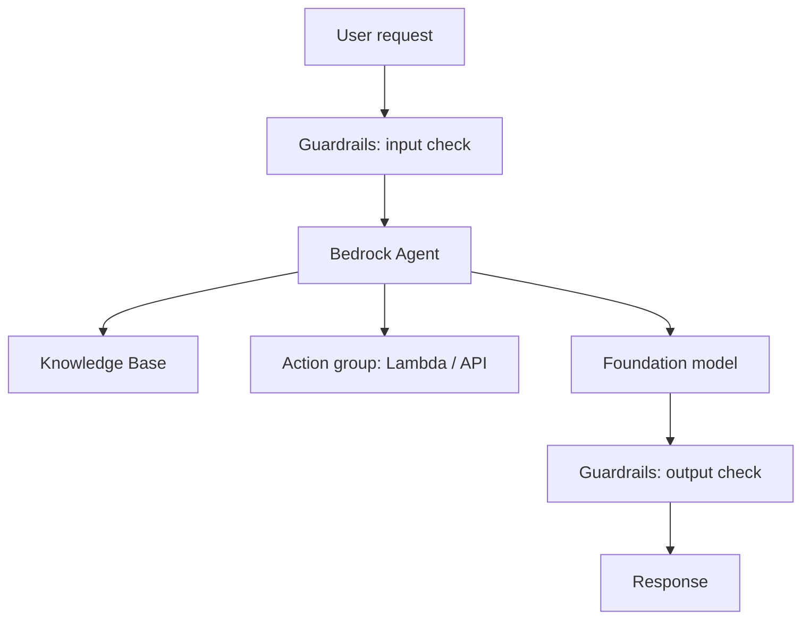
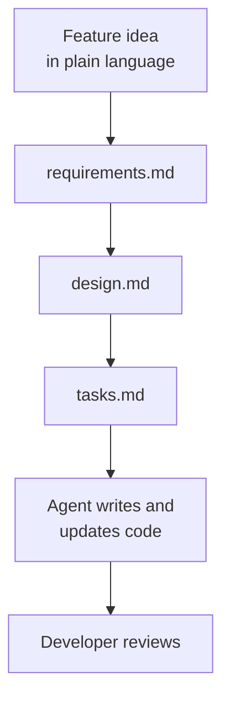
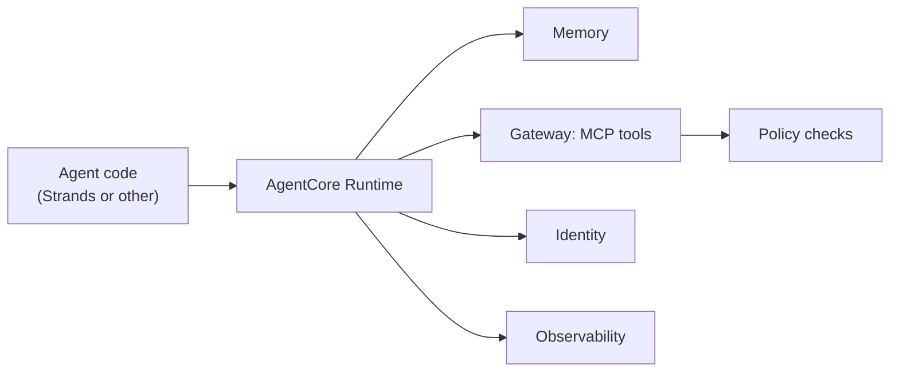
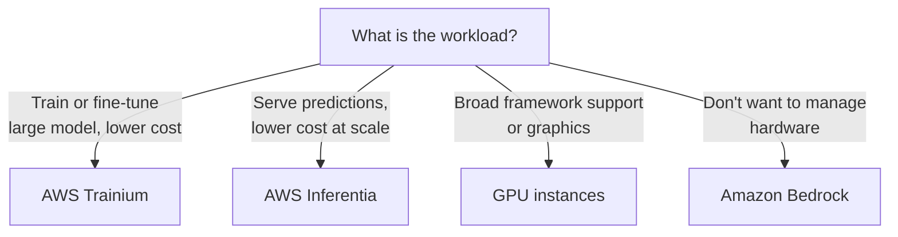
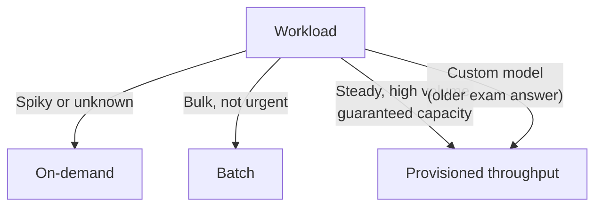

## 2.3.1 Amazon Bedrock: many foundation models behind one serverless API

**Amazon Bedrock** is a fully managed, **serverless** service that gives you access to many [foundation models](concept:2.1.1) through a **single API**. There are no servers, GPUs or endpoints for you to manage, and you pay per use ([token pricing](concept:2.1.9)).

Model choice includes Amazon's own **Amazon Nova** and **Amazon Titan** models plus models from providers such as **Anthropic** (Claude), **Meta** (Llama), **Mistral AI**, **Cohere**, **AI21 Labs**, **Stability AI**, **DeepSeek** and others. Because the API is shared (the **Converse API** works across models), you can **swap models** with a configuration change instead of re-architecting.

Key points for the exam:
- **Your data stays yours**: prompts and outputs are not used to train the base models and are not shared with model providers. Data is encrypted and you choose the AWS Region.
- **Customization**: fine-tune or continue pre-training supported models with your data. Bedrock creates a **private copy** that only you can use.
- **Playgrounds** in the console let you try models and prompts without code.
- It is the [managed API option](concept:1.3.5): the fastest path from idea to a GenAI app.

**On the exam:** "access multiple FMs via one API", "serverless", "no infrastructure to manage", "LEAST operational overhead to build a GenAI app" → **Amazon Bedrock**.

## 2.3.2 Bedrock building blocks: Knowledge Bases, Agents, Guardrails, Prompt Management, Evaluations

Bedrock adds managed features around the models so you don't build the plumbing yourself:

| Feature | What it does |
|---|---|
| **Knowledge Bases** | Managed retrieval: ingests your documents (e.g. from Amazon S3), [chunks](concept:2.1.5) them, creates [embeddings](concept:2.1.4), stores them in a vector store, and retrieves relevant passages to ground answers with citations. Reduces [hallucinations](concept:2.2.2) |
| **Agents** | Configure an [agent](concept:2.1.11) with instructions, **action groups** (APIs or AWS Lambda functions it can call) and knowledge bases. Bedrock handles the reasoning loop. **Multi-agent collaboration** adds a supervisor agent over specialist agents ([patterns](concept:2.1.12)) |
| **Guardrails** | Safety policies applied to inputs and outputs: content filters, denied topics, word filters, sensitive information (PII) masking, contextual grounding checks |
| **Prompt Management** | Create, save, **version** and test reusable prompts with variables |
| **Evaluations** | Compare models or knowledge bases using automatic metrics, LLM-as-a-judge or human reviewers |
| **Flows** | Visually chain prompts, knowledge bases, agents and Lambda into a workflow |

Later steps cover each block in depth. For now, know which block solves which problem.

**On the exam:** "answer from company documents" → Knowledge Bases. "Perform multi-step tasks calling APIs" → Agents. "Block harmful topics or redact PII" → Guardrails. "Version prompts" → Prompt Management. "Compare model quality" → Evaluations.

## 2.3.3 SageMaker AI and SageMaker JumpStart for GenAI

[Amazon SageMaker AI](concept:1.2.5) is AWS's full ML platform. For GenAI it is the choice when you need **more control** than Bedrock offers.

**SageMaker JumpStart** is a **model hub** inside SageMaker AI with hundreds of pre-trained models, including open-source and proprietary FMs (for example Llama, Mistral, Falcon and Stable Diffusion variants), plus solution templates. You can:
- **Deploy** a model with a few clicks to a SageMaker endpoint **in your own account**, choosing the instance type.
- **Fine-tune** it on your own data.
- Evaluate and compare models before deploying.

| | Amazon Bedrock | SageMaker JumpStart / SageMaker AI |
|---|---|---|
| Infrastructure | Serverless, fully managed | Endpoints on instances you choose and pay for while running |
| Control | Less (managed API) | More (instance type, scaling, network, model artifacts) |
| Effort | Lowest | Higher (you manage endpoints) |
| Best for | Fast building with popular FMs | Open-source model access, deep customization, specific hosting needs |

SageMaker AI also supports building or [training your own](concept:1.3.4) models at scale, including **SageMaker HyperPod** for large distributed FM training on clusters of accelerators.

**On the exam:** "pre-trained open-source model, deploy quickly, full control over hosting" → **SageMaker JumpStart**. "Serverless, no endpoint management" → Bedrock.

## 2.3.4 Amazon Quick and Amazon Q Developer: ready-made AI assistants

These are **finished GenAI applications**. You configure and use them rather than build them.

**Amazon Quick** (which absorbed Amazon Q Business and Amazon QuickSight) is the ready-made assistant for **employees and business users**. It answers questions, summarizes and generates content from **company data** through built-in connectors (Amazon S3, SharePoint, Confluence, Salesforce and more). It **respects existing access permissions**, so users only see answers from documents they are allowed to read.

**Amazon Q Developer**: an assistant for **builders**: code suggestions and chat in the IDE, security scanning, code upgrades (for example Java versions), and answers about your AWS resources in the console. Its command-line agent is now the **Kiro CLI**. Note that the current exam guide lists Amazon Quick and Kiro in scope but not Amazon Q, so expect Q Developer mainly in older-style questions.

Amazon Quick is also an **agentic workspace** that brings together BI, research and automation. It includes **Quick Sight** (formerly QuickSight: dashboards and natural-language questions about data), chat agents, **Quick Research** (deep research reports across internal and web sources), and **Quick Flows / Quick Automate** (automating routine and multi-step business processes).

| Need | Service |
|---|---|
| Employees ask questions over internal documents | Amazon Quick (formerly Amazon Q Business) |
| Developers want coding help in the IDE | Amazon Q Developer, or Kiro for agentic spec-driven development |
| Business users want AI-powered dashboards, data Q&A, research and automation | Amazon Quick |

**On the exam:** "no-code, ready-to-use assistant" → Amazon Quick (or Q Developer for coding), not Bedrock (Bedrock is for *building* your own app). "Natural-language questions about business data and dashboards" → Amazon Quick.

## 2.3.5 Kiro: the AI-powered IDE

**Kiro** is AWS's **agentic, AI-powered IDE** (development environment) for building software with AI agents, from prototype to production. It is built on Code OSS, the open-source base of VS Code, so VS Code settings and compatible extensions carry over. A **Kiro CLI** brings the same agent to the terminal.

What sets Kiro apart is **spec-driven development**. Instead of only "vibe coding" through chat, you describe a feature and Kiro produces:
1. **Requirements**: user stories with acceptance criteria.
2. **Design**: architecture, data flow and interfaces.
3. **Tasks**: an ordered implementation plan that the agent then executes and you review.

Other features:
- **Agent hooks**: automations triggered by events such as saving a file (e.g. update tests or docs automatically).
- **Steering files**: project rules and context (coding standards, tech stack) the agent always follows. This is [context engineering](concept:2.1.10) in practice.
- **MCP support**: connect the agent to external tools and data through [MCP servers](concept:2.1.12).
- **Autopilot or supervised** modes to control how much the agent does without approval.

Kiro fits the *development* stage of the [AI lifecycle](concept:1.3.6). It helps you **write software**; it does not host or serve models.

**On the exam:** "AI IDE", "spec-driven development", "turn a prompt into requirements, design and tasks" → **Kiro**.

## 2.3.6 Strands Agents and Amazon Bedrock AgentCore: building and running agents

**Strands Agents** is an **open-source SDK** from AWS for **writing** [agents](concept:2.1.11) in code (Python and TypeScript). It is **model-driven**: you give it a model, a system prompt and a set of tools, and the model itself plans and loops through tool calls until the task is done. It works with Bedrock models and other providers, supports [MCP](concept:2.1.12) tools natively, and supports multi-agent patterns (agents as tools, swarm, graph, workflow).

**Amazon Bedrock AgentCore** is a set of managed services to **deploy and operate** agents securely at scale. It works with **any framework** (Strands, LangGraph, CrewAI and others) and **any model**. You can use its services together or one at a time.

| AgentCore service | Purpose |
|---|---|
| **Runtime** | Serverless hosting with isolated sessions, including long-running tasks |
| **Memory** | Managed short-term and long-term memory |
| **Gateway** | Turns APIs, Lambda functions and existing services into MCP tools agents can discover |
| **Identity** | Agent identity and secure access to AWS and third-party services (OAuth, API keys) for or on behalf of users |
| **Policy** | Rules on which tools an agent can use and under what conditions, enforced outside the agent code |
| **Observability** | Traces, metrics and dashboards of agent steps (Amazon CloudWatch, OpenTelemetry) |
| **Built-in tools** | **Code Interpreter** (sandboxed code) and **Browser** (managed web browser) |

**On the exam:** "open-source SDK to build agents" → Strands Agents. "Run agents in production securely at scale, framework-agnostic" → AgentCore. Bedrock **Agents** is the configuration-based, fully managed alternative inside Bedrock.

## 2.3.7 Advantages of AWS GenAI services: accessibility, lower barrier, speed to market

Why build GenAI on managed AWS services instead of from scratch?

- **Accessibility**: leading FMs are available through an API or console playground. Developers with no ML background can use them, and ready-made assistants ([Amazon Quick](concept:2.3.4)) serve business users directly.
- **Lower barrier to entry**: no need to collect massive datasets, pre-train a model ([FM lifecycle](concept:2.1.8)) or buy GPUs. You start from pre-trained models and pay as you go.
- **Efficiency**: managed and serverless services scale automatically and handle patching, availability and capacity, so teams focus on the application rather than infrastructure.
- **Cost-effectiveness**: pay-per-use pricing, no upfront hardware, and a choice of smaller, cheaper models when they are good enough ([selection factors](concept:2.2.4)).
- **Speed to market**: prebuilt components (Knowledge Bases, Guardrails, Agents, AgentCore) replace months of custom engineering. Swapping models is a configuration change, so you can adopt better models quickly.
- **Meeting business objectives**: a broad model choice, customization with your own data, and native integration with AWS data, security and analytics services let you match the solution to the goal.

This is the classic [managed vs self-hosted](concept:1.3.5) tradeoff: managed services trade some control for far less operational work.

**On the exam:** "fastest time to market", "no ML expertise", "LEAST operational overhead" → a managed AWS GenAI service (usually Bedrock or a ready-made assistant such as Amazon Quick).

## 2.3.8 AWS infrastructure benefits: security, compliance, responsibility, safety

Running GenAI on AWS inherits the protections of the AWS cloud:

**Security**
- Access control with AWS IAM; encryption in transit and at rest with keys you can manage in AWS KMS.
- Private connectivity from your VPC to services like Bedrock (AWS PrivateLink), so traffic avoids the public internet.
- In Bedrock, your prompts and data are **not used to train base models** and are **not shared** with model providers.

**Compliance**
- Services such as Bedrock are in scope for widely used standards (for example ISO, SOC and GDPR, and HIPAA-eligible). Audit reports are available to customers.
- You choose the **Region**, which helps meet data residency requirements.

**Responsibility (shared responsibility model)**
- **AWS** secures the infrastructure: data centers, hardware, the managed service and the model hosting.
- **You** secure what you put in and build: your data, IAM permissions, prompts, application logic and how outputs are used.

**Safety**
- Built-in responsible-AI tooling such as Bedrock Guardrails and AgentCore Policy, plus AI Service Cards that document intended use and limitations of AWS AI services.

Later domains go deeper into each control. For now, know the four benefit categories and who is responsible for what.

**On the exam:** "Will my data be used to train the model?" → No, not in Bedrock. "Who secures the underlying infrastructure?" → AWS. "Who controls user access and data?" → the customer.

## 2.3.9 Compute for GenAI: GPUs, AWS Trainium and AWS Inferentia

GenAI needs massive parallel maths, so it runs on **accelerators** rather than ordinary CPUs.

| Option | Purpose | Instances |
|---|---|---|
| **NVIDIA GPUs** | General-purpose, widely supported for both training and inference | Amazon EC2 **P** family (e.g. P5, P6) for large training; **G** family (e.g. G5, G6) for inference and graphics |
| **AWS Trainium** | AWS-designed chip **for training** (and increasingly inference) of large models at lower cost | EC2 **Trn1**, **Trn2** and newer |
| **AWS Inferentia** | AWS-designed chip **for inference**: high throughput, low latency, low cost per prediction | EC2 **Inf1**, **Inf2** |

The **AWS Neuron SDK** lets common ML frameworks run on Trainium and Inferentia. AWS's own chips aim for **better price-performance** and **energy efficiency** than comparable GPU instances, which also supports sustainability goals.

Managed services hide this choice: Bedrock picks the hardware for you, while SageMaker AI and EC2 let you choose instance types (and **SageMaker HyperPod** manages large training clusters).

Remember the [training vs inference](concept:1.1.3) split: it maps directly to Trainium vs Inferentia.

**On the exam:** "cost-effective training" → **Trainium**. "Cost-effective, high-throughput inference" → **Inferentia**. "Energy-efficient" → AWS-designed chips.

## 2.3.10 Cost tradeoffs: on-demand tokens, batch, provisioned throughput, custom models, regions

Bedrock offers several ways to pay, each trading cost against responsiveness and guarantees:

| Option | How you pay | Best for | Tradeoff |
|---|---|---|---|
| **On-demand** | Per [input/output token](concept:2.1.9), no commitment | Variable or unpredictable traffic, prototypes | Subject to throughput quotas at peak |
| **Batch inference** | Lower per-token price for supported models | Large, non-urgent jobs (e.g. summarize 1M reviews overnight) | Not real-time; results arrive later ([batch inference](concept:1.1.4)) |
| **Provisioned throughput** | Fixed hourly price per **model unit**, cheaper with a 1- or 6-month commitment | Steady high volume needing guaranteed capacity; historically the only way to serve **customized models**, though many custom models (for example fine-tuned Nova models and imported models) can now also use on-demand inference | You pay even when idle |
| **Custom models** | Training charge plus monthly model storage plus hosting | Specialized domain behavior | Highest cost and effort |

Other factors:
- **Model choice**: smaller models cost less per token and respond faster ([selection factors](concept:2.2.4)).
- **Regional coverage**: not every model is in every Region, and prices can differ by Region.
- **Availability and redundancy**: **cross-Region inference** routes requests to other Regions to absorb traffic bursts and improve resilience, without extra routing charges.
- **Self-hosting** (SageMaker endpoints, EC2) charges per instance-hour whether or not traffic arrives.

**On the exam:** "unpredictable usage, pay only for what you use" → on-demand. "Guaranteed throughput" → provisioned throughput. Older exam questions also map "serve a custom model" to provisioned throughput. "Process a large dataset cheaply, latency not important" → batch.

## Exam traps

- **Bedrock vs SageMaker JumpStart**: "serverless, LEAST operational overhead" → Bedrock; "full control of hosting, open-source model on your own endpoint" → JumpStart.
- **Bedrock vs Amazon Quick**: *build* your own GenAI app → Bedrock; *use* a ready-made assistant → Amazon Quick (employee knowledge, business data, BI and automation) or Amazon Q Developer (coding).
- **Kiro vs Q Developer vs Strands**: Kiro is an agentic IDE with spec-driven development; Q Developer is a coding assistant for the IDE and console (its CLI is now the Kiro CLI); Strands Agents is an SDK for writing your own agents.
- **Bedrock Agents vs Strands + AgentCore**: configure a managed agent inside Bedrock vs write agent code in any framework and run it on AgentCore. "Framework-agnostic production runtime" → AgentCore.
- **AgentCore components**: memory across sessions → Memory; expose APIs as MCP tools → Gateway; authenticate to third-party services → Identity; restrict which tools an agent may call → Policy; tracing → Observability.
- **Trainium vs Inferentia**: **T**rainium = **T**raining, **I**nferentia = **I**nference. "Guaranteed capacity" → provisioned throughput (often also the expected answer for "custom model").

## Further reading

- [What is Amazon Bedrock?](https://docs.aws.amazon.com/bedrock/latest/userguide/what-is-bedrock.html)
- [Amazon Bedrock pricing](https://aws.amazon.com/bedrock/pricing/)
- [SageMaker JumpStart pretrained models](https://docs.aws.amazon.com/sagemaker/latest/dg/studio-jumpstart.html)
- [What is Amazon Q Developer?](https://docs.aws.amazon.com/amazonq/latest/qdeveloper-ug/what-is.html)
- [Amazon Quick](https://aws.amazon.com/quick/)
- [Kiro documentation](https://kiro.dev/docs/)
- [Strands Agents documentation](https://strandsagents.com/)
- [What is Amazon Bedrock AgentCore?](https://docs.aws.amazon.com/bedrock-agentcore/latest/devguide/what-is-bedrock-agentcore.html)
- [AWS Trainium](https://aws.amazon.com/ai/machine-learning/trainium/) and [AWS Inferentia](https://aws.amazon.com/ai/machine-learning/inferentia/)
- [CloudCityPress: AWS infrastructure for GenAI](https://github.com/CloudCityPress/aws-aif-c01/blob/main/english/20_30_AWS_infrastructure_for_GenAI.md)
