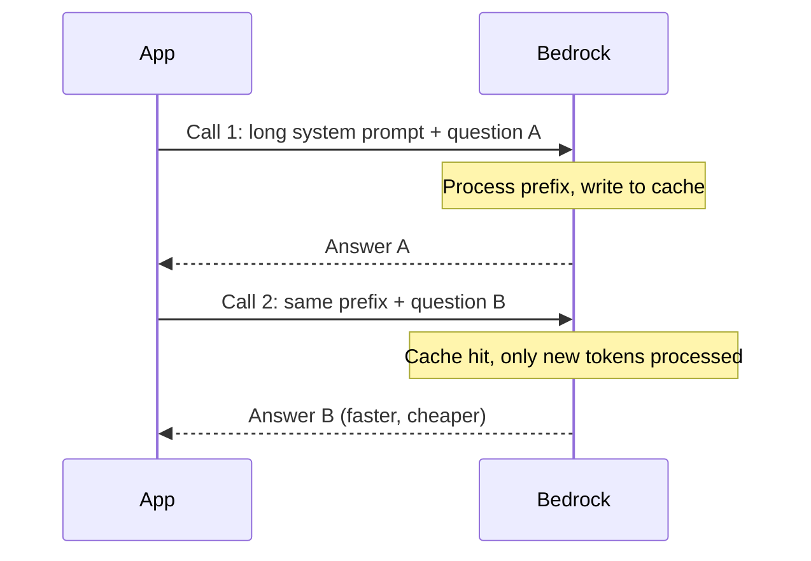
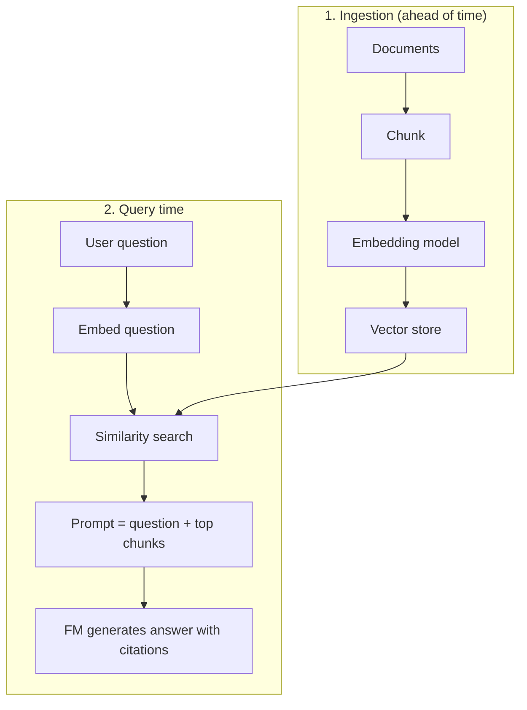
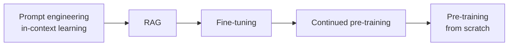
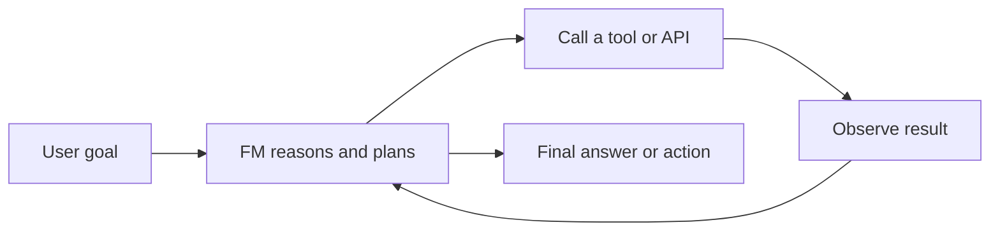

## 3.1.1 FM selection criteria: cost, modality, latency, languages, size, complexity, customization, input/output length

There is no "best" [foundation model](concept:2.1.1). There is only the best fit for one use case. Start from the requirement, then filter models on these criteria:

| Criterion | Question to ask |
|---|---|
| **Cost** | What is the price per input/output token ([token pricing](concept:2.1.9)) at our expected volume? |
| **Modality** | Text only, or images, audio, video, embeddings ([multi-modal](concept:2.1.6))? |
| **Latency** | Does a user wait for the answer in real time, or is it a nightly batch job? |
| **Languages** | Does the model support every language our users write in? |
| **Model size / complexity** | Bigger models reason better but are slower and more expensive. Smaller models suit simple, high-volume tasks. |
| **Customization** | Can we fine-tune it or distill it, or only prompt it? |
| **Input/output length** | Is the [context window](concept:2.1.3) big enough for our documents? What is the maximum output length? |
| **Prompt caching** | Does it support caching a long, repeated prompt prefix? |

Most choices are tradeoffs. A support chatbot needs low latency. A contract analyzer needs a long context window and strong reasoning. A high-volume classifier needs the cheapest small model that is accurate enough. Compare candidates on your own data with Bedrock [evaluations](concept:2.3.2), and recall the general [selection factors](concept:2.2.4).

**On the exam:** look for the one constraint that decides the answer, such as "lowest latency", "must process 300-page documents" or "must also read images".

## 3.1.2 Prompt caching

Many applications send the **same long prefix** with every request: a big system prompt, tool definitions, a policy manual or a document the user keeps asking about. Without caching, the model reprocesses those tokens every time, and you pay for them every time.

**Prompt caching** (supported on Amazon Bedrock for selected models, such as Anthropic Claude and Amazon Nova) stores the processed prefix after the first call. Later calls that start with the *identical* prefix read it from the cache:

- **Lower latency**, because the cached part is not recomputed.
- **Lower cost**, because cached input tokens are billed at a heavily discounted rate. AWS quotes savings of up to 90% on cost and up to 85% on latency for suitable workloads.

Key rules:
- Put the **static content first** and the changing part (the user's question) last. You mark cache checkpoints where the reusable prefix ends.
- The cache is short-lived (a time-to-live of minutes that resets on each hit), so it suits bursts of repeated calls, not calls days apart.
- Caching changes nothing about the answer. It only saves compute.

**On the exam:** "same large context reused across many requests" plus "reduce cost and latency" points to prompt caching, not fine-tuning.

## 3.1.3 Inference parameters: temperature, top-p, top-k, maximum length, stop sequences

**Inference parameters** are settings you send *with each request*. They change how the model picks the next [token](concept:2.1.3) without retraining anything.

| Parameter | What it does | Low value | High value |
|---|---|---|---|
| **Temperature** | Scales randomness across all candidate tokens | Focused, repeatable, factual | Varied, creative, riskier |
| **Top-p** (nucleus) | Samples only from the smallest set of tokens whose probabilities add up to p | Few, very likely tokens | Wider vocabulary |
| **Top-k** | Samples only from the k most likely tokens | Conservative | More diverse |
| **Maximum length** (max tokens) | Caps output tokens | Short, cheap answers, may be cut off | Longer answers, more cost and latency |
| **Stop sequences** | Strings that make the model stop generating | n/a | n/a |

Practical guidance:
- Extraction, classification, Q&A over documents: **low temperature** (around 0 to 0.3).
- Brainstorming, marketing copy, story writing: **higher temperature**.
- Usually tune temperature *or* top-p, not both at once.
- Output length drives cost and latency, because output tokens are the expensive ones ([pricing](concept:2.1.9)).
- Even at temperature 0, outputs may not be perfectly identical ([nondeterminism](concept:2.2.3)).

**On the exam:** "more creative/diverse" → raise temperature (or top-p/top-k). "More consistent/deterministic" → lower them. "Responses are cut off" → raise maximum length. "Stop generating after X" → stop sequence.

## 3.1.4 Retrieval Augmented Generation (RAG): how it works

An FM only knows its training data. It has a cutoff date and has never seen your company's private documents, so it may [hallucinate](concept:2.2.2) when asked about them. **Retrieval Augmented Generation (RAG)** fixes this by looking up relevant facts at query time and pasting them into the prompt. The model's weights never change.

1. **Ingest:** split documents into [chunks](concept:2.1.5), convert each chunk to an [embedding](concept:2.1.4), and store it in a vector database.
2. **Retrieve:** embed the user's question and find the chunks whose vectors are closest in meaning.
3. **Augment:** add those chunks to the prompt as context.
4. **Generate:** the FM answers *from the supplied context* and can cite its sources.

Business applications: internal knowledge assistants (HR, IT, policy), customer-support bots over product manuals, legal and research document Q&A, and sales enablement.

Why it matters: answers stay **current** (update the documents, not the model), they are **grounded** and citable, and it is far cheaper than fine-tuning. Retrieval quality limits answer quality: bad chunks in, bad answers out.

**On the exam:** "use company documents", "data changes often", "reduce hallucinations", "cite sources", "without retraining" → RAG.

## 3.1.5 Amazon Bedrock Knowledge Bases

**Amazon Bedrock Knowledge Bases** is the fully managed way to build [RAG](concept:3.1.4) on AWS. You point it at your data and it handles the whole pipeline: parsing, [chunking](concept:2.1.5), [embedding](concept:2.1.4), storage, retrieval and prompt augmentation.

What you configure:
- **Data source:** Amazon S3 is the most common. Connectors also exist for web crawling, Confluence, SharePoint and Salesforce. Knowledge Bases can also query structured data (for example Amazon Redshift) by turning questions into SQL.
- **Chunking strategy:** default, fixed-size, hierarchical, semantic, or none.
- **Embedding model:** for example Amazon Titan Text Embeddings or Cohere Embed.
- **Vector store:** Amazon OpenSearch Serverless (the quick-create default), Aurora PostgreSQL, Neptune Analytics (for GraphRAG), Amazon S3 Vectors, or supported third-party stores such as Pinecone, Redis and MongoDB Atlas.

How apps use it:
- **Retrieve** API: returns the relevant chunks only, so your code builds the prompt.
- **RetrieveAndGenerate** API: retrieves, augments and calls an FM in one step, and returns the answer **with citations**.
- Attach the knowledge base to a [Bedrock agent](concept:2.3.2) so the agent can look things up.

Keeping data fresh means **syncing** the data source. New documents are re-ingested, and no model training is involved. Optional extras include reranking models to improve result order and metadata filters to narrow a search.

**On the exam:** "managed RAG", "connect an FM to company documents in S3 with the LEAST operational overhead", "responses with source attribution" → Bedrock Knowledge Bases.

## 3.1.6 Vector databases on AWS: OpenSearch Service, Aurora, Neptune, RDS for PostgreSQL

A **vector database** stores [embeddings](concept:2.1.4) and runs fast **similarity search** (nearest neighbours, often k-NN), which RAG needs. The exam names four AWS options:

| Service | How it stores vectors | Choose it when… |
|---|---|---|
| **Amazon OpenSearch Service** (managed or Serverless) | k-NN vector search, plus keyword and hybrid search | You want scale, low latency, and text + vector (hybrid) search. It is the default for Bedrock Knowledge Bases. |
| **Amazon Aurora PostgreSQL** | `pgvector` extension | You already run Aurora and want vectors next to your relational data. |
| **Amazon RDS for PostgreSQL** | `pgvector` extension | Same idea on standard RDS. It is a familiar SQL database with vector columns. |
| **Amazon Neptune** (Neptune Analytics) | Vector search on graph data | Relationships matter (knowledge graphs, GraphRAG, fraud rings). |

Others you may see: **Amazon S3 Vectors** (lowest-cost, durable vector storage for large, less latency-sensitive sets), **Amazon DocumentDB** and **Amazon MemoryDB**, which both support vector search too.

How to choose: reuse what your team already operates, check scale and latency needs, and check whether you need keyword search or graph traversal as well. A plain key-value store such as DynamoDB, or a data warehouse, is not the usual answer for similarity search.

**On the exam:** "store embeddings for similarity search" → one of these four. "PostgreSQL" → pgvector on Aurora or RDS. "Graph relationships" → Neptune. "Search engine / hybrid keyword + semantic" → OpenSearch.

## 3.1.7 Customization cost ladder: in-context learning, RAG, fine-tuning, pre-training, distillation

When a base model isn't good enough, climb the ladder **one rung at a time**. Each step up costs more money, data, time and expertise.

| Approach | Changes weights? | Main cost | Use when |
|---|---|---|---|
| **In-context learning** ([prompting](concept:2.1.10), few-shot examples) | No | Extra input tokens per call | Format, tone or simple task guidance |
| **RAG** | No | Embeddings, vector store, longer prompts | Needs private or fresh facts |
| **Fine-tuning** | Yes | Labeled data, training job, often dedicated hosting | Consistent style, domain task, specialized behavior |
| **Continued pre-training** | Yes | Large unlabeled domain corpus, more compute | Deep domain vocabulary (legal, medical) |
| **Pre-training** | Yes, a new model | Massive data and GPU clusters, millions of dollars | Almost never for an AWS customer |

**Model distillation** sits off the ladder. You pay an *upfront* training cost so that a smaller "student" model learns from a large "teacher". After that, inference is **cheaper and faster** for the same narrow task.

Hidden costs matter: a fine-tuned model on Bedrock often needs Provisioned Throughput to serve ([cost tradeoffs](concept:2.3.10)), and it must be retrained when the base model or the data changes. RAG only needs a re-sync.

**On the exam:** "MOST cost-effective" or "least effort" → start with prompting, then RAG. "Knowledge changes frequently" → RAG, not fine-tuning. "Reduce inference cost of a large model for one task" → distillation.

## 3.1.8 AI agents in applications and their business uses

A chatbot answers. An **[AI agent](concept:2.1.11)** *acts*. It takes a goal, plans steps, calls tools (APIs, databases, knowledge bases), checks results and repeats until done.

On AWS:
- **Amazon Bedrock Agents**: managed agents with action groups (Lambda functions or API schemas), attached [knowledge bases](concept:3.1.5), memory and guardrails. Multi-agent collaboration lets a supervisor agent delegate to specialist agents ([multi-agent patterns](concept:2.1.12)).
- **[Strands Agents and AgentCore](concept:2.3.6)**: build with an open-source framework and run securely at scale with any model.

Business uses:
- **Customer service** that actually resolves issues: checks an order, issues a refund, rebooks a flight.
- **Insurance claims and back-office processing**: read the documents, validate them, update systems.
- **IT and DevOps automation**: triage tickets, query logs, run runbooks.
- **Sales and research assistants**: gather data from several systems and draft a report.
- **Coding agents** such as Kiro and Amazon Q Developer.

Design considerations: agents make several FM calls per task, so they bring **more latency and cost** and **less predictability**. Give tools least-privilege permissions, add guardrails, and use **human-in-the-loop** confirmation (return of control) for risky actions like payments.

**On the exam:** "multi-step task", "take actions in other systems", "call APIs on the user's behalf" → agents. "Answer questions from documents" alone → RAG/Knowledge Bases.

## Exam traps

- **RAG vs fine-tuning:** "frequently changing data", "cite sources" or "without retraining" → RAG. "Change the model's style, tone or specialized behavior" with labeled examples → fine-tuning.
- **Prompt caching vs RAG:** caching reuses the *same* prefix to save cost and latency. It adds no new knowledge. RAG adds knowledge that is *different per question*.
- **Temperature vs maximum length:** temperature controls randomness, while maximum length controls how long (and costly) the output is. "Answers are truncated" is a length problem, not a temperature problem.
- **Knowledge Bases vs Agents:** Knowledge Bases *retrieve and answer*. Agents *plan and act*, and can use a knowledge base as one of their tools.
- **Vector store picks:** PostgreSQL → pgvector (Aurora or RDS). Graph → Neptune. Hybrid search or the Knowledge Bases default → OpenSearch. DynamoDB is a distractor.
- **"MOST cost-effective customization"** → the lowest rung that works: prompt engineering, then RAG. Pre-training from scratch is almost never right.

## Further reading

- [Amazon Bedrock: Prompt caching](https://docs.aws.amazon.com/bedrock/latest/userguide/prompt-caching.html)
- [Amazon Bedrock: Inference parameters](https://docs.aws.amazon.com/bedrock/latest/userguide/inference-parameters.html)
- [What is RAG? (AWS)](https://aws.amazon.com/what-is/retrieval-augmented-generation/)
- [Amazon Bedrock Knowledge Bases](https://docs.aws.amazon.com/bedrock/latest/userguide/knowledge-base.html)
- [What is a vector database? (AWS)](https://aws.amazon.com/what-is/vector-databases/)
- [Amazon Bedrock Agents](https://docs.aws.amazon.com/bedrock/latest/userguide/agents.html)
- [CloudCityPress: Design considerations for FM applications](https://github.com/CloudCityPress/aws-aif-c01/blob/main/english/30_10_Design_considerations_for_FM_applications.md)
