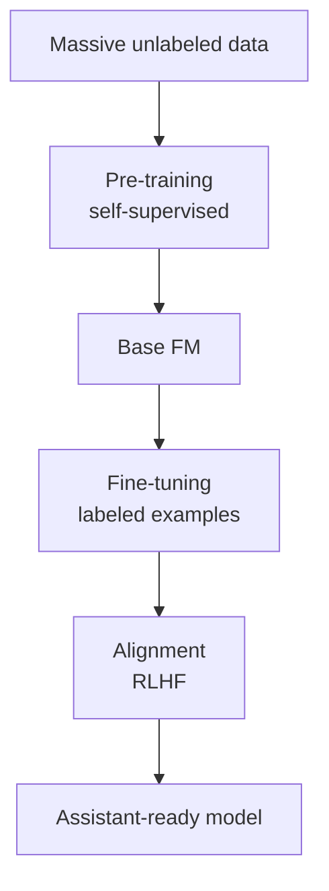
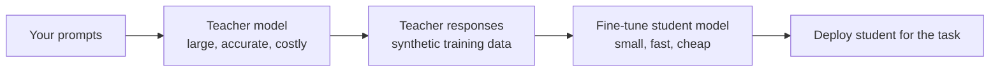
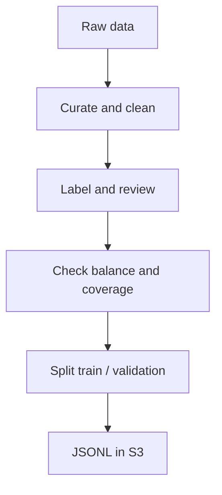
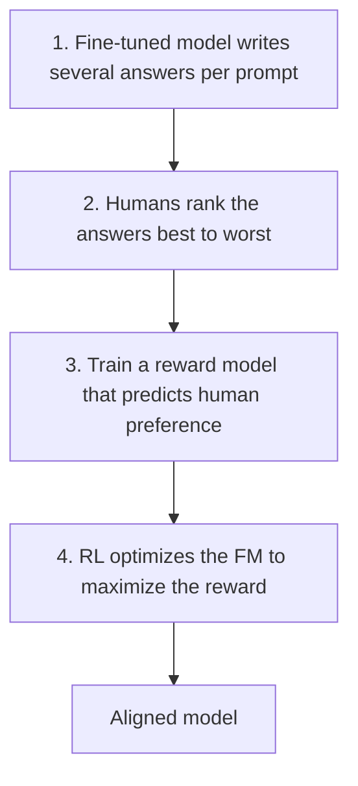

## 3.3.1 Pre-training: self-supervised learning on massive unlabeled data

**Pre-training** is the first and most expensive stage of building a [foundation model](concept:2.1.1). The model reads a massive, broad corpus (web text, books, code, and for multi-modal models images and audio) and learns the general patterns of language and the world.

It is **self-supervised**: nobody labels the data. The text supplies its own answers. A [transformer](concept:2.1.2) is trained to predict the next token (or a masked token), checks itself against the real token, and adjusts billions of weights. Repeat this over trillions of tokens and the model picks up grammar, facts, reasoning patterns and coding skills.

Characteristics:
- **Cost:** thousands of accelerators ([GPUs, Trainium](concept:2.3.9)) for weeks or months, and millions of dollars.
- **Data:** enormous volume and variety. Quality filtering and deduplication matter a lot.
- **Output:** a *base model* that continues text well but doesn't yet reliably follow instructions.

Only model providers (Amazon, Anthropic, Meta, Mistral and others) typically pre-train. Almost every business starts from an existing pre-trained model and adapts it, which is why pre-training sits at the top of the [cost ladder](concept:3.1.7). It is also the first stage of the [FM lifecycle](concept:2.1.8).

**On the exam:** "self-supervised", "unlabeled data at massive scale", "build a model from scratch" → pre-training. It is almost never the cost-effective answer for a business scenario.

## 3.3.2 Fine-tuning and instruction tuning

**Fine-tuning** takes a pre-trained model and continues training it on a **smaller, labeled, task-specific dataset**, usually prompt and ideal-response pairs. The model's weights change, so the new behaviour is built in and doesn't need to be repeated in every prompt.

Use fine-tuning when you need:
- A consistent **style, tone or format** (brand voice, a specific report layout).
- Better performance on a **narrow task** (classifying your ticket categories, extracting your document fields).
- Shorter prompts, because examples no longer need to be sent with every call ([few-shot](concept:3.2.2) moves into the weights).

**Instruction tuning** is a kind of fine-tuning where the dataset is many examples of *instructions and good responses* across varied tasks ("Summarize…", "Translate…", "Write an email…"). It turns a base model that only continues text into a model that **follows instructions**. Chat models are instruction-tuned.

Variants to recognize:
- **Full fine-tuning** updates all weights. It is the most expensive option and the most prone to **catastrophic forgetting** (losing general skills).
- **Parameter-efficient fine-tuning (PEFT)**, for example LoRA, trains a small set of extra weights. It is cheaper and faster, and the base model stays intact.

Limits: fine-tuning doesn't keep knowledge *fresh*, because facts are frozen at training time. It needs good labeled data, and the resulting custom model costs money to host. For frequently changing facts, use [RAG](concept:3.1.4) instead.

**On the exam:** "labeled examples", "adapt to a specific task or style" → fine-tuning. "Teach the model to follow instructions" → instruction tuning.

## 3.3.3 Domain adaptation, transfer learning and continued pre-training

These terms describe *reusing* what a model already knows for a new purpose.

**Transfer learning** is the general principle: knowledge learned on one task or dataset is reused as the starting point for a related task. Every fine-tune of a pre-trained FM is transfer learning, and so is reusing an image model trained on general photos to spot defects in factory images. You need far less data and compute than training from scratch.

**Domain adaptation** means making a general model work well in a **specialized field** (legal, medical, finance, a company's own jargon), where vocabulary and writing style differ from general web text. Two ways to get there:

| Method | Data | What it teaches |
|---|---|---|
| **Continued (continuous) pre-training** | Large volume of **unlabeled** domain text (contracts, clinical notes, internal docs) | Domain vocabulary, concepts and style, using the same self-supervised method as [pre-training](concept:3.3.1) |
| **Domain-specific [fine-tuning](concept:3.3.2)** | **Labeled** domain examples (question and expert answer) | How to perform specific domain tasks |

A common sequence is base model → continued pre-training on domain text → fine-tuning on labeled domain tasks.

Continued pre-training needs much more data and compute than fine-tuning, but much less than pre-training from scratch. Amazon Bedrock supports it for selected models.

**On the exam:** "lots of *unlabeled* industry documents", "learn domain terminology" → continued pre-training. "Reuse a model trained for one task on a related task" → transfer learning.

## 3.3.4 Model distillation

**Model distillation** transfers the skill of a large, capable **teacher** model into a smaller, faster **student** model for a specific use case.

How it works: the teacher generates high-quality answers to prompts that look like your real traffic. The student is then trained to reproduce those answers. The student learns to mimic the teacher *on that task*, not across everything the teacher can do.

Why do it:
- **Lower inference cost** and **lower latency**, which matters at high volume.
- Accuracy close to the large model for the target task.
- Less need for human-labeled data, because the teacher produces the training data.

**Amazon Bedrock Model Distillation** automates this. You pick a teacher and a student from the same model family, supply prompts (or your invocation logs), and Bedrock generates responses, applies data synthesis techniques and fine-tunes the student. AWS quotes distilled models running up to 500% faster and costing up to 75% less, with under 2% accuracy loss for use cases such as RAG.

Tradeoffs: there is an upfront cost to distil, the student is narrower than the teacher, and you must re-distil when the task changes. Check the teacher model's license terms if you distil outside Bedrock.

**On the exam:** "smaller, faster, cheaper model that keeps a large model's accuracy for one use case" → distillation. It is not compression for storage, and it is not RAG.

## 3.3.5 Preparing fine-tuning data: curation, governance, size, labeling, representativeness

A fine-tuned model is only as good as its training data. Five qualities matter. They mirror classic [data preparation](concept:1.3.2):

- **Curation:** clean and select the data. Remove duplicates, errors, irrelevant or low-quality examples, and toxic content. Strip or mask PII. A few hundred excellent examples beat thousands of noisy ones.
- **Governance:** know where data came from (lineage), confirm you have the rights and consent to use it, control access, encrypt it, and document it. Regulated or copyrighted data needs approval before training.
- **Size:** enough examples to show the pattern. Fine-tuning needs far fewer than pre-training (often hundreds to a few thousand), while continued pre-training needs large volumes. Too little data risks [overfitting](concept:1.1.9).
- **Labeling:** responses must be accurate and consistent, ideally written or reviewed by domain experts. Inconsistent labels teach inconsistent behaviour. Services such as SageMaker Ground Truth support human labeling workflows.
- **Representativeness:** examples must reflect real production inputs: languages, edge cases, user groups and all task types. Skewed data produces a skewed and potentially unfair model ([bias and fairness](concept:1.1.10)).

Practical format: for Bedrock fine-tuning, data is usually **JSONL** (one prompt and its response per line) stored in **Amazon S3**. Hold out a [validation set](concept:1.3.3) to measure the model on unseen data.

**On the exam:** "model performs poorly for a group of users" → representativeness. "Model gives inconsistent answers after fine-tuning" → label quality.

## 3.3.6 Reinforcement learning from human feedback (RLHF)

A fine-tuned model may be accurate but still unhelpful, verbose or unsafe. **Reinforcement learning from human feedback (RLHF)** aligns a model with **human preferences**: helpfulness, honesty and harmlessness. It applies [reinforcement learning](concept:1.1.8), where humans' judgments become the reward.

Why not just fine-tune? Ranking two answers ("A is better than B") is easier and more consistent for people than writing the perfect answer, and it captures subtle qualities like tone and safety.

Data preparation for RLHF:
- A diverse set of realistic prompts.
- Clear guidelines for annotators, so different reviewers judge the same way.
- Trained, representative reviewers, because their biases become the model's biases.
- Services such as **SageMaker Ground Truth** to collect human preference data at scale.

Related approaches you may see: **DPO** (direct preference optimization) learns from the same preference pairs without a separate reward model. **RLAIF** uses AI feedback instead of human feedback. On AWS, preference and reinforcement-based customization is available for selected models through SageMaker AI and Bedrock.

**On the exam:** "human rankings of responses", "align outputs with human preferences", "reward model" → RLHF.

## 3.3.7 Customizing models on AWS: Bedrock custom models and SageMaker AI

AWS offers two main paths. Pick by how much **control** you need versus how much **operational effort** you will accept ([Bedrock](concept:2.3.1) vs [SageMaker AI](concept:2.3.3)).

| | **Amazon Bedrock custom models** | **Amazon SageMaker AI** |
|---|---|---|
| Effort | Fully managed. Upload data and start a job | You manage training jobs and endpoints (JumpStart simplifies this) |
| Methods | [Fine-tuning](concept:3.3.2), [continued pre-training](concept:3.3.3), [distillation](concept:3.3.4) and reinforcement fine-tuning for selected models | Any method: full or PEFT fine-tuning, RLHF/DPO, even [pre-training](concept:3.3.1) with SageMaker HyperPod |
| Models | Supported Bedrock models (for example Amazon Nova, Meta Llama) | Open-weight models from JumpStart or Hugging Face, Amazon Nova, or your own |
| Serving | Provisioned Throughput, or on-demand for supported custom models | SageMaker AI endpoints you size and pay for |

Bedrock specifics:
- Training data sits in **S3**, and you get a **private copy** of the model. Your data is not used to train the base model, and it can be encrypted with KMS and kept inside your VPC.
- **Custom Model Import** brings in weights you customised elsewhere (supported open architectures) and serves them through the Bedrock API.

SageMaker AI fits when you need full control over algorithms and infrastructure, an unsupported model, or very large-scale training.

**On the exam:** "fine-tune with the LEAST operational overhead" → Bedrock custom models. "Full control / custom training code / open-source model not on Bedrock" → SageMaker AI (JumpStart).

## Exam traps

- **Fine-tuning vs continued pre-training:** *labeled* prompt-response pairs → fine-tuning. *Unlabeled* domain documents → continued pre-training.
- **Pre-training vs continued pre-training:** pre-training builds a model from scratch. Continued pre-training extends an existing model with new domain text.
- **Distillation vs fine-tuning:** both train a model, but distillation's goal is a *smaller, cheaper* student learning from a *teacher's* outputs.
- **RLHF vs fine-tuning:** human *rankings and preferences* through a reward model → RLHF. Human-written *ideal answers* → supervised fine-tuning.
- **Fine-tuning vs RAG:** fine-tuning changes behaviour and style, but its knowledge goes stale. RAG supplies fresh facts. "Data changes daily" is never fine-tuning.
- **Bedrock vs SageMaker AI:** "managed / least overhead" → Bedrock. "Full control / custom algorithm" → SageMaker AI.

## Further reading

- [Amazon Bedrock: Customize your model](https://docs.aws.amazon.com/bedrock/latest/userguide/custom-models.html)
- [Amazon Bedrock: Model Distillation](https://docs.aws.amazon.com/bedrock/latest/userguide/model-distillation.html)
- [What is RLHF? (AWS)](https://aws.amazon.com/what-is/reinforcement-learning-from-human-feedback/)
- [What is transfer learning? (AWS)](https://aws.amazon.com/what-is/transfer-learning/)
- [SageMaker JumpStart: fine-tune foundation models](https://docs.aws.amazon.com/sagemaker/latest/dg/jumpstart-foundation-models-fine-tuning.html)
- [CloudCityPress: Training and fine-tuning for FMs](https://github.com/CloudCityPress/aws-aif-c01/blob/main/english/30_30_Training_and_fine_tuning_for_FMs.md)
