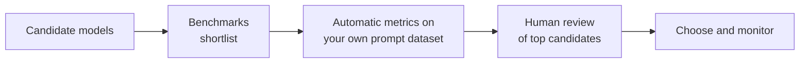
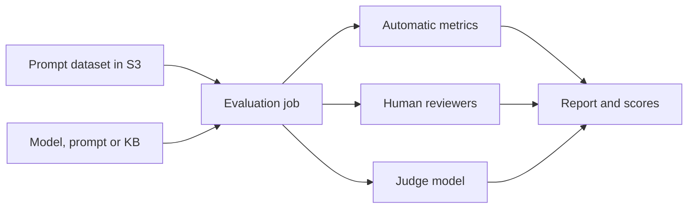
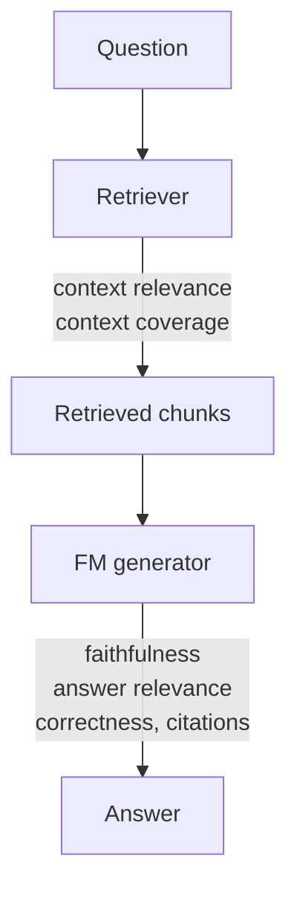

## 3.4.1 Evaluation approaches: human evaluation, benchmark datasets, automatic metrics

GenAI output is open-ended. There is rarely one "correct" sentence, so a single [accuracy score](concept:1.3.9) isn't enough. Combine three approaches:

| Approach | How | Strengths | Weaknesses |
|---|---|---|---|
| **Human evaluation** (human-in-the-loop) | People rate or compare outputs for helpfulness, tone, correctness and brand fit | Catches nuance, style and subtle errors. The gold standard for quality | Slow, expensive, can be inconsistent between reviewers |
| **Benchmark datasets** | Standard public test sets (for example MMLU for knowledge, HELM, GLUE/SuperGLUE for language understanding) | Fair, repeatable comparison across models | Generic. May not reflect *your* task. Models may have seen the test data |
| **Automatic metrics** | Scores computed against reference answers ([ROUGE](concept:3.4.3), [BLEU](concept:3.4.4), [BERTScore](concept:3.4.5)) or by a judge model ([LLM-as-a-judge](concept:3.4.6)) | Fast, cheap, scalable, good for regression testing | Can miss meaning or quality that humans notice |

Best practice: build your own **evaluation dataset** of real prompts and reference answers for your use case. Use automatic scoring for breadth and humans for depth, and re-run the evaluation whenever you change the model, the prompt or the data ([experimentation](concept:3.2.5)).

**On the exam:** "subjective qualities like tone, creativity or brand voice" → human evaluation. "Compare models on standardized tasks" → benchmark datasets. "Evaluate thousands of outputs quickly" → automatic metrics.

## 3.4.2 Amazon Bedrock Model Evaluation

**Amazon Bedrock Model Evaluation** (part of [Bedrock's building blocks](concept:2.3.2)) runs evaluation jobs so you can compare models, prompts or RAG setups on your use case, with results saved to S3 and shown in the console.

Evaluation types:
- **Automatic (programmatic):** Bedrock scores outputs with built-in metrics such as accuracy, robustness and toxicity for tasks like text generation, summarization, Q&A and classification. Use curated built-in datasets or bring your own prompt dataset.
- **Human:** bring your **own work team** of reviewers (for example subject-matter experts) to rate or compare responses on criteria you define, such as relevance, style or brand voice.
- **Model as a judge** ([LLM-as-a-judge](concept:3.4.6)): a judge model scores responses for quality (correctness, completeness, faithfulness, helpfulness) and responsible-AI metrics (harmfulness, refusal), with human-like nuance at automated speed.
- **RAG evaluation:** evaluates [Knowledge Bases](concept:3.1.5), covering retrieval only or retrieval plus generation ([3.4.7](concept:3.4.7)).

You can also evaluate responses produced outside Bedrock ("bring your own inference responses") to compare any model or application.

SageMaker AI offers similar foundation-model evaluation for models you host there, through SageMaker Clarify.

**On the exam:** "compare FMs on our own data with the LEAST effort" or "include human reviewers in model evaluation" → Bedrock Model Evaluation.

## 3.4.3 ROUGE for summarization

**ROUGE** (Recall-Oriented Understudy for Gisting Evaluation) scores a generated text by its **word overlap** with one or more human-written **reference** texts. It is the classic metric for **summarization**.

"Recall-oriented" means it asks: *how much of the reference's content shows up in the model's summary?* A summary that captures the key points of the reference scores high.

Common variants:
- **ROUGE-N:** overlap of n-grams (word sequences). **ROUGE-1** counts single words. **ROUGE-2** counts word pairs.
- **ROUGE-L:** the **longest common subsequence**, which rewards keeping the right words in the right order, even with gaps.

Scores range from 0 to 1, and higher means more overlap.

Example:
- Reference: "Sales rose 10% due to strong online demand."
- Summary: "Online demand drove a 10% sales increase."

Many key words match, so the ROUGE-1 score is decent even though the wording differs.

Limitations:
- It measures **surface overlap, not meaning**. A correct paraphrase using different words scores low, and fluent nonsense that copies words can score well.
- It needs good reference summaries.
- It says nothing about factual correctness or tone.

Use it with [semantic metrics](concept:3.4.5) and [human review](concept:3.4.1).

**On the exam:** "evaluate **summaries** against reference summaries" → ROUGE. The R in ROUGE stands for Recall, and summaries should *recall* key content.

## 3.4.4 BLEU for translation

**BLEU** (Bilingual Evaluation Understudy) measures how closely a machine-generated text matches one or more human **reference translations**, using **n-gram overlap**. It is the classic metric for **machine translation**.

Where [ROUGE](concept:3.4.3) is recall-oriented, BLEU is **precision-oriented**: *of the words and phrases the model produced, how many appear in the reference?* It combines 1-gram to 4-gram matches, so it rewards both correct words and correct word order.

It also applies a **brevity penalty**. Without one, a very short output with only "safe" words would get high precision. The penalty stops a model from gaming the score by leaving content out.

Scores range from 0 to 1 (often shown as 0 to 100). Higher is closer to the reference.

| | ROUGE | BLEU |
|---|---|---|
| Typical task | Summarization | Translation |
| Orientation | Recall (did we cover the reference?) | Precision (is what we wrote in the reference?) |
| Shared weakness | Word overlap, not meaning | Word overlap, not meaning |

Limitations: a valid translation that uses synonyms or different word order is penalized, so having several reference translations helps. BLEU is weak at judging fluency or meaning for single sentences, and is more reliable over a whole test set.

**On the exam:** "evaluate **translation** quality against reference translations" → BLEU. "Bilingual" is the hint.

## 3.4.5 BERTScore for semantic similarity

**BERTScore** compares a generated text with a reference by **meaning**, not exact words. It uses a pre-trained language model (BERT-style) to turn every token in both texts into a contextual [embedding](concept:2.1.4). Each token is then matched to its most similar token in the other text by [vector similarity](concept:3.1.6), and the matches are combined into precision, recall and F1 scores.

Because embeddings capture meaning, **paraphrases and synonyms score well**:

- Reference: "The meeting was postponed."
- Output: "The meeting got delayed."

ROUGE and BLEU see little word overlap here. BERTScore sees that "postponed" and "delayed" mean nearly the same thing and scores the pair high.

Where it fits:
- Open-ended generation, summaries and answers where many wordings are correct.
- Checking that the meaning is preserved after paraphrasing, simplification or translation.

Limitations:
- It still needs a reference text.
- High semantic similarity isn't the same as factual correctness. Swapping a single number ("10%" vs "15%") can barely change the score.
- It costs more compute than simple n-gram counting.

| Metric | Compares | Best for |
|---|---|---|
| ROUGE | Word overlap (recall) | Summarization |
| BLEU | Word overlap (precision) | Translation |
| **BERTScore** | **Embedding similarity** | **Meaning, paraphrase** |

**On the exam:** "semantic similarity", "capture meaning even if the wording differs", "paraphrases" → BERTScore.

## 3.4.6 LLM-as-a-judge

**LLM-as-a-judge** uses a capable FM (the **judge**) to grade another model's outputs against a **rubric**. Example: "Rate this answer 1–5 for correctness, completeness and helpfulness given the question and reference, and explain why."

Why it's popular:
- It evaluates **open-ended** qualities (helpfulness, coherence, faithfulness to a source, harmfulness) that n-gram metrics can't see.
- It works **with or without a reference answer**.
- It is **fast and cheap at scale** compared with human reviewers, and its scores come with written explanations.
- It approximates human judgment well when the rubric is clear.

Amazon Bedrock supports this natively. Model evaluation jobs and [RAG evaluation](concept:3.4.7) jobs can use a judge model from Bedrock, with built-in metrics or your own custom metrics and rubric ([Bedrock Model Evaluation](concept:3.4.2)).

Known weaknesses and fixes:

| Weakness | Mitigation |
|---|---|
| **Position bias** (prefers the first answer shown) | Swap the order and average the results |
| **Verbosity bias** (prefers longer answers) | Rubric explicitly rewards concision |
| **Self-preference** (favours its own model family) | Use a different model family as judge |
| Judge can be wrong or [nondeterministic](concept:2.2.3) | Low temperature, clear rubric, regular human spot-checks |
| Cost of extra FM calls | Sample, or use a smaller judge for simple checks |

Use LLM-as-a-judge to scale evaluation, and **calibrate it against [human evaluation](concept:3.4.1)** on a sample.

**On the exam:** "use an FM to evaluate another FM's responses at scale", "human-like quality scoring without human reviewers" → LLM-as-a-judge.

## 3.4.7 Evaluating RAG, agents and workflows

An application built on an FM can fail even when the model is excellent. Evaluate the **whole system**, component by component.

**RAG** ([how it works](concept:3.1.4)) has two stages, and you score each separately:

- **Retrieval:** did we fetch the *right* chunks (**context relevance**) and *all* the needed information (**context coverage/recall**)? Fix poor retrieval with better [chunking](concept:2.1.5), embeddings or reranking.
- **Generation:** is the answer **faithful** to the retrieved context (grounded, no hallucination)? Is it **relevant** to the question and **correct**, and do the **citations** support its claims?
- Bedrock Model Evaluation runs **Knowledge Base evaluations** in retrieve-only or retrieve-and-generate mode, using [LLM-as-a-judge](concept:3.4.6).

**Agents** ([agents](concept:3.1.8)): judge the final outcome *and* the path to it.
- **Task completion (goal success) rate:** did it achieve the user's goal?
- **Tool selection and parameter accuracy:** right tool, right inputs?
- **Trajectory efficiency:** number of steps, loops and FM calls, which drive latency and cost.
- **Safety:** stayed within permissions, asked for confirmation when it should.
- Agent traces (for example Bedrock Agents traces or AgentCore Observability) show each reasoning and tool step. AgentCore also offers built-in evaluations of agent quality.

**Workflows** (multi-step chains or flows): test each step's output *and* the end-to-end result, plus total latency, cost and error handling.

**On the exam:** "answer not supported by retrieved documents" → faithfulness/grounding problem. "Wrong documents retrieved" → retrieval/context relevance problem. "Did the agent finish the job?" → task completion rate.

## 3.4.8 Business alignment: productivity, engagement, task completion, satisfaction, cost per interaction

A model can score well on ROUGE and still fail the business. The final test is whether the application meets its **business objective**, which links back to [business metrics](concept:1.3.11) and [GenAI value metrics](concept:2.2.5).

| Metric | What it shows | Example |
|---|---|---|
| **Productivity** | Time or effort saved | Support agents resolve 30% more tickets per hour. Developers ship faster with a coding assistant |
| **User engagement** | Whether people actually use and return to it | Active users, sessions, retention, feature adoption |
| **Task completion rate** | Share of interactions where the user's goal was achieved without escalation | 80% of password resets completed by the bot |
| **User satisfaction** | Perceived quality | CSAT or NPS surveys, thumbs up/down, complaint volume |
| **Cost per interaction** | Unit economics | (tokens × [price](concept:2.1.9) + retrieval + infrastructure) ÷ conversations. Compare with the cost of a human-handled contact |

How to apply it:
- Define the target metric **before** building and measure a baseline without AI. Use A/B tests or pilots.
- Balance metrics. A cheaper model is no win if completion and satisfaction drop.
- Keep [monitoring](concept:1.3.8) after launch.

Technical metrics (ROUGE, faithfulness) tell you *whether the model is good*. Business metrics tell you *whether the product is worth it*.

**On the exam:** "measure whether the chatbot reduced support workload" → task completion/deflection and productivity. "Is the AI cost-effective per conversation?" → cost per interaction. "Do users like it?" → user satisfaction.

## Exam traps

- **ROUGE vs BLEU vs BERTScore:** summarization → ROUGE (Recall). Translation → BLEU (Bilingual). Meaning or paraphrase → BERTScore (embeddings). None of them checks facts.
- **Human evaluation vs LLM-as-a-judge:** "subjective, brand voice, highest trust" → humans. "At scale, quickly, cheaply, with human-like judgment" → LLM-as-a-judge.
- **Benchmarks vs your own dataset:** public benchmarks compare models in general. "How will it do on *our* use case?" → evaluate with your own prompt dataset (Bedrock Model Evaluation).
- **RAG failures:** wrong chunks → retrieval (context relevance). Answer ignores or contradicts the chunks → generation (faithfulness).
- **Model metrics vs business metrics:** "meets business objectives", "ROI" or "user satisfaction" → task completion, CSAT, cost per interaction, not BLEU or ROUGE.
- **Classification metrics don't fit open-ended text:** accuracy and F1 suit classifiers. Generated text needs GenAI metrics or judges.

## Further reading

- [Amazon Bedrock: Evaluate model performance](https://docs.aws.amazon.com/bedrock/latest/userguide/evaluation.html)
- [Amazon Bedrock: Evaluate Knowledge Bases (RAG evaluation)](https://docs.aws.amazon.com/bedrock/latest/userguide/evaluation-kb.html)
- [Amazon Bedrock: Model evaluation with a judge model](https://docs.aws.amazon.com/bedrock/latest/userguide/evaluation-judge.html)
- [SageMaker Clarify: Evaluate foundation models](https://docs.aws.amazon.com/sagemaker/latest/dg/clarify-foundation-model-evaluate.html)
- [CloudCityPress: Methods to evaluate FM performance](https://github.com/CloudCityPress/aws-aif-c01/blob/main/english/30_40_Methods_to_evaluate_FM_performance.md)
