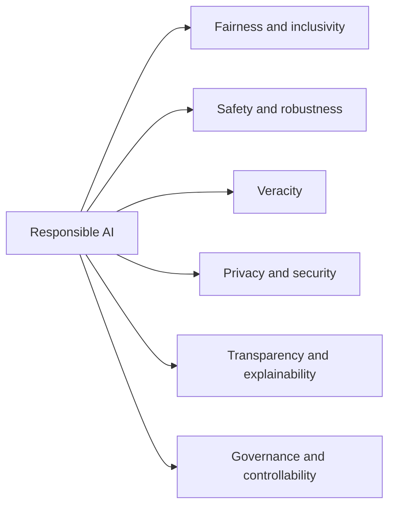
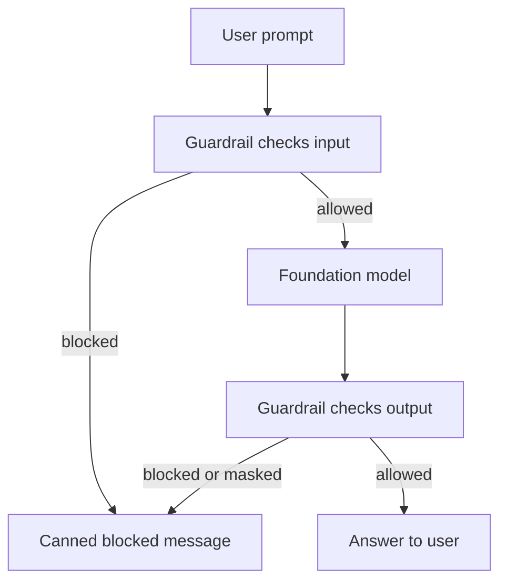
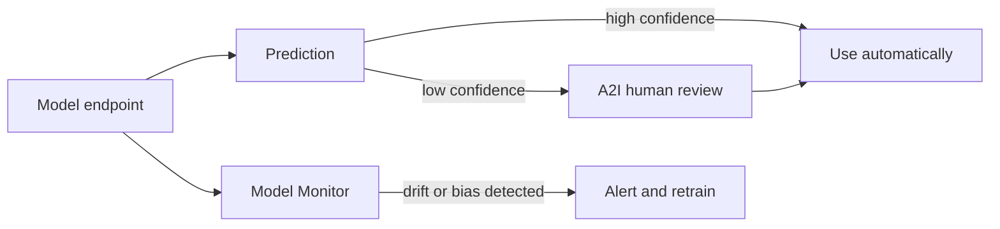

## 4.1.1 Dimensions of responsible AI: fairness, inclusivity, robustness, safety, veracity, privacy, governance

**Responsible AI** means designing, building and running AI so it is fair, safe and trustworthy across its whole lifecycle, not only at launch. AWS groups it into a set of dimensions. Learn what each one asks:

| Dimension | The question it asks |
|---|---|
| **Fairness** | Does the system treat different groups of people equitably? |
| **Inclusivity** | Was it built for, and tested with, the full range of people who will use it (languages, accents, abilities, regions)? |
| **Robustness** | Does it keep working with noisy, unusual or adversarial inputs? |
| **Safety** | Does it avoid harmful output and misuse? |
| **Veracity** | Are its outputs true and accurate, not [hallucinated](concept:2.2.2)? |
| **Privacy and security** | Is data protected and used only as allowed? |
| **Explainability / transparency** | Can people understand how it reached an output and that AI is involved? |
| **Controllability** | Can humans monitor and steer its behavior? |
| **Governance** | Are there policies, owners and processes to manage AI risk? |

These build on [bias and fairness](concept:1.1.10) from Domain 1. Responsible AI is a shared job: AWS provides tools, but you choose the data, the model and the controls.

**On the exam:** match the scenario to the dimension. "Model invents facts" is veracity; "works badly for one accent" is inclusivity/fairness; "breaks on typos" is robustness.

## 4.1.2 How bias affects demographic groups

**Bias** is a systematic error that makes a model favor or disadvantage some people. It usually comes from the data, not from bad intent. Common sources:

- **Sampling bias**: some groups are under-represented in the training data (a face model trained mostly on light-skinned faces).
- **Historical bias**: the data reflects past unfair decisions (old hiring data that favored men).
- **Measurement and label bias**: features or labels are recorded differently for different groups, or labelers bring their own assumptions.
- **Proxy features**: removing "race" or "gender" is not enough if a correlated feature (zip code, first name) stands in for it.

The effect on **demographic groups** is unequal performance or unequal outcomes: higher error rates for one group, more loan rejections for one postcode, a speech system that fails on certain accents. Overall accuracy can look great while one subgroup is badly served, which is why you must measure per group (see [subgroup analysis](concept:4.1.6) later in this step).

Harms are not only ethical. Biased outputs create legal exposure under anti-discrimination law and damage trust in the brand.

**On the exam:** "accurate overall but worse for one group" points to bias in the training data. The fix is better, more representative data plus bias measurement, not a bigger model.

## 4.1.3 Bias vs variance: effects of overfitting and underfitting

The word "bias" means two things. In 4.1.2 it was **social bias** (unfair to groups). Here it is **statistical bias**, from [model fit](concept:1.1.9):

| | Underfitting | Overfitting |
|---|---|---|
| Error type | High **bias** | High **variance** |
| Training data | Poor | Excellent |
| New data | Poor | Poor |
| Cause | Model too simple, too little training | Model too complex, memorizes noise |

How these hurt **fairness and accuracy**:

- An **underfit** model learns only the broadest patterns. If the majority group dominates the data, the patterns it learns are the majority's, so minority groups get more errors.
- An **overfit** model memorizes the training set, including its quirks and historical prejudices. Small subgroups have few examples, so predictions for them swing wildly (high variance) and generalize badly.
- Both lead to **inaccuracy** in production, which shows up as unreliable or unfair decisions.

Fixes: more and more balanced data, regularization or early stopping for overfitting, a more capable model or better features for underfitting, and evaluating on a held-out [test set](concept:1.3.3) broken down by subgroup.

**On the exam:** "great on training data, poor on new data" is overfitting (high variance). "Poor on both" is underfitting (high bias).

## 4.1.4 Dataset characteristics: inclusive, diverse, curated, balanced

Responsible AI starts with the data. The exam names four qualities of a good dataset:

- **Inclusive**: represents all the people and situations the model will meet in production (ages, genders, skin tones, languages, dialects, devices, regions).
- **Diverse**: covers a wide variety of examples and edge cases, not many near-copies of the same thing, so the model is robust.
- **Curated**: comes from trusted, documented sources and has been cleaned, deduplicated and checked for errors, toxic content and personal data. Curation also means knowing the data's origin and license.
- **Balanced**: classes and groups appear in sensible proportions. If 95% of examples are one class, the model can score 95% by always guessing it.

Ways to improve a dataset: collect more data for under-represented groups, oversample or reweight minority groups, generate synthetic examples carefully, and get high-quality labels with clear guidelines and multiple labelers (see [data labeling](concept:1.3.2)). The same rules apply when you [prepare fine-tuning data](concept:3.3.5) for a foundation model.

**On the exam:** if the scenario says a model performs poorly for a group "not well represented in the training data", the answer is a more inclusive, balanced dataset.

## 4.1.5 Amazon Bedrock Guardrails

**Amazon Bedrock Guardrails** is a configurable safety layer that checks both the **user input** and the **model output** against your rules. You met it as a [Bedrock building block](concept:2.3.2); here is what it can do:

- **Content filters**: block hate, insults, sexual content, violence and misconduct at adjustable strengths, plus a **prompt attack** filter for [jailbreaks and prompt injection](concept:3.2.6). Filters cover text and images.
- **Denied topics**: describe topics the app must not discuss (for example, investment advice).
- **Word filters**: block specific words or phrases, including profanity.
- **Sensitive information filters**: detect PII (or your own regex patterns) and **block** or **mask** it.
- **Contextual grounding checks**: score whether a response is grounded in the source and relevant to the query, to catch [hallucinations](concept:2.2.2) in RAG.
- **Automated Reasoning checks**: verify factual claims against formal rules you define, such as an HR policy.

One guardrail can be reused across models, Agents and Knowledge Bases, and the **ApplyGuardrail API** can check text for models hosted outside Bedrock.

**On the exam:** "block a topic", "mask PII in responses", "stop harmful content" with LEAST effort points to Bedrock Guardrails, not to retraining the model.

## 4.1.6 Detecting bias: SageMaker Clarify, label quality, subgroup analysis, human audits

**Amazon SageMaker Clarify** (part of [SageMaker AI](concept:1.2.5)) detects bias and explains predictions:

- **Pre-training bias**: checks the dataset before training, for example **class imbalance** (one group has far fewer rows) or differences in label rates between groups.
- **Post-training bias**: checks the trained model's predictions, for example whether one group gets positive outcomes far less often.
- **Explainability**: shows which features drove predictions (covered in Step 4.2).
- **Foundation model evaluation**: can test FMs for issues such as stereotyping, toxicity and factual knowledge.

Tools are only part of it. The exam also names practices:

- **Label quality analysis**: check that labels are accurate and consistent. Use clear instructions, several labelers per item and review of disagreements (SageMaker Ground Truth supports labeling workflows).
- **Subgroup analysis**: break every metric (accuracy, [precision, recall](concept:1.3.9)) down by demographic group. Averages hide unfairness.
- **Human audits**: people, ideally independent of the build team, review samples of outputs for bias, truthfulness and trustworthiness.

For GenAI, [Bedrock Model Evaluation](concept:3.4.2) adds checks for robustness and toxicity of model responses.

**On the exam:** "detect bias in a dataset or model" or "measure class imbalance" points to SageMaker Clarify. Clarify measures bias; it does not block content at runtime (that is Guardrails).

## 4.1.7 Human review with Amazon Augmented AI (A2I) and monitoring with Model Monitor

Responsible AI continues after deployment. Two SageMaker AI features keep a human and a watchful eye on production:

**Amazon Augmented AI (A2I)** sends selected predictions to **human reviewers**. You set the rule, such as "confidence below 80%" or "random 5% sample for audit". Built-in integrations exist for Amazon Textract (document extraction) and Amazon Rekognition (content moderation), and you can build custom workflows for any model. Reviewers can be your own private workforce, a vendor or Amazon Mechanical Turk.

**Amazon SageMaker Model Monitor** watches a deployed endpoint and alerts you (through Amazon CloudWatch) when things change. It monitors **data quality**, **model quality**, **bias drift** and **feature attribution drift**, the last two using Clarify under the hood. This builds on [drift and re-training](concept:1.3.8).

| Need | Service |
|---|---|
| A person checks risky predictions | A2I |
| Automatic alert when data or bias drifts | Model Monitor |

**On the exam:** "human-in-the-loop for low-confidence predictions" is A2I. "Detect drift over time in production" is Model Monitor.

## 4.1.8 Legal risks of GenAI: IP infringement, biased outputs, lost trust, end-user risk, hallucinations

Generative AI brings legal and business risks the exam lists by name:

- **Intellectual property (IP) infringement claims**: a model may reproduce copyrighted text, code or images from its training data, or be trained on data you had no right to use. Mitigations: check model licenses and data sources, filter outputs, and prefer providers offering IP indemnity (AWS offers it for outputs of some of its own generally available models, such as Amazon Nova).
- **Biased model outputs**: discriminatory content or decisions can break anti-discrimination law (see [bias effects](concept:4.1.2)).
- **Loss of customer trust**: one offensive or wrong answer can go viral and damage the brand for years.
- **End-user risk**: users may act on harmful advice (medical, legal, financial) or be exposed to toxic content.
- **Hallucinations**: confident but false statements, such as invented legal cases or wrong refund policies, can create liability for the company that published them. See [hallucinations](concept:2.2.2).

Controls that reduce these risks: [Bedrock Guardrails](concept:4.1.5), grounding with [RAG](concept:3.1.4), human review for high-stakes outputs, clear disclaimers that content is AI-generated, and keeping a human accountable for final decisions.

**On the exam:** a question listing "copyright", "lawsuit" or "trademark" is about IP risk. "Chatbot told a customer a refund policy that does not exist" is hallucination risk.

## 4.1.9 Responsible model selection: environmental impact and sustainability

Training and running large models uses a lot of energy and hardware. Responsible model selection asks: **what is the smallest, most efficient option that meets the requirement?**

Practical choices that cut environmental impact (and usually cost):

- **Reuse before you build**: use a pre-trained foundation model, or [fine-tune or use RAG](concept:3.1.7), instead of pre-training from scratch.
- **Right-size the model**: a smaller model, or a [distilled](concept:3.3.4) one, often meets the need with far less compute per request.
- **Efficient hardware**: [AWS Trainium and Inferentia](concept:2.3.9) are designed for better performance per watt than general-purpose GPUs for training and inference.
- **Use managed, shared infrastructure**: serverless and on-demand services such as Amazon Bedrock avoid idle, dedicated capacity.
- **Batch where possible**: [batch inference](concept:1.1.4) runs work efficiently instead of keeping endpoints always on.
- **Region choice**: some AWS Regions run on a cleaner energy mix.

The **AWS Well-Architected Framework** has a **Sustainability pillar** for these practices, and the AWS Customer Carbon Footprint Tool reports the estimated emissions of your AWS usage.

Model selection also weighs the other responsible AI factors: the provider's documentation, license terms, known limitations and safety features.

**On the exam:** "reduce environmental impact" or "most sustainable" points to a smaller or pre-trained model, efficient chips and avoiding training from scratch.

## Exam traps

- **Clarify vs Guardrails**: SageMaker Clarify *measures* bias and explains predictions (offline analysis and monitoring). Bedrock Guardrails *blocks or masks* content at runtime. "Detect bias in a dataset" is Clarify; "prevent the chatbot discussing X" is Guardrails.
- **A2I vs Model Monitor**: A2I puts a *person* in the loop for individual predictions. Model Monitor *automatically* watches the endpoint for data, quality, bias and attribution drift.
- **Ground Truth vs A2I**: Ground Truth labels data *before* training. A2I reviews predictions *after* deployment.
- **Social bias vs statistical bias**: "unfair to a group" is social bias (fix the data). "Underfitting" is high statistical bias (fix the model's capacity).
- **"Accurate overall but poor for one group"** → unrepresentative data. Answer with more inclusive, balanced data and subgroup analysis.
- **"Most sustainable" / "lowest environmental impact"** → pre-trained or smaller model, efficient chips, no training from scratch.

## Further reading

- [AWS Responsible AI](https://aws.amazon.com/ai/responsible-ai/)
- [Amazon Bedrock Guardrails](https://docs.aws.amazon.com/bedrock/latest/userguide/guardrails.html)
- [Amazon SageMaker Clarify: fairness and explainability](https://docs.aws.amazon.com/sagemaker/latest/dg/clarify-fairness-and-explainability.html)
- [Amazon Augmented AI (A2I)](https://docs.aws.amazon.com/sagemaker/latest/dg/a2i-use-augmented-ai-a2i-human-review-loops.html)
- [Amazon SageMaker Model Monitor](https://docs.aws.amazon.com/sagemaker/latest/dg/model-monitor.html)
- [Well-Architected Sustainability pillar](https://docs.aws.amazon.com/wellarchitected/latest/sustainability-pillar/sustainability-pillar.html)
- [CloudCityPress: Develop responsible AI systems](https://github.com/CloudCityPress/aws-aif-c01/blob/main/english/40_10_Develop_responsible_AI_systems.md)
