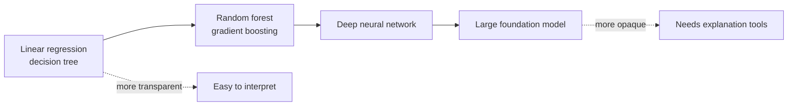
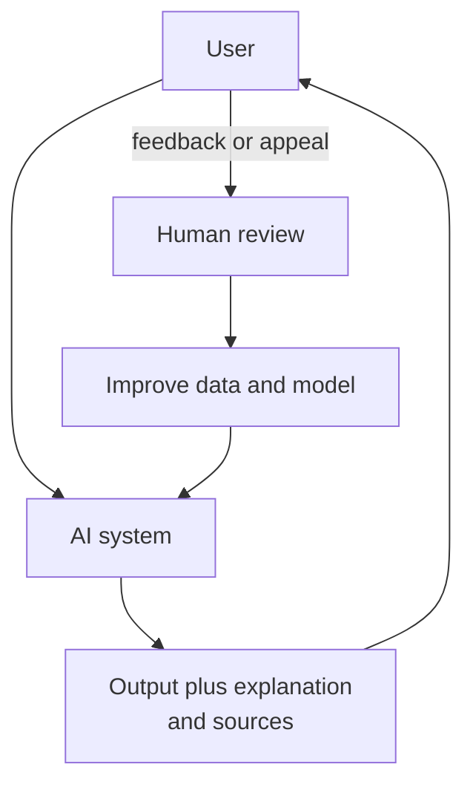

## 4.2.1 Transparent vs explainable vs black-box models

Three ideas the exam keeps apart:

- **Transparent (interpretable) model**: you can read *how* it works directly from the model itself. A linear regression's coefficients or a small decision tree's rules show exactly why each prediction happened.
- **Explainable model**: the model may be complex, but you can produce a human-understandable **explanation** of its outputs, usually with a separate technique such as SHAP (next section). Explainability is about *why this output*, even if the inner workings stay hidden.
- **Black-box model**: its internal logic cannot be inspected in a meaningful way. Deep neural networks and large foundation models with billions of parameters are the typical examples (see [neural networks](concept:1.1.2) and [interpretability limits](concept:2.2.3)).

Transparency also covers the *process* around a model: documenting the training data, intended use, limitations and evaluation results so others can judge it. That is what Model Cards and AI Service Cards do later in this step.

Why it matters: regulators and customers may require a reason for decisions such as loan denials, and explanations help teams debug bias.

**On the exam:** "regulators require the company to explain each decision" favors a transparent model or an explainability tool, and may rule out an opaque FM ([traditional ML vs FMs](concept:1.2.9)).

## 4.2.2 Explainability techniques: feature importance, SHAP, partial dependence plots

These techniques explain models after training. **SageMaker Clarify** ([seen in 4.1](concept:4.1.6)) provides them on AWS.

- **Feature importance** (feature attribution): ranks which input features most influenced predictions overall. Example: for a loan model, income and debt ratio matter most; postcode matters suspiciously much, which hints at bias.
- **SHAP (SHapley Additive exPlanations)**: a method from game theory that assigns each feature a contribution value for **one individual prediction** as well as globally. It answers "why was *this* applicant rejected?" Clarify uses a SHAP-based method (Kernel SHAP).
- **Partial dependence plots (PDPs)**: show how the predicted outcome changes as **one feature** varies while others are held constant, for example how approval probability rises with income. Good for spotting non-linear effects.

| Technique | Answers |
|---|---|
| Feature importance | Which features matter most overall? |
| SHAP values | How much did each feature push this one prediction? |
| Partial dependence plot | How does the output change as one feature changes? |

Model Monitor can track **feature attribution drift** in production, alerting you when the features driving predictions change ([Model Monitor](concept:4.1.7)).

For LLMs, these classic tools are less useful. Instead you rely on [chain-of-thought](concept:3.2.3) reasoning traces, [source citations from RAG](concept:3.1.5) and evaluation results.

**On the exam:** "explain which features contributed to an individual prediction" points to SHAP values via SageMaker Clarify.

## 4.2.3 Amazon SageMaker Model Cards

**Amazon SageMaker Model Cards** are structured documents that record the essential facts about a model, in one place, for governance and audits. A model card typically holds:

- **Intended uses** and out-of-scope uses
- **Risk rating** (for example low, medium, high)
- **Training details**: data sources, algorithm, training job
- **Evaluation results**: metrics, including bias and explainability reports from Clarify
- **Business details**, owners and additional notes

You create cards in SageMaker AI (they can be auto-populated from training jobs and linked to the model in the Model Registry), keep versions as the model changes, and **export them to PDF** to share with auditors, risk teams or customers. The **SageMaker Model Dashboard** gives a single view of models with their cards and monitoring status.

Model cards are a **documentation and transparency** tool. They do not measure bias themselves (Clarify does) and do not block anything at runtime (Guardrails does).

For foundation models, a related tool is **[Amazon Bedrock Model Evaluation](concept:3.4.2)**: its evaluation reports give transparent, comparable evidence of how candidate models perform on accuracy, robustness and toxicity for your use case, which supports choosing and documenting a model.

**On the exam:** "document intended use, risk rating and evaluation results of a model for auditors" points to SageMaker Model Cards.

## 4.2.4 Open-source models, data, licensing and AWS AI Service Cards

**Open-source (open-weight) models** support transparency because you can inspect their weights, architecture and often their training approach and data documentation. You can host them yourself, for example via [SageMaker JumpStart](concept:2.3.3), and audit or [fine-tune](concept:3.3.2) them. Proprietary models available through Bedrock reveal less about their internals, so you rely on the provider's documentation.

Transparency also depends on **data**: knowing where training data came from, whether it was consented to, and what it contains.

**Licensing** sets what you may do with a model or dataset. Check whether a license allows **commercial use**, modification and redistribution, and what attribution it requires. Some "open" models restrict usage by scale or field. Using a model or dataset outside its license is an [IP risk](concept:4.1.8).

**AWS AI Service Cards** are AWS's own transparency documents for its AI services and models (for example, Amazon Rekognition face matching, Amazon Textract, Amazon Transcribe and Amazon Nova models). Each card describes:

- intended use cases and limitations
- responsible AI design choices AWS made
- best practices for deploying and tuning performance

| Document | Written by | About |
|---|---|---|
| SageMaker Model Card | You | Your own model |
| AWS AI Service Card | AWS | An AWS AI service or model |

**On the exam:** "where can we read AWS's documented intended uses and limitations for Amazon Rekognition?" is an AI Service Card.

## 4.2.5 Tradeoffs: interpretability vs performance, safety vs transparency

Responsible AI choices often pull in opposite directions.

**Interpretability vs performance.** Simple, transparent models (linear models, small trees) are easy to explain but may be less accurate on complex data such as images or language. Complex models (deep learning, FMs) often perform better but are black boxes. You **measure both**: model performance metrics on one side, and on the other, how well you can explain results (can you show the main features, does a reviewer understand the explanation). Pick the simplest model that meets the performance bar, especially in regulated decisions like credit or hiring.

**Safety vs transparency.** Revealing everything about a system can make it less safe:

- Publishing exact guardrail rules, system prompts or filter thresholds helps attackers craft [jailbreaks](concept:3.2.6).
- Releasing full training data may expose personal or proprietary information.
- Openly sharing powerful model weights can enable misuse.

So organizations disclose *what* the system does, its limits and its evaluation results (model cards, service cards) while protecting security-sensitive details.

Other tradeoffs: stronger content filtering can block legitimate answers (helpfulness vs safety), and privacy techniques such as adding noise can lower accuracy.

**On the exam:** "the business needs to explain every decision and accepts slightly lower accuracy" favors an interpretable model. Transparency does not mean publishing every security detail.

## 4.2.6 Human-centered design for explainable AI

**Human-centered design (HCD)** for explainable AI means designing the system around the people who use it and are affected by it, so they can understand, trust appropriately, question and correct it. Principles the exam highlights:

- **AI decision transparency**: tell users when they are dealing with AI, and give a plain-language reason for important outputs ("declined mainly because of debt-to-income ratio"). Show sources for generated answers.
- **User-feedback mechanisms**: thumbs up or down, "report a problem", corrections. Feedback flows back into evaluation and retraining, as in [RLHF](concept:3.3.6).
- **Design for amplified decision-making**: in high-stakes or stressful situations, keep the interface clear and simple and keep a human accountable for the final call.
- **Unbiased and accessible design**: test with diverse users, and avoid interfaces that nudge users to over-trust the AI.
- **Human control**: allow users to override, appeal or escalate to a person.

**On the exam:** "let users understand and challenge AI decisions" or "collect user feedback to improve the model" are human-centered design principles.

## Exam traps

- **Transparent vs explainable**: transparent means you can read the model itself (linear model, small tree). Explainable means you can produce explanations of a complex model's outputs (SHAP via Clarify).
- **Model Cards vs AI Service Cards**: you write Model Cards for *your* models in SageMaker AI. AWS writes AI Service Cards for *its* services and models.
- **Model Cards vs Clarify**: Clarify *produces* bias and explainability reports. Model Cards *document* them alongside intended use and risk rating.
- **SHAP vs PDP**: SHAP explains contributions to an *individual* prediction. A partial dependence plot shows how output changes as *one feature* varies.
- **"Must explain decisions to regulators"** → interpretable model or explainability tool, not the biggest black-box model.
- **"Open-source model"** helps transparency, but the *license* decides whether commercial use is allowed.

## Further reading

- [Amazon SageMaker Model Cards](https://docs.aws.amazon.com/sagemaker/latest/dg/model-cards.html)
- [SageMaker Clarify: fairness and explainability](https://docs.aws.amazon.com/sagemaker/latest/dg/clarify-fairness-and-explainability.html)
- [Amazon Bedrock model evaluation](https://docs.aws.amazon.com/bedrock/latest/userguide/evaluation.html)
- [AWS AI Service Cards](https://aws.amazon.com/ai/responsible-ai/resources/)
- [CloudCityPress: Transparent and explainable models](https://github.com/CloudCityPress/aws-aif-c01/blob/main/english/40_20_Transparent_and_explainable_models.md)
