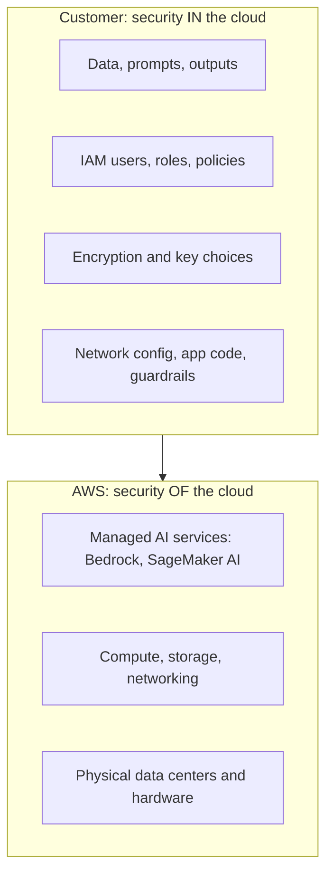
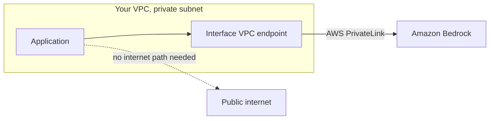
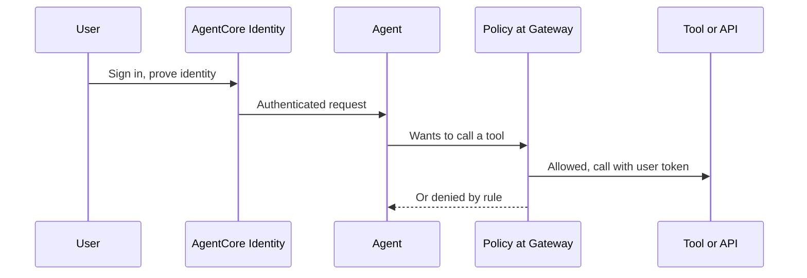
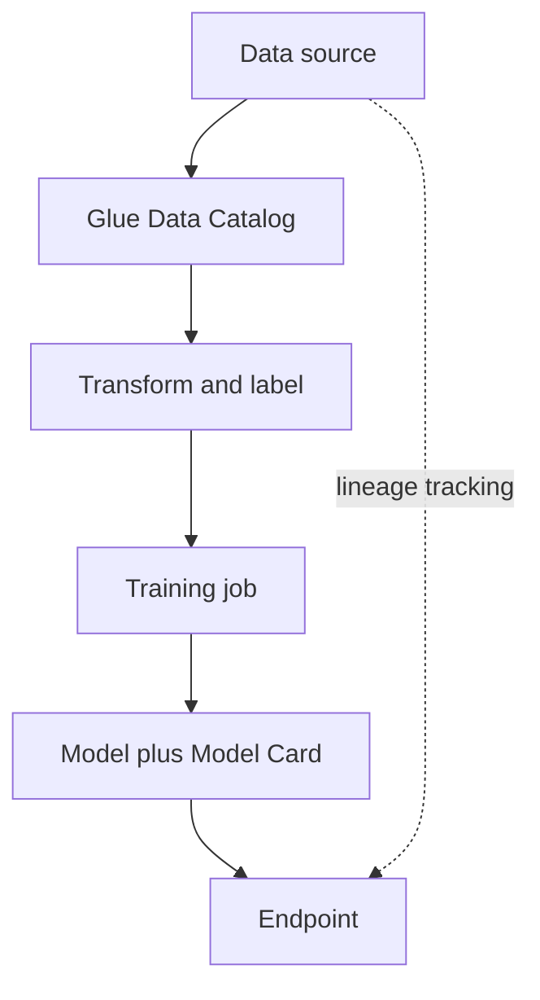
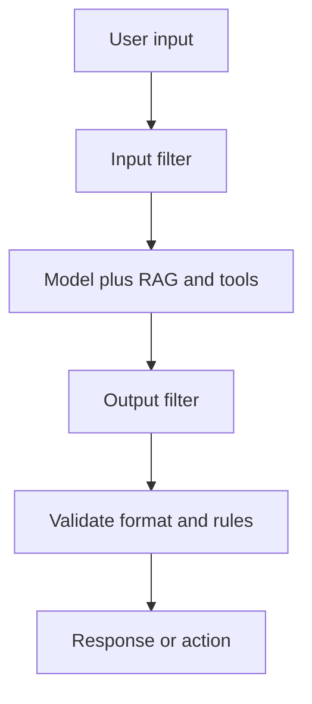
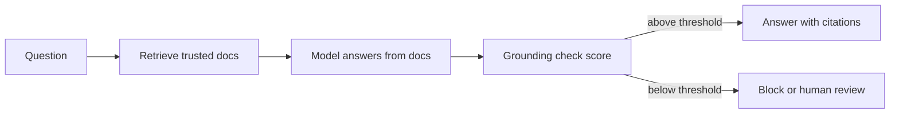

## 5.1.1 The AWS shared responsibility model for AI

The **shared responsibility model** splits security work between AWS and you:

- **AWS: security OF the cloud.** Data centers, hardware, networking, the hypervisor, and the managed service itself. For Amazon Bedrock, AWS runs and secures the model hosting infrastructure. Your prompts and completions are not used to train the base models and are not shared with model providers.
- **You: security IN the cloud.** Your data, who can access it ([IAM](concept:5.1.2)), encryption settings, network setup, your application code, your prompts and guardrail configuration, and how you use model outputs.

The split **shifts with the service type**. The more managed the service, the more AWS handles:

| You use | AWS also manages | You still own |
|---|---|---|
| Bedrock, Amazon Quick (managed) | Model hosting, scaling, patching | Data, access, prompts, outputs, guardrails |
| SageMaker AI endpoints | Underlying instances and platform | Model, training data, container code, network config |
| Model on your own EC2 | Hardware only | OS patching, framework, model, everything above |

This extends the [infrastructure benefits](concept:2.3.8) from Domain 2. Responsibility is never fully handed off: data and access are always yours.

**On the exam:** "who is responsible for encrypting the training data / configuring IAM?" is always the customer. "Who patches the Bedrock hosts?" is AWS.

## 5.1.2 IAM roles, policies and least privilege

**AWS Identity and Access Management (IAM)** controls *who* can do *what* on *which* resource.

- **Users and groups**: identities for people. Prefer federated sign-in with temporary credentials over long-lived user access keys.
- **Roles**: identities that services and applications *assume* to get temporary credentials. A SageMaker AI training job uses an **execution role** to read from S3. A Lambda function calling Bedrock uses its execution role. Never embed access keys in code.
- **Policies**: JSON documents that allow or deny actions. **Identity-based** policies attach to users or roles. **Resource-based** policies attach to a resource, such as an S3 bucket policy.

**Least privilege** means granting only the permissions needed for the task. Examples for AI:

- Allow `bedrock:InvokeModel` only on the specific model ARNs an app needs, not `bedrock:*`.
- Give a training role read access to one S3 prefix, not all buckets.
- Separate roles for data scientists, ML engineers and auditors (SageMaker Role Manager helps build persona-based roles).

Store API keys and database passwords in **AWS Secrets Manager**, which rotates them, instead of in code or prompts.

**On the exam:** "grant an application access to Bedrock securely" → an IAM role with a least-privilege policy. Hard-coded access keys are always wrong.

## 5.1.3 Encryption at rest and in transit with AWS KMS

**Encryption at rest** protects stored data: training datasets in S3, model artifacts, vector stores, notebook volumes, logs. **Encryption in transit** protects data moving over the network using **TLS** (HTTPS).

**AWS Key Management Service (AWS KMS)** creates and controls the keys used for encryption at rest, and integrates with S3, SageMaker AI, Bedrock, OpenSearch Service and most other services.

| Key type | Who manages it | When to choose |
|---|---|---|
| AWS owned key | AWS, invisible to you | Default, zero effort |
| AWS managed key | AWS, visible in your account | Default for many services |
| **Customer managed key (CMK)** | You: rotation, key policy, disable, audit | Compliance requires control over the key |

Customer managed keys let you control who may use the key through **key policies**, disable it to make data unreadable, and audit every use in [CloudTrail](concept:5.1.10).

AI examples:

- Bedrock encrypts data at rest by default, and you can supply a customer managed key for custom (fine-tuned) models, Knowledge Bases, agents and evaluation jobs.
- SageMaker AI can encrypt training volumes, output artifacts and endpoints with KMS keys, and encrypt traffic between training containers.
- All Bedrock and SageMaker API traffic uses TLS.

**On the exam:** "company must control and rotate its own encryption keys" → AWS KMS customer managed key.

## 5.1.4 Network isolation: Amazon VPC and AWS PrivateLink

**Amazon VPC** is your private, isolated network in AWS. You can run SageMaker AI notebooks, training jobs and endpoints inside your VPC subnets, controlled by security groups.

**AWS PrivateLink** gives private connectivity from your VPC to AWS services through **interface VPC endpoints**. Traffic to Bedrock or SageMaker AI stays on the AWS network and never crosses the public internet, and you need no internet gateway or NAT.

Related controls:

- **Gateway VPC endpoint for S3**: private access to training data in S3.
- **SageMaker network isolation**: a training job or model container can be blocked from making *any* outbound network calls, so it cannot leak data.
- **Endpoint policies**: limit which actions or resources can be reached through an endpoint.
- Disable direct internet access on SageMaker notebooks.

This is **infrastructure protection**, one of the security considerations in this domain.

**On the exam:** "access Bedrock without traffic going over the internet" or "private connectivity" → AWS PrivateLink (interface VPC endpoint).

## 5.1.5 Finding sensitive data with Amazon Macie

**Amazon Macie** uses machine learning and pattern matching to **discover and report sensitive data in Amazon S3**: personally identifiable information (names, addresses, passport numbers), financial data (credit card numbers), credentials and similar. It also flags S3 bucket security issues, such as buckets that are public or unencrypted.

Why it matters for AI: before you use S3 data to [fine-tune a model](concept:3.3.5) or load it into a [Knowledge Base](concept:3.1.5), you need to know if it contains PII. Data that goes into training can come back out in model outputs.

Typical flow:

1. Run a Macie discovery job on the S3 buckets that hold training or RAG data.
2. Review findings (sent to EventBridge and the Macie console).
3. Remove, mask or tokenize the sensitive fields, or exclude those objects, before training.

| Need | Tool |
|---|---|
| Find PII sitting in S3 data | **Macie** |
| Mask PII in a live prompt or model response | **[Bedrock Guardrails](concept:4.1.5)** sensitive information filter |
| Detect PII in a piece of text via API | Amazon Comprehend (PII detection) |

**On the exam:** "identify sensitive data / PII in S3 before training" → Amazon Macie. Macie scans S3; it does not filter chatbot traffic.

## 5.1.6 Securing agents: AgentCore Identity and Policy in AgentCore

[AI agents](concept:2.1.11) act on their own: they call tools, APIs and other systems. Two [AgentCore](concept:2.3.6) services answer two different security questions.

**Amazon Bedrock AgentCore Identity: who is this, and what credentials can it use?**

- **Inbound**: authenticates the users or apps that invoke an agent, using IAM or an existing identity provider (OAuth/OpenID Connect providers such as Okta or Microsoft Entra ID).
- **Outbound**: lets the agent access other services *on behalf of the user*, by managing OAuth tokens and API keys in a secure token vault, so credentials are never hard-coded in agent code or exposed to the model.

**Policy in AgentCore: what is this agent allowed to do?**

- You write rules about which tools an agent may call and under what conditions (for example, "refunds only up to 500 dollars"). Rules can be authored in natural language and are stored in the Cedar policy language.
- Rules are enforced **deterministically, outside the agent**, at the AgentCore Gateway, before each tool call runs. A prompt-injected or confused model cannot talk its way past them.

**On the exam:** authentication and credentials (who, which token) → AgentCore Identity. Limits on which actions or tool calls an agent may take → Policy in AgentCore.

## 5.1.7 Data lineage, data cataloging and source citation

Being able to say **where data and answers came from** is a security, compliance and trust requirement.

- **Data lineage**: the recorded history of data, from its origin through every transformation to the model trained on it and the predictions served. If a dataset turns out to be poisoned or unlicensed, lineage tells you which models are affected. **SageMaker ML Lineage Tracking** records links between datasets, training jobs, models and endpoints.
- **Data cataloging**: a searchable inventory of datasets with metadata (owner, schema, sensitivity, source). The **AWS Glue Data Catalog** is the central metadata store on AWS, and **AWS Lake Formation** adds fine-grained access control on top.
- **Documenting models**: [SageMaker Model Cards](concept:4.2.3) record training data sources, intended use and evaluation, completing the paper trail.
- **Source citation**: for GenAI, the app shows which documents an answer came from. [Bedrock Knowledge Bases](concept:3.1.5) return citations with each RAG response, so users can verify the answer.

**On the exam:** "trace which data was used to train a model" → data lineage. "Show users the documents an answer is based on" → source citation from a Knowledge Base.

## 5.1.8 Secure data engineering: quality, privacy-enhancing technologies, access control, integrity

Secure AI depends on secure data pipelines. The exam names four best practices:

**Assess data quality.** Check completeness, accuracy, consistency and freshness before training. AWS Glue Data Quality and AWS Glue DataBrew can profile data and apply quality rules. Poor data is a security issue too: it hides poisoning and causes [biased models](concept:4.1.4).

**Use privacy-enhancing technologies (PETs).** Reduce exposure of personal data:

- **Masking / redaction**: hide fields such as names or card numbers.
- **Tokenization or pseudonymization**: replace identifiers with tokens.
- **Anonymization and aggregation**: remove the link to individuals.
- **Differential privacy**: add statistical noise so no individual can be identified.
- **Encryption** [at rest and in transit](concept:5.1.3).

**Enforce data access control.** Apply [least privilege](concept:5.1.2) with IAM, S3 bucket policies and **Lake Formation** fine-grained (table, column, row) permissions. Separate raw sensitive data from curated training data.

**Protect data integrity.** Make sure data is not altered unexpectedly: checksums, S3 Versioning, write-once storage (S3 Object Lock) for critical datasets, tracked [lineage](concept:5.1.7), and audit logs of who changed what.

**On the exam:** "use customer data for training without exposing identities" → privacy-enhancing techniques such as masking, anonymization or tokenization, ideally after finding the PII with [Macie](concept:5.1.5).

## 5.1.9 AI threats: prompt injection, data leakage, poisoning, toxicity, and output filtering

GenAI adds threats traditional apps did not have. Building on [prompt risks](concept:3.2.6):

| Threat | What happens | Main defenses |
|---|---|---|
| **Prompt injection** | Malicious instructions in user input, or hidden in documents or tool results the model reads (indirect injection), override the system prompt | Guardrails prompt attack filter, separate instructions from data, least-privilege tools, Policy in AgentCore |
| **Data leakage** | Model reveals PII, secrets, the system prompt or other users' data | Keep secrets out of prompts, Macie before training, Guardrails PII masking, per-user access control on RAG data |
| **Data poisoning** | Attacker plants bad data in training sets or the RAG corpus to change behavior | Trusted, curated sources, integrity checks, lineage, access control on data stores |
| **Toxicity** | Hateful, violent or harmful output | Guardrails content filters, evaluation, human review |

**Output filtering and validation** treats model output as untrusted. Filter it with [Bedrock Guardrails](concept:4.1.5) and validate it before anything acts on it: check format (valid JSON, allowed values), check business rules, and never run generated code or SQL without checks.

**On the exam:** "a document in the knowledge base contains instructions that change the model's behavior" is indirect prompt injection. "Training data was tampered with" is poisoning.

## 5.1.10 Threat detection, vulnerability management, logging and audit trails

The exam lists several broader security considerations. In-scope AWS services cover them:

- **Application security**: secure coding, input validation, secrets in [Secrets Manager](concept:5.1.2), authentication in front of every AI endpoint.
- **Infrastructure protection**: [VPC and PrivateLink](concept:5.1.4), security groups, encryption.
- **Vulnerability management**: find and patch known software vulnerabilities (CVEs) in the instances, containers and functions that host your AI app. **Amazon Inspector** scans them automatically (details in Step 5.2).
- **Threat detection**: spot suspicious behavior, such as a role suddenly calling models at unusual volume or from an unknown location. Use CloudWatch metrics and alarms on usage, and review CloudTrail activity. (Amazon GuardDuty is AWS's dedicated threat detection service, but it is out of scope for this exam.)
- **Logging and audit trails for AI interactions**:
  - **AWS CloudTrail** records *API calls*: who invoked which model or changed which guardrail, and when.
  - **Bedrock model invocation logging** records the *content* of requests and responses (prompts and outputs) to CloudWatch Logs or S3. It is off by default; you turn it on.
  - **AgentCore Observability** traces agent steps and tool calls.

Logs themselves may contain sensitive prompts, so encrypt them, restrict access and set retention.

**On the exam:** "audit which user called the model" → CloudTrail. "Keep a record of every prompt and response" → Bedrock model invocation logging.

## 5.1.11 Hallucination detection and grounding: RAG grounding, output validation, confidence scoring

[Hallucinations](concept:2.2.2) are a security and trust issue when users act on false answers. Three families of defenses:

**Grounding: give the model the facts.**

- **[RAG](concept:3.1.4) grounding**: retrieve trusted documents and instruct the model to answer only from them, saying "I don't know" otherwise.
- **Source citations** from [Knowledge Bases](concept:3.1.5) let users verify claims.
- A lower [temperature](concept:3.1.3) reduces creative drift for factual tasks.

**Detection and output validation: check the answer.**

- **Bedrock Guardrails contextual grounding check** scores each response for *grounding* (supported by the source) and *relevance* (answers the question), and blocks responses below your threshold.
- **Automated Reasoning checks** in Guardrails verify claims against formal rules you define.
- Rule and schema checks, cross-checks against a database, or an [LLM-as-a-judge](concept:3.4.6) review.

**Confidence scoring: know when to trust it.**

- Use scores such as grounding scores or token probabilities, or ask the model the same question several times and compare answers (low agreement suggests hallucination).
- Route low-confidence answers to a human with [A2I](concept:4.1.7) or show a warning.

**On the exam:** "reduce hallucinations using company documents" → RAG. "Automatically detect responses not supported by the source" → Guardrails contextual grounding check.

## Exam traps

- **AgentCore Identity vs Policy in AgentCore**: Identity answers *who* (authenticate users, manage the agent's OAuth tokens and API keys). Policy answers *what is allowed* (deterministic rules on tool calls, enforced at the Gateway).
- **Macie vs Guardrails**: Macie *finds* PII in data stored in S3. Guardrails *masks or blocks* PII in live prompts and responses.
- **CloudTrail vs model invocation logging**: CloudTrail logs *who called the API*. Bedrock model invocation logging captures the *prompt and response text*.
- **PrivateLink vs VPC**: "without traversing the internet" to an AWS service → PrivateLink interface endpoint, not just "put it in a VPC".
- **"Control our own keys"** → KMS customer managed key. **"Hard-coded credentials"** → always wrong; use IAM roles or Secrets Manager.
- **Shared responsibility**: data, access, encryption choices and guardrail configuration are always the customer's, even on fully managed Bedrock.

## Further reading

- [AWS shared responsibility model](https://aws.amazon.com/compliance/shared-responsibility-model/)
- [Security in Amazon Bedrock](https://docs.aws.amazon.com/bedrock/latest/userguide/security.html)
- [IAM security best practices](https://docs.aws.amazon.com/IAM/latest/UserGuide/best-practices.html)
- [AWS KMS concepts](https://docs.aws.amazon.com/kms/latest/developerguide/overview.html)
- [Amazon Macie](https://docs.aws.amazon.com/macie/latest/user/what-is-macie.html)
- [Amazon Bedrock AgentCore](https://docs.aws.amazon.com/bedrock-agentcore/latest/devguide/what-is-bedrock-agentcore.html)
- [Bedrock model invocation logging](https://docs.aws.amazon.com/bedrock/latest/userguide/model-invocation-logging.html)
- [CloudCityPress: Methods to secure AI systems](https://github.com/CloudCityPress/aws-aif-c01/blob/main/english/50_10_Methods_to_secure_AI_systems.md)
