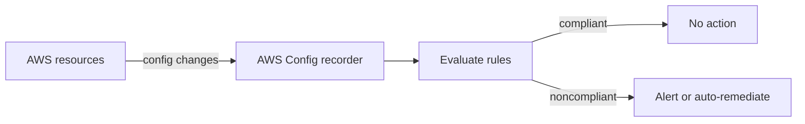
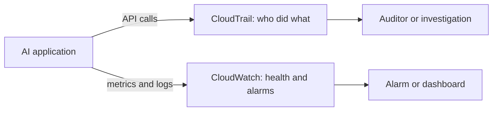
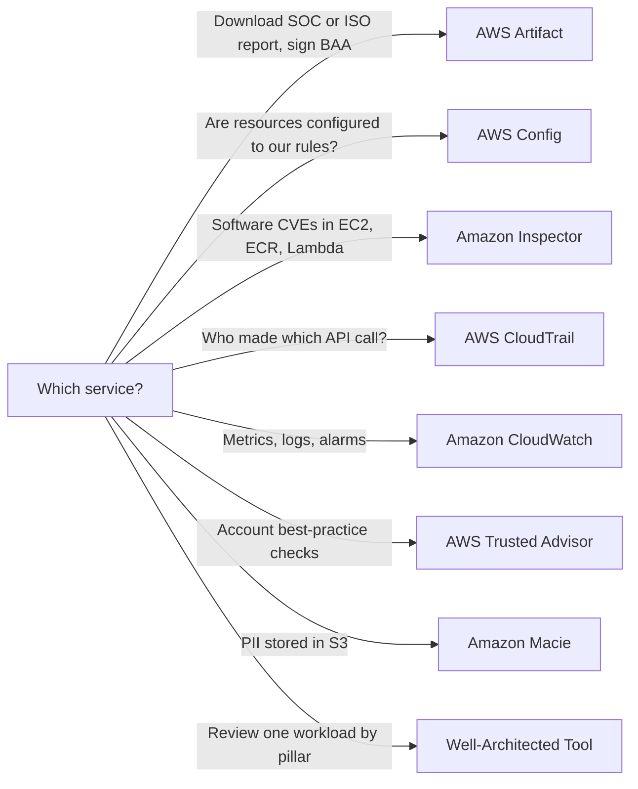
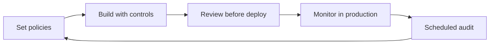
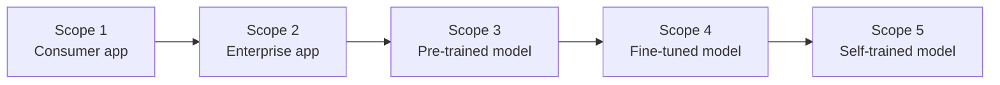

## 5.2.1 Compliance standards and AI regulations

**Compliance** means proving that your system meets external rules: laws, industry standards and contracts. AI systems must meet the usual standards *plus* a growing set of AI-specific ones.

General standards you will see:

- **ISO/IEC 27001** (information security), **SOC 1/2/3** reports (controls audited by a third party)
- **GDPR** (EU personal data protection), **HIPAA** (US health data), **PCI DSS** (payment card data)

AI-specific frameworks and laws:

- **ISO/IEC 42001**: the international standard for an **AI management system**. AWS has achieved ISO/IEC 42001 certification for services including Amazon Bedrock.
- **NIST AI Risk Management Framework**: voluntary US guidance organized as Govern, Map, Measure, Manage.
- **EU AI Act**: regulates AI by **risk level**. Some uses are banned, high-risk uses (such as hiring or credit scoring) face strict requirements, and systems like chatbots carry transparency duties (users must know they are talking to AI).

Why AI compliance is harder: models are complex and opaque ([black boxes](concept:4.2.1)), behavior can drift over time, outputs can be biased or harmful, and it is hard to show *who* is accountable for an automated decision. This is why documentation such as [Model Cards](concept:4.2.3), [lineage](concept:5.1.7) and audit logs matter.

Under [shared responsibility](concept:5.1.1), an AWS service being certified does not make *your* workload compliant. You must configure and operate it compliantly.

**On the exam:** "AI management system standard" → ISO/IEC 42001. "Risk-based EU regulation of AI" → EU AI Act.

## 5.2.2 AWS Artifact: compliance reports and agreements

**AWS Artifact** is a self-service portal in the AWS console for **compliance documents about AWS itself**. It has two parts:

- **Artifact Reports**: download AWS's audit reports and certifications on demand, such as SOC reports, PCI DSS attestations and ISO certificates (including ISO/IEC 42001). **Third-party reports** from independent software vendors that sell in AWS Marketplace are also available.
- **Artifact Agreements**: review, accept and manage agreements with AWS for your account or organization, such as the **Business Associate Addendum (BAA)** needed for HIPAA workloads.

Typical use: your auditor asks for evidence that the cloud provider hosting your AI app has SOC 2 controls. You download the AWS SOC 2 report from Artifact and hand it over.

What Artifact does **not** do: it does not check *your* resources, scan for vulnerabilities or log activity. It provides documents about AWS's side of the [shared responsibility model](concept:5.1.1).

**On the exam:** "download AWS compliance reports", "provide proof of AWS's ISO or SOC compliance to an auditor" or "accept a BAA" → AWS Artifact.

## 5.2.3 AWS Config: resource configuration compliance

**AWS Config** continuously **records the configuration of your AWS resources** and how it changes over time, then **evaluates** those configurations against rules.

- **Configuration history**: what did this S3 bucket or SageMaker endpoint look like last Tuesday, and who changed it (Config links changes to the CloudTrail events behind them).
- **Config rules**: AWS managed or custom rules that flag resources as *compliant* or *noncompliant*. Examples relevant to AI: S3 buckets must be encrypted and not public, SageMaker notebook instances must not have direct internet access, SageMaker endpoint configurations must use a KMS key.
- **Conformance packs**: bundles of rules mapped to a standard or best-practice set, deployed together.
- **Remediation**: noncompliant resources can trigger automatic fixes.

Think of Config as answering "**is my setup configured the way our policy says, and has it drifted?**" It does not look inside software for vulnerabilities (Inspector) and does not record every API call (CloudTrail).

**On the exam:** "ensure all S3 buckets holding training data stay encrypted" or "track configuration changes to resources over time" → AWS Config.

## 5.2.4 Amazon Inspector: vulnerability scanning

**Amazon Inspector** is an automated **vulnerability management** service. It continuously scans your workloads for:

- **Software vulnerabilities**: known CVEs in operating system packages and application libraries.
- **Unintended network exposure**: for example, an EC2 instance reachable from the internet on an open port.

What it scans:

- **Amazon EC2 instances**
- **Container images in Amazon ECR** (such as the custom inference container for a model)
- **AWS Lambda functions** (packages and, optionally, code)

Inspector rescans automatically when a new CVE is published or the workload changes, and gives each finding a risk score so you can prioritize patching. This supports the [vulnerability management](concept:5.1.10) consideration from Step 5.1.

AI angle: a self-hosted model on EC2, a container serving a model from SageMaker AI or ECS, or a Lambda function that calls Bedrock all depend on open-source libraries that may have known vulnerabilities. Inspector finds them.

What Inspector does **not** do: it does not check configuration against your policies (Config), find PII in S3 (Macie), or scan model outputs for harmful content (Guardrails).

**On the exam:** "scan EC2 instances or container images for software vulnerabilities / CVEs" → Amazon Inspector.

## 5.2.5 AWS CloudTrail and Amazon CloudWatch: audit logs and monitoring

These two sound alike but answer different questions.

**AWS CloudTrail: who did what, when, from where?** It records **API calls** in your account: the identity, time, source IP, action and resources. Examples: who created a guardrail, who deleted a Knowledge Base, which role invoked a model. It is the **audit trail** for governance and investigations. Store trails in S3 with long retention.

**Amazon CloudWatch: how is it performing right now?** It collects **metrics, logs and alarms**:

- Bedrock metrics such as invocations, latency, input and output token counts, and throttles
- SageMaker AI endpoint metrics (latency, errors, instance use) and [Model Monitor](concept:4.1.7) results
- **Logs**, including Bedrock [model invocation logs](concept:5.1.10) with prompt and response text
- **Alarms** and **dashboards**, for example alert when token use spikes

| Question | Service |
|---|---|
| Which user changed the guardrail yesterday? | CloudTrail |
| Is endpoint latency above 2 seconds? | CloudWatch |
| What exactly did the user ask the model? | Model invocation logging (to CloudWatch Logs or S3) |

**On the exam:** "audit", "who made the API call", "governance trail" → CloudTrail. "Monitor", "metrics", "alarm", "latency", "dashboard" → CloudWatch.

## 5.2.6 AWS Trusted Advisor and the Well-Architected Tool

**AWS Trusted Advisor** inspects your account and gives **best-practice recommendations** in categories such as **cost optimization, performance, security, fault tolerance, service limits** and operational excellence. Examples: an S3 bucket with open access, IAM access keys that should be rotated, idle resources wasting money, or usage near a service quota. Basic checks are free; the full set of checks requires a Business or higher support plan. It is automated and account-wide, not specific to one workload.

**AWS Well-Architected Tool** lets you **review a specific workload** against the Well-Architected Framework's six pillars: operational excellence, security, reliability, performance efficiency, cost optimization and [sustainability](concept:4.1.9). You answer questions, and it reports high and medium risks with an improvement plan. **Lenses** add domain-specific questions, including the **Generative AI Lens** and the **Machine Learning Lens**.

Use this map to pick the right governance or security service:

**On the exam:** "recommendations to reduce cost and improve security across the account" → Trusted Advisor. "Review our GenAI workload against best practices" → Well-Architected Tool with the Generative AI Lens.

## 5.2.7 Data governance: lifecycle, logging, residency, monitoring, retention

**Data governance** is the set of rules for how data is collected, stored, used, shared and deleted. For AI, the exam names these strategies:

- **Data lifecycle**: manage data from collection through use, archiving and deletion. **S3 Lifecycle** rules can move old training data to **Amazon S3 Glacier** and delete it when no longer needed.
- **Logging**: record access and use of data and models ([CloudTrail](concept:5.2.5), S3 access logs, model invocation logs) so you can prove what happened.
- **Residency**: keep data in the required country or region. Choose the AWS Region carefully. With Bedrock **cross-Region inference**, pick a geographic inference profile (for example, EU) so requests stay within that geography, or call the model in-Region only.
- **Monitoring and observation**: watch data quality, access patterns and model behavior continuously ([Model Monitor](concept:4.1.7), CloudWatch, [Macie](concept:5.1.5) for new sensitive data).
- **Retention**: keep data and logs as long as law or policy requires, and no longer. Set retention periods on CloudWatch Logs and S3. Use S3 Object Lock where records must be immutable.

Other governance building blocks: a [data catalog](concept:5.1.7) with owners and classifications, and [access control](concept:5.1.8) based on that classification.

**On the exam:** "data must not leave the EU" → residency (Region choice, geographic inference profile). "Keep logs for seven years at lowest cost" → retention with S3 Lifecycle to S3 Glacier.

## 5.2.8 Governance processes: policies, review cadence, transparency standards, training

Tools only work inside a governance process. The exam expects you to know its parts:

- **Policies**: written rules such as an **acceptable use policy** for GenAI (what data employees may paste into AI tools), model approval criteria, data classification and incident response for AI failures.
- **Governance structure**: an AI governance board or committee with legal, security, compliance and business members, and a named owner for every model.
- **Review cadence**: reviews at fixed points: before deployment, after major changes, and on a schedule (for example, quarterly bias and performance reviews).
- **Review strategies**: combine **technical** reviews (metrics, [bias reports](concept:4.1.6), red-teaming) with **non-technical** reviews (legal, ethics, business impact), ideally including someone independent of the build team.
- **Governance frameworks**: adopt a recognized structure such as the [Generative AI Security Scoping Matrix](concept:5.2.9), NIST AI RMF or [ISO/IEC 42001](concept:5.2.1).
- **Transparency standards**: decide what you disclose and document: [Model Cards](concept:4.2.3), telling users when content is AI-generated, publishing limitations.
- **Team training**: train builders and users on responsible AI, security risks such as prompt injection, and the policies themselves. Policies nobody knows about do not work.

**On the exam:** "ensure employees know what data they may enter into public AI tools" → acceptable use policy plus training.

## 5.2.9 The Generative AI Security Scoping Matrix

The **AWS Generative AI Security Scoping Matrix** classifies GenAI use cases into **five scopes** by how much of the solution you own. The higher the scope, the more security and governance responsibility you carry, extending the [shared responsibility model](concept:5.1.1).

| Scope | You are... | Example |
|---|---|---|
| **1 Consumer app** | using a public third-party GenAI service | Employees use a public chatbot |
| **2 Enterprise app** | using a third-party SaaS app with GenAI features, under an enterprise agreement | Amazon Quick, a SaaS tool with built-in AI |
| **3 Pre-trained models** | building your own app on an existing FM via API | App calling a Bedrock model, with RAG |
| **4 Fine-tuned models** | fine-tuning an existing FM with your data | Custom model in Bedrock or SageMaker AI |
| **5 Self-trained models** | training a model from scratch on your data | Pre-training your own FM |

Scopes 1 and 2 are **buying** (you mainly control usage, data entered and contracts). Scopes 3 to 5 are **building** (you also secure the app, data, prompts and, from Scope 4, the model and its training data).

For each scope the matrix asks about the same security disciplines: **governance and compliance, legal and privacy, risk management, controls, and resilience**.

**On the exam:** "fine-tuned a Bedrock model on company data" → Scope 4. "Calls a Bedrock model with RAG, no customization" → Scope 3.

## Exam traps

- **Artifact vs Config**: Artifact gives *AWS's* compliance reports and agreements. Config checks *your* resources' configurations against rules.
- **Config vs Inspector vs Trusted Advisor**: Config = configuration compliance and change history. Inspector = software vulnerabilities (CVEs) and network exposure in EC2, ECR images and Lambda. Trusted Advisor = account-wide best-practice recommendations (cost, security, limits).
- **CloudTrail vs CloudWatch**: CloudTrail = *who* called *which API* (audit). CloudWatch = metrics, logs, alarms (performance and health). Prompt text comes from Bedrock model invocation logging.
- **Macie** finds sensitive data in S3. It is not a vulnerability scanner or audit log.
- **Trusted Advisor vs Well-Architected Tool**: automated checks across the account vs a guided review of one workload (with GenAI and ML lenses).
- **Scoping Matrix**: buying (Scopes 1 and 2) vs building (Scopes 3 to 5). Fine-tuning is Scope 4, not 3 or 5.

## Further reading

- [AWS Artifact](https://docs.aws.amazon.com/artifact/latest/ug/what-is-aws-artifact.html)
- [AWS Config](https://docs.aws.amazon.com/config/latest/developerguide/WhatIsConfig.html)
- [Amazon Inspector](https://docs.aws.amazon.com/inspector/latest/user/what-is-inspector.html)
- [AWS CloudTrail](https://docs.aws.amazon.com/awscloudtrail/latest/userguide/cloudtrail-user-guide.html)
- [Amazon CloudWatch](https://docs.aws.amazon.com/AmazonCloudWatch/latest/monitoring/WhatIsCloudWatch.html)
- [AWS Trusted Advisor](https://docs.aws.amazon.com/awssupport/latest/user/trusted-advisor.html)
- [AWS Well-Architected Tool](https://docs.aws.amazon.com/wellarchitected/latest/userguide/intro.html)
- [Generative AI Lens](https://docs.aws.amazon.com/wellarchitected/latest/generative-ai-lens/generative-ai-lens.html)
- [Generative AI Security Scoping Matrix](https://aws.amazon.com/blogs/security/securing-generative-ai-an-introduction-to-the-generative-ai-security-scoping-matrix/)
- [CloudCityPress: Governance and compliance for AI](https://github.com/CloudCityPress/aws-aif-c01/blob/main/english/50_20_Governance_and_compliance_for_AI.md)
